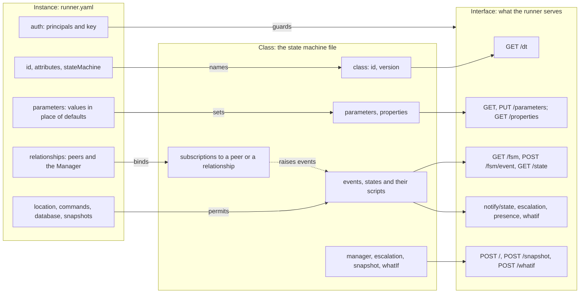
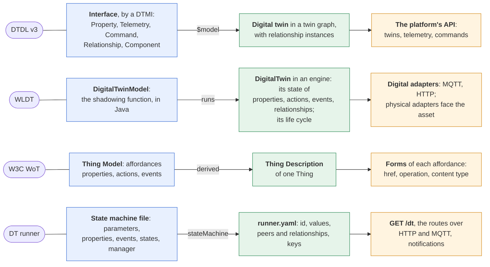

# Class, Instance and Interface

A digital twin (DT) on the runner is made of two files and a folder of
scripts. This document says what each of them is, who writes it, what
belongs in which, and what the two files must agree on. It uses three
words:

| Word      | What it is                                              | Where it lives            | Who writes it                     |
| :-------- | :------------------------------------------------------ | :------------------------ | :-------------------------------- |
| class     | A kind of twin: what it declares and how it behaves     | The state machine file    | The DT author                     |
| instance  | One twin of that kind, running in one place             | `runner.yaml`             | The operator                      |
| interface | What a caller sees of a class: values, commands, events | The replies of the runner | Nobody: it follows from the class |

The word "model" is avoided on purpose. It already means a simulation
model, a DTDL model and a Thing Model of the Web of Things.

## The Three Parts at a Glance

The instance names its class and fills in what the class leaves open.
The runner derives the interface from both: what may be read, set,
run and raised comes from the class, and where it is reached and who
may call it comes from the instance.



## Against DTDL, WLDT and WoT

Each of the three other technologies also separates a kind of twin, a
twin of that kind, and what a caller sees of it. Read across a row of
the diagram: the blue box is the class, the green box the instance, and
the orange box the interface.



| Concept                 | DTDL v3                                                  | WLDT                                               | WoT                                | DT runner                                                    |
| :---------------------- | :------------------------------------------------------- | :------------------------------------------------- | :--------------------------------- | :----------------------------------------------------------- |
| The class               | An Interface, named by a DTMI                            | The `DigitalTwinModel`, Java code                  | A Thing Model                      | The state machine file, named by `class`                     |
| The instance            | A digital twin in a twin graph, whose `$model` is a DTMI | A `DigitalTwin` in a `DigitalTwinEngine`           | A Thing Description of one Thing   | `runner.yaml`, one runner                                    |
| The interface           | The API of the platform that holds the twins             | The digital adapters                               | The forms of the affordances       | `GET /dt`, the routes over HTTP and MQTT, the notifications  |
| Values that change      | Property, Telemetry                                      | The properties of the digital twin state           | Property affordances, `observable` | `properties`                                                 |
| Settings                | A writable Property                                      | A writable property                                | A writable property                | `parameters`, `controllable`                                 |
| Operations              | Command                                                  | Actions, routed to the asset                       | Action affordances                 | `manager.commands`, run through `POST /`                     |
| Events                  | Telemetry, roughly                                       | Events of the digital twin state                   | Event affordances                  | `events`, which move the machine; notifications to a Manager |
| Links to other twins    | Relationship, with a target and multiplicity             | Relationships, with instances that name a target   | `links`                            | `relationships.peers`, and subscriptions to a relationship   |
| Parts                   | Component                                                | None                                               | `tm:submodel`                      | None                                                         |
| What fills in the class | Values of the twin's properties                          | The code of the model                              | Placeholders, `{{NAME}}`           | Instance values under `parameters`                           |
| Behaviour               | None                                                     | The shadowing function's callbacks                 | Handler code of the Scripting API  | `states`, their transitions and scripts                      |
| The twin's own course   | None                                                     | The life cycle: bound, shadowed, out of sync, done | `expose()` and `destroy()`         | The state of the machine, and snapshots                      |

Where the correspondence does not hold:

- **The runner has what the others lack.** Behaviour is a state
  machine that the runner reads, not code that it calls. The state of
  the machine is first-class, as are what-ifs on a private copy,
  snapshots, a replay twin, and keys that sign what the twin says.
  Its relationships carry signed notices between running twins.
- **The others have what the runner lacks.** It has no Component or
  `tm:submodel`: one runner is one twin, with no parts. Its
  relationships are names, without the target class and multiplicity
  of DTDL. It exports no document in a standard format, so `GET /dt`
  is in a format of its own, and it has no semantic annotations. It
  does not mirror an asset as WLDT's physical adapters do: a value of
  the asset reaches the twin only through a script or a sensor that
  writes a property.
- **The words differ in scope.** WLDT's model is code, so its class
  and its behaviour are one thing. A WoT Thing Model fills in its
  placeholders as text, which the runner declines
  ([Why Not Placeholders](#why-not-placeholders)).
  DTDL leaves the instance and its interface to a platform.

## The Two Roles

1. **The DT author** gives a state machine file and the scripts that
   its states and commands run. Together they are the class. The
   author knows what the twin measures, which settings its scripts
   read, and how it moves from one state to another. The author does
   not know where the twin will run, or beside which other twins.
2. **The operator** fills in `runner.yaml` and starts the runner. That
   makes one instance. The operator knows the port, the broker, the
   keys, the neighbours and the size of this one twin. The operator
   does not change the class.

One class can have many instances. Each instance is one runner, with
its own `runner.yaml`, database and port, as before (S2 of
[docs/issues/README.md](docs/issues/README.md)).

```text
              the class                          the instances
   ┌──────────────────────────────┐      ┌───────────────────────────┐
   │ hospital.fsm.yaml            │◄─────┤ runner.yaml    hospital-1 │
   │ scripts/open, full, closed,  │      │   capacity default (2)    │
   │         admit, discharge     │      │   neighbour: hospital-2   │
   └──────────────────────────────┘      ├───────────────────────────┤
                 ▲                       │ runner-2.yaml  hospital-2 │
                 └───────────────────────┤   capacity: 1             │
                                         │   no neighbour            │
                                         └───────────────────────────┘
```

## What Goes Where

The rule: a thing that is the same for every twin of the kind belongs
to the class. A thing that differs from one twin to the next, or that
is a secret or an address, belongs to the instance.

### The class: the state machine file

| Section         | What it holds                                                    |
| :-------------- | :--------------------------------------------------------------- |
| `class`         | The id and the version of the class                              |
| `events`        | The events that move the machine                                 |
| `states`        | The states, their transitions, and the script that each runs     |
| `parameters`    | The settings that the scripts read, with types and defaults      |
| `properties`    | The values that the scripts and sensors write, with types, units |
| `env`           | The environment variables of the scripts                         |
| `escalation`    | When the runner asks the Manager for help by itself              |
| `manager`       | The commands that a Manager may run                              |
| `subscriptions` | The events raised when a peer changes                            |
| `snapshot`      | The commands that save and restore what the scripts keep         |
| `whatIf`        | The commands that run on a private copy, and whether to replay   |

[STATE-MACHINE.md](STATE-MACHINE.md) describes every key.

### The instance: runner.yaml

| Key                            | What it holds                                          |
| :----------------------------- | :----------------------------------------------------- |
| `id`, `attributes`             | The name of this twin, and facts about it              |
| `stateMachine`                 | The class that this twin is an instance of             |
| `parameters`                   | The values of this twin, in place of class defaults    |
| `location`, `commands`         | Where the scripts are, and which of them may run       |
| `port`, `mqtt`                 | Where this twin is reached                             |
| `database`                     | Where this twin keeps its state                        |
| `stopGrace`, `stateInterval`   | Timing that the operator tunes                         |
| `relationships.manager.notify` | The Manager that this twin notifies                    |
| `relationships.peers`          | The other twins it deals with, and what each is to it  |
| `auth`                         | Who may call this twin, and the key that it signs with |
| `scripts`                      | The account that its scripts run as                    |
| `snapshots`                    | Where this twin is saved, and the time its scripts get |

[README.md](README.md#configure) describes every key.

Relationships and keys are always of the instance. A peer has an
address and a public key, and a Manager has a URL; none of them can be
the same for two twins.

## What the Two Files Must Agree On

The runner checks each of these when it starts, and names every
problem before it stops:

| The class says                       | The instance must say                        | Otherwise                                          |
| :----------------------------------- | :------------------------------------------- | :------------------------------------------------- |
| a state, such as `open`              | `open` under `commands`                      | `state open is not a permitted command`            |
| a command under `manager.commands`   | the same name under `commands`               | `manager command admit is not a permitted command` |
| `peer: hospital-2` in a subscription | a peer with the id `hospital-2`              | `subscription to unlisted peer hospital-2`         |
| a parameter, such as `capacity`      | under `parameters`, only declared names      | `parameter beds is not declared`                   |
| the type and range of a parameter    | under `parameters`, a value that fits        | `parameter capacity: Too small: ...`               |
| `relationship: neighbour`            | nothing: see [Relationships](#relationships) | the subscription is idle, with a line in the log   |

A command under `snapshot` is checked as one under `manager.commands`:
`snapshot save script save-beds is not a permitted command`. So is one
under `whatIf.commands`: `what-if command forecast-ward is not a
permitted command`. The class itself must also name a save script for
it, and may not use a state as one; see
[WHAT-IF.md](WHAT-IF.md#what-the-author-writes). The operator gives a
what-if the database file, `snapshots` and `auth.principals`, or the
twin refuses it with `409`.

`whatIf.replay: true` is a promise of the class alone: that its
scripts keep to files of their own and divide their waits by
`DT_TIME_SCALE` in a replay twin ([REPLAY.md](REPLAY.md#what-a-class-must-do)).
The instance adds nothing for it. A replay twin is an instance of its
own, whose `runner.yaml` `runner-replay` writes from the copy of the
twin's: the `id` with `.replay`, another port and database, the
values of the twin with what the replay changes, the same peers, and
one principal of its own.

The scripts are the third part. A state or a command has the name of
its script, so the names in the class, the names under `commands` and
the files in `location` are the same names. The author ships the
scripts with the class; the operator permits them in `runner.yaml`.

## Class Identity

A class may name itself:

```yaml
class:
  id: 'urn:dtaas:hospital'
  version: '1.0.0'
```

- `id` is up to 200 characters without spaces. A URN or a URL keeps it
  unique across authors; the runner accepts any word.
- `version` is up to 64 characters without spaces. Quote it, so that
  YAML does not read `1.0` as a number.
- The section is optional. Without it the descriptor shows
  `"class": null`.

`GET /dt` and the presence notice show it:

```json
{
  "id": "hospital-2",
  "class": { "id": "urn:dtaas:hospital", "version": "1.0.0" }
}
```

What the id is for:

- **Today, a Manager can group twins by kind.** It can tell that
  hospital-1 and hospital-2 take the same parameters and commands, and
  apply one policy to both, without comparing their replies.
- **Later, it names what is exported and what is saved.** A Thing
  Description of the class needs an identifier. A saved twin that is
  loaded elsewhere needs to say which class it was a twin of.

The id is not what makes sharing work. Two runners share a class by
naming the same file under `stateMachine`, with or without a `class`
section. The section was built with the sharing because it is small
and a Manager can use it at once; nothing else in the runner reads
it.

The runner never compares versions. See
[A New Version of a Class](#a-new-version-of-a-class).

## Instance Values

A class declares its parameters with defaults. An instance may set its
own value for any of them, under `parameters` in `runner.yaml`:

```yaml
# hospital.fsm.yaml, the class
parameters:
  capacity:
    type: integer
    minimum: 1
    default: 2
  scope:
    type: string
    enum:
      - single
      - multi
    default: single
    controllable: true
```

```yaml
# runner-2.yaml, one instance
stateMachine: 'hospital.fsm.yaml'
parameters:
  capacity: 1
```

- The value takes the place of the default, for this instance only.
  The scripts read it as `DT_PARAM_CAPACITY`, and `GET /parameters`
  shows it as both `value` and `default`.
- Any declared parameter may be set, controllable or not.
- For a controllable parameter, the instance value is where the twin
  starts. A value that a Manager sets later is stored, and wins after
  a restart, as it does over a default.
- `parameters` needs a `stateMachine`. Without one the runner stops
  with `The parameters of runner.yaml need a stateMachine file`.

### Why Not Placeholders

The other way to make a class is a template. The file holds
placeholders, and each instance supplies the text that replaces them:

```yaml
# a template, which the runner does NOT support
parameters:
  capacity:
    type: integer
    default: '{{CAPACITY}}'
subscriptions:
  - peer: '{{NEIGHBOUR}}'
    when:
      state: full
    event: neighbour-full
```

The runner uses instance values, for four reasons:

| Question                         | A template with placeholders                                  | Instance values                                            |
| :------------------------------- | :------------------------------------------------------------ | :--------------------------------------------------------- |
| Is the class a valid file alone? | No: `'{{CAPACITY}}'` is a string where an integer is declared | Yes: it loads, and can be checked, without any instance    |
| What is the type of a value?     | Text, whatever is pasted in                                   | The declared type, checked against `minimum` and `enum`    |
| What can an instance change?     | Any text of the file, also a state or a script name           | Only what the class declares as a parameter                |
| What does a mistake look like?   | A YAML error at some line of the filled file                  | `parameter capacity: Too small: expected number to be >=1` |

The third row matters most. With a template, the operator can change
the behaviour of the class by what is pasted in. With instance values,
the class says exactly what an instance may set, and the rest of the
file is the author's alone.

## Relationships

A class can not name a peer by its id: the id belongs to one instance.
A subscription of a class names a relationship, and each instance says
which of its peers have it:

```yaml
# hospital.fsm.yaml, the class
events:
  - neighbour-full
subscriptions:
  - relationship: neighbour
    when:
      state: full
    event: neighbour-full
```

```yaml
# runner.yaml of hospital-1, one instance
relationships:
  peers:
    - id: 'hospital-2'
      topic: 'dtaas/hospital-2'
      relationship: neighbour
    - id: 'hospital-3'
      topic: 'dtaas/hospital-3'
      relationship: neighbour
```

- **Every peer of the relationship is followed.** Above, `neighbour-full`
  is raised when hospital-2 turns full, and again when hospital-3
  does. Each peer is watched by itself.
- **A relationship without a peer is idle.** It is not an error, as
  another instance of the class may have such a peer. The runner logs
  one line, so that a misspelt name can be found.
- **A peer has one relationship**, or none. `GET /peers` shows it.
- **`peer: <id>` stays valid.** A file that only one twin runs may
  name its peer directly. A subscription names a peer or a
  relationship, never both.

A relationship is only a name that the two files share. The runner
attaches no meaning to `neighbour`.

## The Hospitals

Two hospitals, hospital-1 and hospital-2, are instances of one class,
`hospital.fsm.yaml`. Their `runner.yaml` files
differ in what an instance owns:

| Key                             | hospital-1          | hospital-2          |
| :------------------------------ | :------------------ | :------------------ |
| `id`                            | `hospital-1`        | `hospital-2`        |
| `port`                          | `5100`              | `5200`              |
| `stateMachine`                  | `hospital.fsm.yaml` | `hospital.fsm.yaml` |
| `parameters.capacity`           | not set, so `2`     | `1`                 |
| `database`                      | its own             | its own             |
| `mqtt.topic`                    | `dtaas/hospital-1`  | `dtaas/hospital-2`  |
| the peer                        | `hospital-2`        | `hospital-1`        |
| the `relationship` of that peer | `neighbour`         | not set             |

hospital-1 follows its neighbour. hospital-2 lists hospital-1, so that
its scripts can find a bed there, but gives it no relationship, so it
follows no one.

To add a third hospital, the operator copies a `runner.yaml`, changes
`id`, `port`, `database`, `mqtt.topic` and the peers, and starts a
runner. The class is not touched.

## The Interface

The interface of a class is what a caller can read, write and call on
any of its instances. It is not a file. It follows from the class, and
the runner serves it:

| Part of the interface           | Declared in the class      | Served by                                  |
| :------------------------------ | :------------------------- | :----------------------------------------- |
| The class itself                | `class`                    | `GET /dt`                                  |
| Values that a caller reads      | `properties`               | `GET /properties`, `GET /state`            |
| Settings that a Manager changes | `parameters`, controllable | `GET` and `PUT /parameters`                |
| Commands that a Manager runs    | `manager.commands`         | `POST /`                                   |
| Events that a caller raises     | `events`                   | `POST /fsm/event`                          |
| The state of the machine        | `states`                   | `GET /fsm`, `GET /state`                   |
| Changes, as they happen         | all of the above           | the `notify/state` topic, the webhook      |
| Calls for help                  | `escalation`               | the `notify/escalation` topic, the webhook |
| Saves of the twin               | `snapshot`                 | `POST /snapshot`                           |
| Trials on a private copy        | `whatIf.commands`          | `POST /whatif`, `GET /whatif/:id`          |

Every instance of a class has the same interface. What differs is
where it is reached, and the values.

The interface is not exported as a document today. The Web of Things
calls such a document a Thing Description, and its class-level form a
Thing Model; see
[Against DTDL, WLDT and WoT](#against-dtdl-wldt-and-wot). The full
mapping is in
[docs/dt-capabilities-comparison.md](docs/dt-capabilities-comparison.md#the-runner-as-a-wot-thing).
Exporting it is proposal C4 of the
[issues](docs/issues/README.md#proposed-work). The types of the
properties and parameters are already those that a Thing Description
uses.

## A New Version of a Class

When the author changes a class, each instance takes the new file at
its next start. The runner does not compare the `version` with the one
it ran before, because it can not know which changes are compatible.
It checks what it can see:

| What was stored                                    | With the new file                              |
| :------------------------------------------------- | :--------------------------------------------- |
| The machine was in a state that the file still has | It resumes in that state                       |
| The machine was in a state that is gone            | It starts unstarted, with a warning            |
| A stored parameter value still fits                | It is kept                                     |
| A stored parameter value no longer fits            | It is dropped, with a warning, for the default |
| A stored property value no longer fits             | It is dropped, with a warning, and is `null`   |
| An instance value no longer fits                   | The runner stops, and names the parameter      |

The last row differs from the others on purpose. A stored value is the
runner's own, so it can drop it. An instance value is written by the
operator, who must be told.

The author raises `version` so that a Manager can see which instances
run which version of a class.

## Moving a Twin and Bringing It Back

An operator saves a twin as a snapshot, and starts a runner from it
with `--reinstate` ([README](README.md#saving-and-reinstating)). A
snapshot holds a copy of both files: the class, under its own name,
and `runner.yaml`, with its secrets blanked. It also holds the
database and the scripts.

The `runner.yaml` given with `-c` is the one that counts, as a moved
twin needs another port and other paths, and may have another `id`.
The runner compares the copies with the twin of that file:

| Compared                                    | When they differ          |
| :------------------------------------------ | :------------------------ |
| The `id` of the class                       | The runner stops          |
| The `version` of the class                  | A warning                 |
| The values of `parameters` in `runner.yaml` | A warning for each name   |
| The state machine file, byte for byte       | A warning                 |
| Each script of the copy, against `location` | A warning for each script |

Then it starts as after a restart, with the checks of
[A New Version of a Class](#a-new-version-of-a-class): a stored value
that no longer fits the class is dropped with a warning. A twin is
brought back under a new version of its class in the same way as it
restarts under one.

A snapshot keeps the instance values of the twin, which the database
does not hold. A copy of the class alone, or of the database alone,
would bring the twin back with the defaults of the class.

## One File or Two for the Operator

`runner.yaml` holds two kinds of settings: those of the runner as a
process (`port`, `location`, `database`, `scripts`, `stopGrace`), and
those of the twin as an instance (`id`, `parameters`,
`relationships`, `auth`). They could be two files. The runner keeps
one, and this is open to change.

For two files:

- **The instance could move.** The instance file would follow a twin
  from one host to another, and the process file would stay with the
  host.
- **Different people.** A platform operator could own the process
  file, and the owner of the twin the instance file.
- **A saved twin** would be the instance file plus its stored state.
  Since 0.12.0 a snapshot copies both files, and the operator gives
  the instance file of the new host
  ([Moving a Twin](#moving-a-twin-and-bringing-it-back)).

For one file:

- **One runner is one twin** (S2). The process settings are not shared
  by anything, so a second file separates two halves that are always
  used together.
- **The line is not sharp.** `mqtt.topic` is the address of the twin,
  but `mqtt.url` is the broker of the host. `auth.key` is the identity
  of the twin, but it is a path on the host. Every such key would need
  a ruling.
- **Starting stays simple.** One file and one command start a twin. A
  missing or mismatched second file is a new way to fail.
- **Grouping is cheaper than splitting.** The keys of the instance can
  be grouped inside the one file, as `relationships` already is, and
  split later if a twin must move.

## Not Built

- An exported interface: a Thing Description or DTDL (C4).
- Typed relationships, with a target class and typed attributes (C5).
- Inheritance, or a class made of other classes.
- A registry of classes, or fetching a class by its id.
- Instance values for anything but parameters. The bounds of a
  property and the `env` of a state are of the class.
- Several relationships for one peer.
