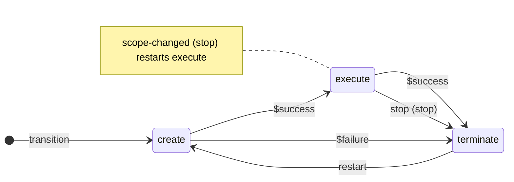
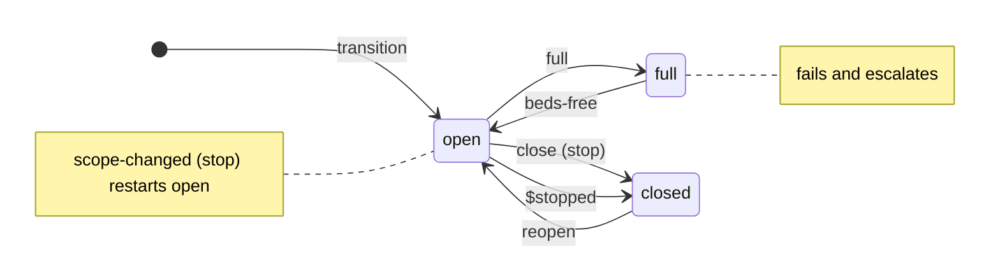

# State Machine User Guide

This guide is for authors of digital twins (DTs) and for the operators
who run them. It explains how to write the state machine file of a DT,
how to start and drive the machine, and what each request answers. You
need no knowledge of the runner's code. The design and implementation
are described for runner developers in
[docs/state-machine-design.md](docs/state-machine-design.md), and the
whole API, including the routes that only run commands, in
[API.md](api/API.md).

## What the State Machine Does

A DT runs as a set of scripts, such as _create_, _execute_ and
_terminate_. The state machine runs them in order for you:

- Each **state** is a script of the same name. Entering a state runs
  its script.
- A **transition request** starts the machine in a state you name.
- **Events**, sent by you, by a Manager or by the DT's own scripts,
  move the machine from one state to the next.
- When a script exits, the runner raises a **completion event**,
  `$success`, `$failure` or `$stopped`, which can move the machine on
  by itself.
- The runner remembers the machine across a restart when it has a
  database file.

## Configure the Runner

The runner reads _runner.yaml_. These keys matter for a state machine:

```yaml
id: 'pipeline-1' # names the DT
port: 5300
location: 'scripts' # folder of the scripts, relative to this file
commands: # the scripts that may run; every state must be one
  - create
  - execute
  - terminate
stateMachine: 'state-machine.yaml' # relative to this file, or absolute
database: 'runner.db' # optional; keeps the machine across restarts
stopGrace: 5000 # optional; milliseconds from SIGTERM to SIGKILL
```

- Without `stateMachine` the state machine is off, and its routes
  answer `404`.
- The runner reads the state machine file once, when it starts. Restart
  the runner after changing the file.
- Each state needs a script in `location`: a shell script of the state's
  name on Linux, which must be executable, and a PowerShell script with
  the `.ps1` extension on Windows, such as _create.ps1_. A folder may
  hold both.
- `mqtt` and `notify` sections add an MQTT API and a webhook; see
  [MQTT](#mqtt) and [Watch the State](#watch-the-state).

## Write the State Machine File

### States and Transitions

```yaml
events: # the events that clients may send
  - stop
  - restart
states:
  create:
    transitions:
      $success: execute # when the create script exits with 0
      $failure: terminate # when it exits with another code
  execute:
    transitions:
      stop: terminate # when a client sends stop
  terminate:
    transitions:
      restart: create
```

- `states` maps each state to its `transitions`, which map an event to
  the next state. A state has at most one transition for each event.
- A state without transitions may be left empty, as in `terminate:`.
- `events` lists the events that clients may send. Leave it out when
  only completion events move the machine.
- State, event and parameter names have up to 64 letters, digits, `_`,
  `.` or `-`, and start with a letter or digit.

### Completion Events

The runner raises one completion event when the script of the current
state exits. Clients can not send them.

| Event      | Raised when                                                                    |
| :--------- | :----------------------------------------------------------------------------- |
| `$success` | the script exited with code 0                                                  |
| `$failure` | the script exited with another code, was killed from outside, or did not start |
| `$stopped` | the runner stopped the script, on a stop request                               |

Without a transition for the event, the machine stays in its state,
idle, with the status of the script (see [Script Status](#script-status)).
A loop made only of `$success` and `$failure` transitions is refused,
as fast scripts would run it forever.

### Stop Transitions

A plain transition leaves the script of the old state running; the
next script has to end it if needed. A transition with `stop: true`
stops the old script first:

```yaml
states:
  execute:
    transitions:
      stop:
        state: terminate
        stop: true
      restart:
        state: execute # a self-transition restarts the script
        stop: true
```

On such an event the runner enters the next state at once and answers
`accepted`. It then stops the old script, waits until it has exited,
and runs the script of the next state. The stopped script raises no
`$stopped`, as the machine has already left its state.

`stop: true` is not allowed on completion events, whose script has
already exited.

### Parameters

Parameters are settings of the DT that a Manager can read and, where
you allow it, change:

```yaml
events:
  - scope-changed
parameters:
  scope:
    type: enum
    values:
      - single
      - multi
    default: single
    controllable: true # a client may change it
    event: scope-changed # raised when a request changes the value
  capacity:
    type: number
    default: 20 # not controllable: shared with the Manager, read only
```

- `type` is `string`, `number`, `boolean` or `enum`; an `enum` lists
  its `values`.
- `default` is required and must fit the type. YAML reads `20` as a
  number, so a `string` parameter needs quotes, as in `'20'`.
- `controllable` is `false` unless given.
- `event`, if given, must be in `events`.
- Two names that become the same variable name, such as `a-b` and
  `A_B`, are refused.

The runner never restarts a script on its own. A script keeps the
values it started with. To make a change take effect at once, give the
parameter an `event` whose transition restarts the script, as a
self-transition with `stop: true` does.

### Environment

Each script inherits the runner's environment and gets these
variables:

| Variable          | Value                                                                   |
| :---------------- | :---------------------------------------------------------------------- |
| `RUNNER_URL`      | `http://127.0.0.1:<port>`, the runner's HTTP API                        |
| `RUNNER_TOKEN`    | the bearer token for that API, with access control only                 |
| `DT_ID`           | the `id` of _runner.yaml_                                               |
| `DT_STATE`        | the state whose script this is                                          |
| `DT_ENTRY`        | the number of that entry into a state, counted from 1                   |
| `DT_PARAM_<NAME>` | the value of each parameter when the script starts, as `DT_PARAM_SCOPE` |

`<NAME>` is the parameter name in upper case, with `.` and `-` as `_`.
The file may add variables for every script and for one state:

```yaml
env:
  HINT: '${DT_ID}/${DT_STATE}#${DT_ENTRY} scope=${DT_PARAM_SCOPE}'
states:
  open:
    env:
      POLL_MS: 500
```

- Names have upper-case letters, digits and `_`, start with a letter,
  and may not start with `DT_` or `RUNNER_`.
- Values are strings, numbers or booleans; a script reads them as
  strings.
- A value may use `${NAME}` for `RUNNER_URL`, `RUNNER_TOKEN`, `DT_ID`,
  `DT_STATE`, `DT_ENTRY` or a `DT_PARAM_` variable, and nothing else, so the file
  means the same on every host.
- The `env` of a state wins over the `env` of the file, which wins over
  the runner's variables and environment.

The scripts of the state machine get no input on stdin; stdin is empty
and closed.

### Escalation

A DT escalates to its Manager when it can not adapt by itself any
more. You choose the conditions on which the runner escalates by
itself:

```yaml
escalation:
  onFailure: true # a script failed and its state has no $failure transition
  onNoTransition: true # a client event has no transition in the current state
```

Both are `false` unless given. `onNoTransition` escalates each event
once per entry into a state, and not before the first transition.
Scripts and clients may also escalate at any time with
[`POST /escalate`](#escalate). The runner sends each escalation as a
notification of kind `escalation` (see [Watch the State](#watch-the-state)).

### Manager Commands

```yaml
manager:
  commands:
    - admit
```

The commands that a Manager may submit with `POST /`. Each must be one
of the `commands` of _runner.yaml_. `GET /dt` shows the list. With
access control ([README](README.md#access-control)), a principal in the
role `manager` may run only these commands; without it, the list is not
enforced.

### When the Runner Refuses the File

The runner does not start, and its message names the file and every
problem, when:

- the file is missing, empty, not YAML, or has a key the runner does
  not know;
- a state is not one of the `commands` of _runner.yaml_;
- a transition leads to an undeclared state, or uses an event that is
  neither in `events` nor a completion event;
- `stop: true` is on a completion event, or a transition object has a
  key other than `state` and `stop`;
- `$success` and `$failure` transitions alone form a loop;
- a name breaks the naming rule, a parameter, `env` or `escalation`
  entry is invalid, or a manager command is not permitted.

## Run the Machine

All requests take and return JSON; send `Content-Type: application/json`
with a body. Every route below also works over [MQTT](#mqtt).

### Start the Machine

The machine has no state until a transition request names one, unless
a [restart](#restarts) restored it:

```bash
curl -X POST http://localhost:5300/fsm/transition \
  -H 'Content-Type: application/json' -d '{"state": "create"}'
```

```json
{ "status": "accepted", "state": "create" }
```

The reply comes once the script has started, with HTTP status `202`.
A transition request moves the machine to any state, but only while it
is **idle**: before the first transition, and whenever the script of
the current state is not running. While the script runs, the request
is refused with `busy`. Use an event instead, or stop the script.

### Send Events

```bash
curl -X POST http://localhost:5300/fsm/event \
  -H 'Content-Type: application/json' -d '{"event": "stop"}'
```

```json
{ "status": "accepted", "state": "terminate" }
```

An event moves the machine along the transition of the current state
for that event, even while the script of that state runs.

Transition and event requests answer with one of these statuses, and
with `state`, the state after the request, or `null` before the first
transition:

| Status                | HTTP | Meaning                                                   |
| :-------------------- | :--- | :-------------------------------------------------------- |
| `accepted`            | 202  | the machine entered the state and started its script      |
| `invalid state`       | 400  | the state is not in the file                              |
| `invalid event`       | 400  | the event is not in `events`                              |
| `invalid request key` | 400  | the request key belongs to another request                |
| `busy`                | 409  | a transition request while the script of the state runs   |
| `no transition`       | 409  | the current state has no transition for the event         |
| `script running`      | 409  | the script of the next state is still running from before |
| `no state machine`    | 404  | _runner.yaml_ has no `stateMachine`                       |
| `stopping`            | 503  | the runner is shutting down                               |

A body without `state` or `event` is refused before these checks with
`400` and `{"message": "Validation Failed", "error": "Bad Request",
"statusCode": 400}`.

`script running` means that the script of the next state still runs,
for example because a plain transition left it running, or because a
client ran it with `POST /`. The runner does not enter such a state, as
the script would not run again for the new entry. A completion
transition into such a state is skipped with a warning in the runner's
log.

### Raise Events From Scripts

A script raises an event as any client does, at `RUNNER_URL`, with the
token of `RUNNER_TOKEN`, which the runner ignores without access
control:

```sh
code=$(curl -sS -o /dev/null -w '%{http_code}' -X POST \
  -H 'Content-Type: application/json' \
  -H "Authorization: Bearer $RUNNER_TOKEN" -d '{"event": "done"}' \
  "$RUNNER_URL/fsm/event")
case "$code" in
  202 | 503) exit 0 ;;
  409) echo "not now" ;;
  *) echo "event refused: $code" >&2 && exit 1 ;;
esac
```

| Reply                                                                | For the script                                                                      |
| :------------------------------------------------------------------- | :---------------------------------------------------------------------------------- |
| `202` `accepted`                                                     | the state is left: its exit no longer moves the machine; `stop: true` sends SIGTERM |
| `400` `invalid event`, `Validation Failed`; `404` `no state machine` | a mistake in the script or the file; a retry does not help                          |
| `409` `no transition`, `script running`                              | not now                                                                             |
| `503` `stopping`                                                     | the runner is shutting down; the script should exit                                 |

`curl` prints `000` when the runner can not be reached. In PowerShell
5.1, which the runner uses for `.ps1` scripts, `Invoke-RestMethod`
throws on a `4xx` or `5xx` reply:

```powershell
$headers = @{ Authorization = "Bearer $env:RUNNER_TOKEN" }
try {
  Invoke-RestMethod -Method Post -Uri "$env:RUNNER_URL/fsm/event" `
    -Headers $headers -ContentType 'application/json' `
    -Body '{"event": "done"}' | Out-Null
  $code = 202
} catch { $code = [int]$_.Exception.Response.StatusCode }
```

The runner's container image has neither `curl` nor `wget`. A script
that runs in it uses `node`, which prints `0` when the runner can not
be reached:

```sh
code=$(node -e "fetch(process.env.RUNNER_URL + '/fsm/event', {
  method: 'POST',
  headers: { 'Content-Type': 'application/json' },
  body: JSON.stringify({ event: 'done' }),
}).then((reply) => console.log(reply.status), () => console.log(0))")
```

### Read and Set Parameters

`GET /parameters` returns each parameter with its value:

```json
{
  "scope": {
    "value": "single",
    "type": "enum",
    "values": ["single", "multi"],
    "default": "single",
    "controllable": true
  },
  "capacity": {
    "value": 20,
    "type": "number",
    "default": 20,
    "controllable": false
  }
}
```

`PUT /parameters` with `{"scope": "multi"}` sets controllable
parameters. The runner checks the whole body first; on any problem it
changes nothing and answers `400`, listing every problem:

```json
{
  "message": ["parameter capacity is not controllable"],
  "error": "Bad Request",
  "statusCode": 400
}
```

Otherwise it stores the new values, raises the `event` of each changed
parameter in the order of the file, and answers `200` with the body of
`GET /parameters`. An event that the machine refuses is only logged;
the new value stands. A value equal to the current one raises no event.
Both routes answer `404` with `{"status": "no state machine", "state":
null}` without a state machine. A script reads the current values with
`GET $RUNNER_URL/parameters`; its `DT_PARAM_` variables keep the values
it started with.

### Stop a Script

```bash
curl -X POST http://localhost:5300/stop \
  -H 'Content-Type: application/json' -d '{"name": "execute"}'
```

```json
{ "stopped": ["execute"] }
```

Without a `name`, or without a body, the runner stops every running
script. It sends `SIGTERM`, then `SIGKILL` after `stopGrace`, and
answers `200` once the scripts have exited; the list is empty when
nothing ran. On Windows the runner ends `powershell.exe` at once, and
the processes that the script started keep running.

When the stopped script is that of the current state, the runner raises
`$stopped`. Without a `$stopped` transition the machine stays in the
state, idle, with status `stopped`, so a transition request can move it.
A script must let a stop end it: the runner waits until the script's
stdout and stderr close, so a child such as a foreground `sleep` holds
the stop. Loop on short sleeps, start the last command with `exec`, or
end children with a `trap`.

### Watch the State

`GET /fsm` returns the machine:

```json
{
  "state": "execute",
  "status": "running",
  "entry": 2,
  "events": ["restart", "scope-changed", "stop"]
}
```

`entry` counts the entries into states, `0` before the first
transition; it tells two entries into the same state apart. `events`
lists the events of the file in alphabetical order.

`GET /state` returns the whole DT in one document: its `id`, the
`time`, the body of `GET /fsm` as `machine` (or `null` without a state
machine), the parameter values, and the latest command without its
logs. `GET /` returns the latest command with its logs and exit code,
and `GET /history` the names of all commands, the state scripts
included.

With a `notify` section in _runner.yaml_, or with MQTT, the runner
sends the state document whenever it changes, as a notification of kind
`state`:

```json
{
  "kind": "state",
  "id": "pipeline-1",
  "time": "2026-10-26T11:22:43.000Z",
  "data": { "id": "pipeline-1", "time": "2026-10-26T11:22:43.000Z" }
}
```

`data` is the whole state document of `GET /state`, shortened here.

Over MQTT the notifications go to `<topic>/notify/<kind>`, where `kind`
is `state`, `escalation` or `presence`; the last state document is
retained. A webhook gets each notification as a `POST`. See the
[API reference](api/API.md#notifications) for the details.

#### Script Status

| `status`      | Meaning                                                                                |
| :------------ | :------------------------------------------------------------------------------------- |
| `none`        | no transition yet                                                                      |
| `running`     | the script of the current state runs; transition requests are `busy`                   |
| `valid`       | the script exited with 0                                                               |
| `invalid`     | the script failed (`GET /` shows the command as `failed`)                              |
| `stopped`     | the runner stopped the script                                                          |
| `interrupted` | the script ran when the runner stopped, and did not finish (see [Restarts](#restarts)) |

Every status but `running` leaves the machine idle.

### Escalate

```bash
curl -X POST http://localhost:5300/escalate \
  -H 'Content-Type: application/json' \
  -d '{"reason": "capacity", "proposal": {"scope": "multi"}}'
```

```json
{ "status": "accepted" }
```

`reason`, a non-empty string of up to 1 KiB, is required; `proposal`, a
JSON object of up to 4 KiB, is optional. The runner answers `202`, with
or without a state machine, and sends the escalation to the Manager.

### Repeated Requests

A transition, event or escalation request may carry an
`Idempotency-Key` header of up to 255 characters, unique to the
request. A repeat of an accepted request with the same key gets the
first reply, and nothing happens again. A refused request changed
nothing, so its repeat is checked again. The runner keeps the latest
256 keys of each kind in memory. A key of another request gets
`invalid request key`.

### Restarts

With a `database` in _runner.yaml_ the runner stores the state, the
entry count and the script status at each entry and each script exit,
and the latest parameter values at each change. When it starts again:

- A state whose script was running comes back with status
  `interrupted`. The runner does not run the script again, as it may
  have done part of its work; the machine is idle, so send a transition
  request or an event.
- The commands that had not finished are `interrupted` in `GET /` and
  `GET /state`; a repeat of such a request gets `failed`.
- A stored state that the file no longer has is dropped with a warning
  in the log, and the machine starts without a state. The entry count
  is kept, so entry numbers never repeat.
- A stored parameter value that the file no longer allows, such as a
  removed parameter or enum value, is dropped with a warning; the
  parameter starts at its default. A restored value raises no event.
- Without `stateMachine`, the runner logs the stored state and keeps it
  for a later start with the state machine.

Without a database file, the runner starts with no state and the
default values.

### Shut Down

On `SIGINT` or `SIGTERM` the runner stops taking transitions and events
(`503 stopping`) and waits for the running scripts before it closes
its database. A script that exits meanwhile keeps its status, but its
completion transition does not run. The next state of a stop transition
that has not started yet is not run either, and comes back
`interrupted` after a restart.

### MQTT

With an `mqtt` section, every route has a request topic under the base
`topic`. The payload is the JSON body of the HTTP request, and the
response, with the same body as over HTTP, goes to the MQTT 5 response
topic of the request, or else to the request topic followed by
`/response`.

| Topic                    | HTTP                   | Payload                  |
| :----------------------- | :--------------------- | :----------------------- |
| `<topic>/transition`     | `POST /fsm/transition` | `{"state": "create"}`    |
| `<topic>/event`          | `POST /fsm/event`      | `{"event": "stop"}`      |
| `<topic>/fsm`            | `GET /fsm`             | ignored                  |
| `<topic>/state`          | `GET /state`           | ignored                  |
| `<topic>/parameters`     | `GET /parameters`      | ignored                  |
| `<topic>/set-parameters` | `PUT /parameters`      | `{"scope": "multi"}`     |
| `<topic>/stop`           | `POST /stop`           | `{"name": "execute"}`    |
| `<topic>/escalate`       | `POST /escalate`       | `{"reason": "capacity"}` |
| `<topic>/execute`        | `POST /`               | `{"name": "create"}`     |

MQTT has no status codes, so the `status` in the body is the outcome.
Over MQTT 5, the request key is the `idempotency-key` user property.

## Example: A Pipeline

A DT that creates its resources, executes for a while and terminates.
The scope of the work is a parameter; changing it restarts _execute_.

_runner.yaml_:

```yaml
id: 'pipeline-1'
port: 5300
location: 'scripts'
commands:
  - create
  - execute
  - terminate
stateMachine: 'state-machine.yaml'
database: 'runner.db'
```

_state-machine.yaml_:

```yaml
events:
  - stop
  - restart
  - scope-changed
parameters:
  scope:
    type: enum
    values:
      - single
      - multi
    default: single
    controllable: true
    event: scope-changed
  capacity:
    type: number
    default: 20
states:
  create:
    transitions:
      $success: execute
      $failure: terminate
  execute:
    transitions:
      $success: terminate
      stop:
        state: terminate
        stop: true
      scope-changed:
        state: execute
        stop: true
  terminate:
    transitions:
      restart: create
```



_scripts/create_ and _scripts/terminate_ print a line each:

```sh
#!/bin/sh
echo "created $DT_ID, entry $DT_ENTRY"
```

```sh
#!/bin/sh
echo "terminated"
```

_scripts/execute_ works for 30 seconds in short sleeps, so a stop ends
it at once:

```sh
#!/bin/sh
echo "executing with scope $DT_PARAM_SCOPE"
i=0
while [ "$i" -lt 300 ]; do sleep 0.1; i=$((i + 1)); done
```

On Windows the folder holds _create.ps1_, _execute.ps1_ and
_terminate.ps1_ instead, such as _execute.ps1_:

```powershell
Write-Output "executing with scope $env:DT_PARAM_SCOPE"
foreach ($i in 1..300) { Start-Sleep -Milliseconds 100 }
```

In the diagram, `transition` is the request that starts the machine,
and `(stop)` marks a transition with `stop: true`. The requests, with
the replies of a runner and the HTTP status:

| Request                                         | Reply                                                                                                 |
| :---------------------------------------------- | :---------------------------------------------------------------------------------------------------- |
| `GET /fsm`                                      | `200` `{"state": null, "status": "none", "entry": 0, "events": ["restart", "scope-changed", "stop"]}` |
| `POST /fsm/transition` `{"state": "create"}`    | `202` `{"status": "accepted", "state": "create"}`                                                     |
| `GET /fsm`, once _create_ has exited            | `200` `{"state": "execute", "status": "running", "entry": 2, ...}`                                    |
| `POST /fsm/transition` `{"state": "terminate"}` | `409` `{"status": "busy", "state": "execute"}`                                                        |
| `PUT /parameters` `{"scope": "multi"}`          | `200` with the parameters; `scope-changed` restarts _execute_ as entry 3                              |
| `POST /fsm/event` `{"event": "stop"}`           | `202` `{"status": "accepted", "state": "terminate"}`                                                  |
| `GET /fsm`, once _terminate_ has exited         | `200` `{"state": "terminate", "status": "valid", "entry": 4, ...}`                                    |
| `POST /fsm/event` `{"event": "stop"}`           | `409` `{"status": "no transition", "state": "terminate"}`                                             |
| `POST /fsm/event` `{"event": "restart"}`        | `202` `{"status": "accepted", "state": "create"}`; _execute_ runs as entry 6                          |

The runner process is then killed while _execute_ runs, and started
again:

| Request                                         | Reply                                                                                        |
| :---------------------------------------------- | :------------------------------------------------------------------------------------------- |
| `GET /fsm`                                      | `200` `{"state": "execute", "status": "interrupted", "entry": 6, ...}`                       |
| `GET /`                                         | `200` `{"name": "execute", "status": "interrupted", "logs": {...}, "exitCode": null}`        |
| `GET /parameters`                               | `200`, with `scope` still `multi`                                                            |
| `POST /fsm/transition` `{"state": "terminate"}` | `202` `{"status": "accepted", "state": "terminate"}`; `GET /fsm` then shows entry 7, `valid` |

## Example: Hospital Bed Management

The [hospital demo](demo/hospital/README.md) runs the DT of one
hospital, with two wards, that a Manager of a network of hospitals
steers. Its recording, [hospital.cast](demo/hospital/hospital.cast) and
[hospital.mp4](demo/hospital/hospital.mp4), shows every request below.
The state machine is [hospital.fsm.yaml](demo/hospital/hospital.fsm.yaml):

```yaml
events:
  - full
  - beds-free
  - scope-changed
  - close
  - reopen
parameters:
  # a patient goes to the requested ward only (single), or to any ward
  # with a free bed (multi)
  scope:
    type: enum
    values:
      - single
      - multi
    default: single
    controllable: true
    event: scope-changed
  # beds per ward, which the Manager may read but not change
  capacity:
    type: number
    default: 2
    controllable: false
env:
  HINT: '${DT_ID}/${DT_STATE}#${DT_ENTRY} scope=${DT_PARAM_SCOPE}'
escalation:
  onFailure: true
  onNoTransition: true
manager:
  commands:
    - admit
    - discharge
states:
  open:
    env:
      POLL_MS: 500
    transitions:
      full: full
      scope-changed:
        state: open
        stop: true
      close:
        state: closed
        stop: true
      $stopped: closed
  full:
    transitions:
      beds-free: open
  closed:
    transitions:
      reopen: open
```



As above, `transition` starts the machine and `(stop)` marks
`stop: true`.

- _open_ watches the beds every `POLL_MS` milliseconds and raises
  `full` over `RUNNER_URL` once none is free.
- _full_ looks for an early discharge, finds none and fails; with
  `onFailure`, the runner escalates to the Manager.
- The Manager runs `admit` and `discharge` with `POST /` and an
  `input` object; `discharge` raises `beds-free`.

The requests of the recording, with their replies:

| Request                                                             | Reply                                                                                                                                          |
| :------------------------------------------------------------------ | :--------------------------------------------------------------------------------------------------------------------------------------------- |
| `POST /fsm/transition` `{"state": "open"}`                          | `202` `{"status": "accepted", "state": "open"}`; _open_ logs `DT_ENTRY=1`, `POLL_MS=500`                                                       |
| `PUT /parameters` `{"capacity": 3}`                                 | `400` `{"message": ["parameter capacity is not controllable"], ...}`                                                                           |
| `PUT /parameters` `{"scope": "multi"}`                              | `200`; `scope-changed` restarts _open_ as entry 2 with `DT_PARAM_SCOPE=multi`                                                                  |
| `POST /` admitting the last free beds                               | `200` `success`; _open_ raises `full`, _full_ fails: machine `full`, entry 3, `invalid`, and an `escalation` notification of trigger `failure` |
| `POST /fsm/event` `{"event": "close"}`                              | `409` `{"status": "no transition", "state": "full"}`, escalated once for this entry                                                            |
| MQTT `execute` `{"name": "discharge", "input": {"patient": "p-1"}}` | `success`; `discharge` raises `beds-free`: machine `open`, entry 4, `running`                                                                  |
| `POST /stop` `{"name": "open"}`                                     | `200` `{"stopped": ["open"]}`; `$stopped` leads to `closed`, entry 5, then `valid`                                                             |

The demo's [README](demo/hospital/README.md) tells how to record it
again.
