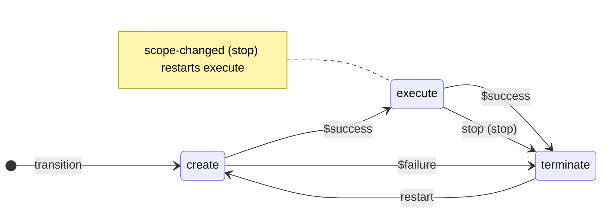
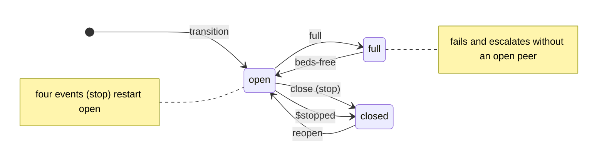

# State Machine User Guide

This guide is for authors of digital twins (DTs) and for the operators
who run them. It explains how to write the state machine file of a DT,
how to start and drive the machine, and what each request answers. You
need no knowledge of the runner's code. The design and implementation
are described for runner developers in
[docs/state-machine-design.md](docs/state-machine-design.md), and the
whole API, including the routes that only run commands, in
[API.md](api/API.md).

## What the State Machine Does

A DT runs as a set of scripts, such as _create_, _execute_ and
_terminate_. The state machine runs them in order for you:

- Each **state** is a script of the same name. Entering a state runs
  its script.
- A **transition request** starts the machine in a state you name.
- **Events**, sent by you, by a Manager or by the DT's own scripts,
  or raised by the runner when a peer DT changes, move the machine
  from one state to the next.
- When a script exits, the runner raises a **completion event**,
  `$success`, `$failure` or `$stopped`, which can move the machine on
  by itself.
- The runner remembers the machine across a restart when it has a
  database file.

## Configure the Runner

The runner reads _runner.yaml_. These keys matter for a state machine:

```yaml
id: 'pipeline-1' # names the DT
port: 5300
location: 'scripts' # folder of the scripts, relative to this file
commands: # the scripts that may run; every state must be one
  - create
  - execute
  - terminate
stateMachine: 'state-machine.yaml' # relative to this file, or absolute
parameters: # optional; values of parameters of the file, for this DT
  capacity: 30
database: 'runner.db' # optional; keeps the machine across restarts
stopGrace: 5000 # optional; milliseconds from SIGTERM to SIGKILL
```

- Without `stateMachine` the state machine is off, and its routes
  answer `404`.
- The runner reads the state machine file once, when it starts. Restart
  the runner after changing the file.
- Each state needs a script in `location`: a shell script of the state's
  name on Linux, which must be executable, and a PowerShell script with
  the `.ps1` extension on Windows, such as _create.ps1_. A folder may
  hold both.
- `parameters` gives parameters of the state machine file the values
  of this DT; see [Parameters](#parameters).
- An `mqtt` section adds an MQTT API, and `notify` under
  `relationships.manager` a webhook; see [MQTT](#mqtt) and
  [Watch the State](#watch-the-state).
- `peers` under `relationships` lists the DTs this one follows; see
  [Subscriptions to Peers](#subscriptions-to-peers).
- Before version 0.11.0, `notify` and `peers` were at the top of the
  file. Both still load there in 0.11, with a warning, and go in 0.12
  ([README](README.md#relationships)).

## Class and Instance

The state machine file is a **class**: the kind of DT, with its
declarations and its behaviour. The DT author writes it together with
the scripts. _runner.yaml_ describes one **instance** of the class,
and the operator writes it: the `id`, the port, the paths, the keys,
the peers and the values of this DT. Several runners may name the same
state machine file, as the two hospitals of the
[example](#example-hospital-bed-management) do.

The optional `class` section of the file names the class:

```yaml
class:
  id: 'urn:dtaas:demo:hospital'
  version: '1.0.0'
```

- `id` has 1 to 200 characters and `version` 1 to 64, both without
  spaces. Both are required when the section is present.
- Quote the `version`: YAML reads `1.0` as a number, and the runner
  takes a string only.
- `GET /dt` and the presence notice show the section as `class`, and
  `null` without it. The runner never interprets the id and never
  compares versions.

An instance sets three things of its class in _runner.yaml_:

- `parameters` gives [parameters](#parameters) of the file their
  values for this DT.
- `relationship` of a peer binds the
  [subscriptions](#subscriptions-to-peers) that name that relationship
  to the peer.
- `commands` must hold every state of the class and every one of its
  [manager commands](#manager-commands).

The file has no placeholders and no templates.
[CLASS-INSTANCE-INTERFACE.md](CLASS-INSTANCE-INTERFACE.md) gives the
full account of class, instance and interface.

## Write the State Machine File

### States and Transitions

```yaml
events: # the events that clients may send
  - stop
  - restart
states:
  create:
    transitions:
      $success: execute # when the create script exits with 0
      $failure: terminate # when it exits with another code
  execute:
    transitions:
      stop: terminate # when a client sends stop
  terminate:
    transitions:
      restart: create
```

- `states` maps each state to its `transitions`, which map an event to
  the next state. A state has at most one transition for each event.
- A state without transitions may be left empty, as in `terminate:`.
- `events` lists the events that clients may send. Leave it out when
  only completion events move the machine.
- State, event, parameter and property names have up to 64 letters,
  digits, `_`, `.` or `-`, and start with a letter or digit.
- `states` may be left out too, for a DT that only declares; see
  [A File Without States](#a-file-without-states).

### Completion Events

The runner raises one completion event when the script of the current
state exits. Clients can not send them.

| Event      | Raised when                                                                    |
| :--------- | :----------------------------------------------------------------------------- |
| `$success` | the script exited with code 0                                                  |
| `$failure` | the script exited with another code, was killed from outside, or did not start |
| `$stopped` | the runner stopped the script, on a stop request                               |

Without a transition for the event, the machine stays in its state,
idle, with the status of the script (see [Script Status](#script-status)).
A loop made only of `$success` and `$failure` transitions is refused,
as fast scripts would run it forever.

### Stop Transitions

A plain transition leaves the script of the old state running; the
next script has to end it if needed. A transition with `stop: true`
stops the old script first:

```yaml
states:
  execute:
    transitions:
      stop:
        state: terminate
        stop: true
      restart:
        state: execute # a self-transition restarts the script
        stop: true
```

On such an event the runner enters the next state at once and answers
`accepted`. It then stops the old script, waits until it has exited,
and runs the script of the next state. The stopped script raises no
`$stopped`, as the machine has already left its state.

`stop: true` is not allowed on completion events, whose script has
already exited.

### Parameters

Parameters are settings of the DT that a Manager can read and, where
you allow it, change:

```yaml
events:
  - scope-changed
parameters:
  scope:
    type: string
    enum: # optional; the values that the parameter may take
      - single
      - multi
    default: single
    controllable: true # a client may change it
    event: scope-changed # raised when a request changes the value
  capacity:
    type: integer
    minimum: 1 # optional, as maximum
    default: 20 # not controllable: shared with the Manager, read only
states:
  execute:
    transitions:
      scope-changed: # restarts execute with the new value
        state: execute
        stop: true
```

- `type` is `string`, `number`, `integer` or `boolean`, as in JSON
  Schema.
- `enum` lists the values that a `string`, `number` or `integer` may
  take, and `minimum` and `maximum` bound a `number` or an `integer`.
  A parameter takes no `unit` and no other keyword.
- `default` is required and must fit the declaration. YAML reads `20`
  as a number, so a `string` parameter needs quotes, as in `'20'`.
- `controllable` is `false` unless given.
- `event`, if given, must be in `events`.
- Two names that become the same variable name, such as `a-b` and
  `A_B`, are refused, and so are the names `set` and `response`.
- Before version 0.11.0 an enum was written `type: enum` with a list
  of `values`. That spelling still loads in 0.11, with a warning in
  the log, and goes in 0.12; write `type: string` with `enum`.

The `default` is that of the [class](#class-and-instance). An instance
sets its own value under `parameters` in _runner.yaml_:

```yaml
parameters:
  capacity: 30
```

- Each value replaces the `default` of that parameter for this DT. Any
  declared parameter may be set, controllable or not.
- The runner checks the values when it starts. A name that the file
  does not declare, or a value that does not fit its declaration, stops
  the runner:

  ```text
  Invalid parameters in runner.yaml for /home/dt/state-machine.yaml:
  ✖ parameter beds is not declared
  ✖ parameter capacity: Too small: expected number to be >=1
  ```

- `parameters` without `stateMachine` stops the runner with
  `The parameters of runner.yaml need a stateMachine file`.
- `GET /parameters` shows the value of the instance as `default`.

The runner never restarts a script on its own. A script keeps the
values it started with. To make a change take effect at once, give the
parameter an `event` whose transition restarts the script, as a
self-transition with `stop: true` does.
[Pattern: Fidelity](#pattern-fidelity) uses such a parameter to let a
Manager trade accuracy for computing power.

### Properties

Properties are the latest values that your scripts, or a sensor
outside the runner, hand the runner: a reading of the physical twin,
or a figure computed from it. A parameter goes from the Manager to the
scripts; a property goes from the scripts to the Manager and the
peers. The runner checks, stores, shows and publishes the values. It
never interprets them.

```yaml
properties:
  free-beds:
    type: integer
    minimum: 0
    unit: beds # every number names its unit
  ward-status:
    type: string
    enum:
      - open
      - full
      - closed
  forecast: # free beds in each of the next hours
    type: array
    items:
      type: number
      unit: beds
  position:
    type: object
    properties:
      latitude:
        type: number
        unit: deg
      longitude:
        type: number
        unit: deg
    required:
      - latitude
      - longitude
```

The types are those of JSON Schema, as a W3C Web of Things Thing
Description uses them:

| Keyword                  | Applies to                    | Needed            |
| :----------------------- | :---------------------------- | :---------------- |
| `type`                   | every value                   | yes               |
| `enum`                   | `string`, `number`, `integer` | no                |
| `minimum`, `maximum`     | `number`, `integer`           | no                |
| `unit`                   | `number`, `integer`           | yes               |
| `items`                  | `array`                       | yes               |
| `properties`, `required` | `object`                      | `properties` only |

- `type` is `string`, `number`, `integer`, `boolean`, `object` or
  `array`. The runner accepts no other keyword.
- Every `number` and `integer` names its `unit`, also inside an object
  or an array, so that a reader of the value never has to guess it.
  Write `unit: '1'` for a number without a dimension. The other types
  take no `unit`.
- An array declares its `items`, and an object its `properties`. A
  member of an object is optional unless `required` lists it; a member
  that is not declared is refused.
- There is no `default`. A property is `null` until its first write.
- A name may not be both a parameter and a property, nor be `set` or
  `response`.

Scripts and sensors write the values with `PUT /properties`; see
[Read and Write Properties](#read-and-write-properties). A write
raises no event. Scripts get no `DT_PROP_` variable: a value copied
when a script starts would be stale during a long run.

### A File Without States

A DT that only runs commands with `POST /` may still declare
parameters, properties and manager commands, and name its
[class](#class-and-instance). Leave `states` out:

```yaml
parameters:
  capacity:
    type: integer
    default: 20
properties:
  free-beds:
    type: integer
    minimum: 0
    unit: beds
manager:
  commands:
    - create
```

Such a DT has no machine. `GET /fsm` and the transition and event
requests answer `404` `no state machine`, as without a file, and
`GET /dt` shows `"stateMachine": false`. The parameter and property
requests work. The file may not have `events` or `subscriptions`,
which nothing would take; the runner refuses it with
`events need states`.

### Environment

Each script inherits the runner's environment and gets these
variables. When the operator runs the scripts as a second account
([Script User](README.md#script-user)), a script inherits only
`TMPDIR` and `LANG`, gets `HOME`, `USER` and `LOGNAME` of that account
and a fixed `PATH`, and runs in the run directory, the one place where
it may write.

| Variable          | Value                                                                   |
| :---------------- | :---------------------------------------------------------------------- |
| `RUNNER_URL`      | `http://127.0.0.1:<port>`, the runner's HTTP API                        |
| `RUNNER_TOKEN`    | the bearer token for that API, with access control only                 |
| `DT_ID`           | the `id` of _runner.yaml_                                               |
| `DT_STATE`        | the state whose script this is; for `POST /`, the current state         |
| `DT_ENTRY`        | the number of that entry into a state, counted from 1                   |
| `DT_PARAM_<NAME>` | the value of each parameter when the script starts, as `DT_PARAM_SCOPE` |

`<NAME>` is the parameter name in upper case, with `.` and `-` as `_`.
The file may add variables for every script and for one state:

```yaml
env:
  HINT: '${DT_ID}/${DT_STATE}#${DT_ENTRY} scope=${DT_PARAM_SCOPE}'
states:
  open:
    env:
      POLL_MS: 500
```

- Names have upper-case letters, digits and `_`, start with a letter,
  and may not start with `DT_` or `RUNNER_`.
- Values are strings, numbers or booleans; a script reads them as
  strings.
- A value may use `${NAME}` for `RUNNER_URL`, `RUNNER_TOKEN`, `DT_ID`,
  `DT_STATE`, `DT_ENTRY` or a `DT_PARAM_` variable, and nothing else, so the file
  means the same on every host.
- The `env` of a state wins over the `env` of the file, which wins over
  the runner's variables and environment.
- With a script account, a name that the dynamic loader or the C
  library reads a file from, such as `LD_PRELOAD`, `LANG` or `LC_ALL`,
  stops the runner at startup; the README lists them under
  [Declared Environment](README.md#declared-environment).

The scripts of the state machine get no input on stdin; stdin is empty
and closed.

### Escalation

A DT escalates to its Manager when it can not adapt by itself any
more. You choose the conditions on which the runner escalates by
itself:

```yaml
escalation:
  onFailure: true # a script failed and its state has no $failure transition
  onNoTransition: true # a client event has no transition in the current state
```

Both are `false` unless given. `onNoTransition` escalates each event
once per entry into a state, and not before the first transition.
Scripts and clients may also escalate at any time with
[`POST /escalate`](#escalate). The runner sends each escalation as a
notification of kind `escalation` (see [Watch the State](#watch-the-state)).

### Manager Commands

```yaml
manager:
  commands:
    - admit
```

The commands that a Manager may submit with `POST /`. Each must be one
of the `commands` of _runner.yaml_. `GET /dt` shows the list. With
access control ([README](README.md#access-control)), a principal in the
role `manager` may run only these commands; without it, the list is not
enforced.

### Subscriptions to Peers

A DT can react to its peers, the DTs that the operator lists under
`relationships.peers` in _runner.yaml_ ([README](README.md#peers)).
Each subscription names a relationship or a peer, a condition on what
the peer last reported, and the event that the runner raises when the
condition turns true:

```yaml
events:
  - neighbour-full
  - neighbour-down
subscriptions:
  - relationship: neighbour
    when:
      state: full
    event: neighbour-full
  - relationship: neighbour
    when:
      online: false
    event: neighbour-down
states:
  open:
    transitions:
      neighbour-full:
        state: open
        stop: true
```

The operator gives peers the relationship in _runner.yaml_:

```yaml
relationships:
  peers:
    - id: 'hospital-2'
      topic: 'dtaas/hospital-2'
      relationship: neighbour
```

- A subscription names either `relationship` or `peer`, and not both.
- `relationship` is a name that _runner.yaml_ gives to peers, one name
  for each peer. A [class](#class-and-instance) that several instances
  share should use it, as each instance has its own peers. When it
  starts, the runner binds the subscription to every peer with that
  relationship, enabled or not: one subscription for each peer, so
  each peer raises the event on its own change.
- A relationship that no peer has is not an error. Its subscriptions
  are idle, and the runner logs one line:

  ```text
  /home/dt/state-machine.yaml: no peer of runner.yaml has the relationship neighbour, so its subscriptions are idle
  ```

- `peer` is the `id` of one peer of _runner.yaml_, enabled or not, as
  in `peer: hospital-2`. A peer that subscriptions reach both by id and
  by relationship, with the same `when` and `event`, is followed once.
- `when` holds exactly one condition. `state: <name>` holds when the
  peer's last state document has that `machine.state`; it is the
  peer's state, so it need not be one of yours. `online: true` or
  `online: false` holds when the peer's last presence notice says so,
  including the `online: false` that the broker sends for a runner
  that dies.
- `event` is one of your `events`; a completion event can not be
  named.
- The same `peer` and `when` may raise two events; both are raised, in
  file order.

The runner raises the event only when the condition turns from not
holding, or unknown, to holding: once per change, not on every
document. A peer that keeps reporting `full` raises
`neighbour-full` once; it raises it again only after it reported
another state in between. See [React to Peers](#react-to-peers) for
what the event does.

### When the Runner Refuses the File

The runner does not start, and its message names the file and every
problem, when:

- the file is missing, empty, not YAML, or has a key the runner does
  not know;
- a state is not one of the `commands` of _runner.yaml_;
- a transition leads to an undeclared state, or uses an event that is
  neither in `events` nor a completion event;
- `stop: true` is on a completion event, or a transition object has a
  key other than `state` and `stop`;
- `$success` and `$failure` transitions alone form a loop;
- a name breaks the naming rule, a parameter, `env` or `escalation`
  entry is invalid, or a manager command is not permitted;
- a property has a keyword that the runner does not know or that does
  not apply to its type, a number without a `unit`, an array without
  `items` or an object without `properties`, an `enum` value of another
  type, a `minimum` above its `maximum`, or a `required` name that is
  not among its `properties`;
- a name is both a parameter and a property, or a parameter or a
  property is named `set` or `response`;
- the file has `events` or `subscriptions` but no `states`;
- the `class` section has a key other than `id` and `version`, misses
  one, or one of them has a space, is too long or is not a string;
- a subscription has a key other than `peer`, `relationship`, `when`
  and `event`, names both a `peer` and a `relationship` or neither, or
  misses `when` or `event`; its `when` has no condition, both or
  another key; its `peer` is not listed in _runner.yaml_; its `event`
  is not in `events`; or two subscriptions have the same `peer` or
  `relationship`, `when` and `event`;
- `parameters` of _runner.yaml_ names a parameter that the file does
  not declare, or gives a value that does not fit its declaration.

## Run the Machine

All requests take and return JSON; send `Content-Type: application/json`
with a body. Every route below also works over [MQTT](#mqtt).

### Start the Machine

The machine has no state until a transition request names one, unless
a [restart](#restarts) restored it:

```bash
curl -X POST http://localhost:5300/fsm/transition \
  -H 'Content-Type: application/json' -d '{"state": "create"}'
```

```json
{ "status": "accepted", "state": "create" }
```

The reply comes once the script has started, with HTTP status `202`.
A transition request moves the machine to any state, but only while it
is **idle**: before the first transition, and whenever the script of
the current state is not running. While the script runs, the request
is refused with `busy`. Use an event instead, or stop the script.

### Send Events

```bash
curl -X POST http://localhost:5300/fsm/event \
  -H 'Content-Type: application/json' -d '{"event": "stop"}'
```

```json
{ "status": "accepted", "state": "terminate" }
```

An event moves the machine along the transition of the current state
for that event, even while the script of that state runs.

Transition and event requests answer with one of these statuses, and
with `state`, the state after the request, or `null` before the first
transition:

| Status                | HTTP | Meaning                                                   |
| :-------------------- | :--- | :-------------------------------------------------------- |
| `accepted`            | 202  | the machine entered the state and started its script      |
| `invalid state`       | 400  | the state is not in the file                              |
| `invalid event`       | 400  | the event is not in `events`                              |
| `invalid request key` | 400  | the request key belongs to another request                |
| `busy`                | 409  | a transition request while the script of the state runs   |
| `no transition`       | 409  | the current state has no transition for the event         |
| `script running`      | 409  | the script of the next state is still running from before |
| `no state machine`    | 404  | no `stateMachine` key, or a file that has no states       |
| `stopping`            | 503  | the runner is shutting down                               |

A body without `state` or `event` is refused before these checks with
`400` and `{"message": "Validation Failed", "error": "Bad Request",
"statusCode": 400}`.

`script running` means that the script of the next state still runs,
for example because a plain transition left it running, or because a
client ran it with `POST /`. The runner does not enter such a state, as
the script would not run again for the new entry. A completion
transition into such a state is skipped with a warning in the runner's
log.

### Raise Events From Scripts

A script raises an event as any client does, at `RUNNER_URL`, with the
token of `RUNNER_TOKEN`, which the runner ignores without access
control:

```sh
code=$(curl -sS -o /dev/null -w '%{http_code}' -X POST \
  -H 'Content-Type: application/json' \
  -H "Authorization: Bearer $RUNNER_TOKEN" -d '{"event": "done"}' \
  "$RUNNER_URL/fsm/event")
case "$code" in
  202 | 503) exit 0 ;;
  409) echo "not now" ;;
  *) echo "event refused: $code" >&2 && exit 1 ;;
esac
```

| Reply                                                                | For the script                                                                      |
| :------------------------------------------------------------------- | :---------------------------------------------------------------------------------- |
| `202` `accepted`                                                     | the state is left: its exit no longer moves the machine; `stop: true` sends SIGTERM |
| `400` `invalid event`, `Validation Failed`; `404` `no state machine` | a mistake in the script or the file; a retry does not help                          |
| `409` `no transition`, `script running`                              | not now                                                                             |
| `503` `stopping`                                                     | the runner is shutting down; the script should exit                                 |

`curl` prints `000` when the runner can not be reached. In PowerShell
5.1, which the runner uses for `.ps1` scripts, `Invoke-RestMethod`
throws on a `4xx` or `5xx` reply:

```powershell
$headers = @{ Authorization = "Bearer $env:RUNNER_TOKEN" }
try {
  Invoke-RestMethod -Method Post -Uri "$env:RUNNER_URL/fsm/event" `
    -Headers $headers -ContentType 'application/json' `
    -Body '{"event": "done"}' | Out-Null
  $code = 202
} catch { $code = [int]$_.Exception.Response.StatusCode }
```

The runner's container image has neither `curl` nor `wget`. A script
that runs in it uses `node`, which prints `0` when the runner can not
be reached:

```sh
code=$(node -e "fetch(process.env.RUNNER_URL + '/fsm/event', {
  method: 'POST',
  headers: { 'Content-Type': 'application/json' },
  body: JSON.stringify({ event: 'done' }),
}).then((reply) => console.log(reply.status), () => console.log(0))")
```

### React to Peers

An event of a [subscription](#subscriptions-to-peers) takes the path of
an event that a client sends, without a request key and without a
reply:

- The current state's transition for the event is taken, a
  `stop: true` self-transition too, which restarts the state's script.
  `runner.log` logs the peer, the condition and the event of each
  accepted one.
- Without a transition, the event is logged at debug level and, with
  `escalation.onNoTransition`, escalates once per entry into a state.
- Before the first transition the event finds no transition and does
  not escalate. The runner still counts the change as seen, so a state
  that needs to know a peer's current state at entry reads
  `GET $RUNNER_URL/peers`.
- While the runner shuts down the event is refused `stopping`, with a
  warning in the log.

The runner reads the peer's notices only while the peer is enabled
(`PUT /peers`), and forgets what it saw of a peer that is disabled, so
the first notice after an enable counts as a change. A notice that the
runner drops, such as an unsigned one from a peer with a `publicKey`,
raises nothing. A peer that sends nothing raises nothing: a
subscription reacts to notices and has no timeout.

### Read and Set Parameters

`GET /parameters` returns each parameter with its value:

```json
{
  "scope": {
    "value": "single",
    "type": "string",
    "enum": ["single", "multi"],
    "default": "single",
    "controllable": true
  },
  "capacity": {
    "value": 20,
    "type": "integer",
    "minimum": 1,
    "default": 20,
    "controllable": false
  }
}
```

An enum shows as `"type": "string"` with `"enum"`, also when the file
still spells it `type: enum`. Before version 0.11.0 the reply had
`"type": "enum"` and `"values"`. `default` is the value that
`parameters` of _runner.yaml_ gives the parameter, else the `default`
of the file.

`PUT /parameters` with `{"scope": "multi"}` sets controllable
parameters. The runner checks the whole body first; on any problem it
changes nothing and answers `400`, listing every problem:

```json
{
  "message": ["parameter capacity is not controllable"],
  "error": "Bad Request",
  "statusCode": 400
}
```

Otherwise it stores the new values, raises the `event` of each changed
parameter in the order of the file, and answers `200` with the body of
`GET /parameters`. An event that the machine refuses is only logged;
the new value stands. A value equal to the current one raises no event.
Both routes answer `404` with `{"status": "no state machine", "state":
null}` without a state machine file. A script reads the current values
with `GET $RUNNER_URL/parameters`; its `DT_PARAM_` variables keep the
values it started with.

### Read and Write Properties

`PUT /properties` hands the runner the latest values, as a flat object
of property names and values. A script sends it to `RUNNER_URL` with
the token of `RUNNER_TOKEN`, as it raises an event:

```sh
curl -sS -o /dev/null -X PUT -H 'Content-Type: application/json' \
  -H "Authorization: Bearer $RUNNER_TOKEN" -d '{"free-beds": 3}' \
  "$RUNNER_URL/properties"
```

```powershell
$headers = @{ Authorization = "Bearer $env:RUNNER_TOKEN" }
Invoke-RestMethod -Method Put -Uri "$env:RUNNER_URL/properties" `
  -Headers $headers -ContentType 'application/json' `
  -Body '{"free-beds": 3}' | Out-Null
```

The runner checks the whole body first. If a name is not declared or a
value does not fit its declaration, it changes nothing and answers
`400`, listing every problem:

```json
{
  "message": [
    "property free-beds: Too small: expected number to be >=0",
    "property size is not declared"
  ],
  "error": "Bad Request",
  "statusCode": 400
}
```

Otherwise it stores the values and answers `200` with the body of
`GET /properties`, each property with its latest value, the time of
the write, who wrote it, and its declaration:

```json
{
  "free-beds": {
    "value": 3,
    "time": "2026-10-26T11:22:43.120Z",
    "by": "script",
    "type": "integer",
    "minimum": 0,
    "unit": "beds"
  }
}
```

- `null` is a value of every type and means "not known", for example
  while a sensor is offline.
- Writing the same value again updates `time`, so a reader sees that
  the feed is alive. `{}` is `200` and changes nothing.
- `by` is the name of the principal that wrote the value, `script` for
  a script of the runner, or `null` without access control.
- A write raises no event. A script that wants the machine to react
  raises an event as well.
- With access control, the roles `client`, `script` and `sensor` may
  write, and every role may read. A `manager` may not write: it tunes
  the parameters, and must not write what the DT observes. A `sensor`
  is a principal of _runner.yaml_ that feeds values from outside the
  runner; it may call these two routes only.
- Both routes answer `404` `no state machine` without a state machine
  file.

### Stop a Script

```bash
curl -X POST http://localhost:5300/stop \
  -H 'Content-Type: application/json' -d '{"name": "execute"}'
```

```json
{ "stopped": ["execute"] }
```

Without a `name`, or without a body, the runner stops every running
script. It sends `SIGTERM`, then `SIGKILL` after `stopGrace`, and
answers `200` once the scripts have exited; the list is empty when
nothing ran. On Windows the runner ends `powershell.exe` at once, and
the processes that the script started keep running, unmeasured.

When the stopped script is that of the current state, the runner raises
`$stopped`. Without a `$stopped` transition the machine stays in the
state, idle, with status `stopped`, so a transition request can move it.
A script must let a stop end it: the runner waits until the script's
stdout and stderr close, so a child such as a foreground `sleep` holds
the stop. Loop on short sleeps, start the last command with `exec`, or
end children with a `trap`.

### Watch the State

`GET /fsm` returns the machine:

```json
{
  "state": "execute",
  "status": "running",
  "entry": 2,
  "events": ["restart", "scope-changed", "stop"]
}
```

`entry` counts the entries into states, `0` before the first
transition; it tells two entries into the same state apart. `events`
lists the events of the file in alphabetical order.

`GET /state` returns the whole DT in one document: its `id`, the
`time`, the body of `GET /fsm` as `machine` (or `null` without a state
machine), the parameter values, the latest value and write time of
each property, and the latest command without its logs. `GET /`
returns the latest command with its logs, exit code and resources, and
`GET /history` every command with its status, exit code, times and
resources, the state scripts included. `GET /metrics`
counts the entries into each state, the seconds spent there, the
scripts that finished, the transition and event requests, the commands
by status, their resources and the escalations since the runner
started.

With a `notify` section under `relationships.manager` in
_runner.yaml_, or with MQTT, the runner sends the state document
whenever it changes, as a notification of kind `state`:

```json
{
  "kind": "state",
  "id": "pipeline-1",
  "time": "2026-10-26T11:22:43.000Z",
  "data": { "id": "pipeline-1", "time": "2026-10-26T11:22:43.000Z" }
}
```

`data` is the whole state document of `GET /state`, shortened here.

A fast feed of property values does not flood the Manager. A document
whose only change is in property values waits until `stateInterval`
milliseconds, a key of _runner.yaml_ that is `1000` unless given, have
passed since the last state notification. A change of the machine, a
parameter or the command is sent at once, with the property values
that were waiting.

Over MQTT the notifications go to `<topic>/notify/<kind>`, where `kind`
is `state`, `escalation` or `presence`; the last state document and the
last presence notice are retained, an escalation is not. A webhook gets
each notification as a `POST`. See the [API
reference](api/API.md#notifications) for the details.

#### Script Status

| `status`      | Meaning                                                                                |
| :------------ | :------------------------------------------------------------------------------------- |
| `none`        | no transition yet                                                                      |
| `running`     | the script of the current state runs; transition requests are `busy`                   |
| `valid`       | the script exited with 0                                                               |
| `invalid`     | the script failed (`GET /` shows the command as `failed`)                              |
| `stopped`     | the runner stopped the script                                                          |
| `interrupted` | the script ran when the runner stopped, and did not finish (see [Restarts](#restarts)) |

Every status but `running` leaves the machine idle.

### Escalate

```bash
curl -X POST http://localhost:5300/escalate \
  -H 'Content-Type: application/json' \
  -d '{"reason": "capacity", "proposal": {"scope": "multi"}}'
```

```json
{ "status": "accepted" }
```

`reason`, a non-empty string of up to 1 KiB, is required; `proposal`, a
JSON object of up to 4 KiB, is optional. The runner answers `202`, with
or without a state machine, and sends the escalation to the Manager.

### Repeated Requests

A transition, event or escalation request may carry an
`Idempotency-Key` header of up to 255 characters, unique to the
request. A repeat of an accepted request with the same key gets the
first reply, and nothing happens again. A refused request changed
nothing, so its repeat is checked again. The runner keeps the latest
256 keys of each kind in memory. A key of another request gets
`invalid request key`.

### Restarts

With a `database` in _runner.yaml_ the runner stores the state, the
entry count and the script status at each entry and each script exit,
the latest parameter values at each change, and the latest value of
each property at each write. When it starts again:

- A state whose script was running comes back with status
  `interrupted`. The runner does not run the script again, as it may
  have done part of its work; the machine is idle, so send a transition
  request or an event.
- The commands that had not finished are `interrupted` in `GET /`,
  `GET /state` and `GET /history`; a repeat of such a request gets
  `failed`.
- A stored state that the file no longer has is dropped with a warning
  in the log, and the machine starts without a state. The entry count
  is kept, so entry numbers never repeat.
- A stored parameter value that the file no longer allows, such as a
  removed parameter or enum value, or a parameter no longer
  controllable, is dropped with a warning; the parameter starts at its
  default. A restored value raises no event. A stored value of a
  controllable parameter wins over the value of `parameters` in
  _runner.yaml_, which is the default of the instance.
- Each property comes back with its value, and the time and the writer
  of its last write. A stored value that no longer fits its
  declaration is dropped with a warning, and the property is `null`.
- Without `stateMachine`, the runner logs the stored state and keeps it
  for a later start with the state machine.

Without a database file, the runner starts with no state, the default
values of the parameters, and every property `null`.

### Shut Down

On `SIGINT` or `SIGTERM` the runner stops taking transitions and events
(`503 stopping`) and waits for the running scripts before it closes
its database. A script that exits meanwhile keeps its status, but its
completion transition does not run. The next state of a stop transition
that has not started yet is not run either, and comes back
`interrupted` after a restart.

### MQTT

With an `mqtt` section, every route has a request topic under the base
`topic`. The payload is the JSON body of the HTTP request, and the
response, with the same body as over HTTP, goes to the MQTT 5 response
topic of the request, or else to the request topic followed by
`/response`.

| Topic                    | HTTP                   | Payload                  |
| :----------------------- | :--------------------- | :----------------------- |
| `<topic>/transition`     | `POST /fsm/transition` | `{"state": "create"}`    |
| `<topic>/event`          | `POST /fsm/event`      | `{"event": "stop"}`      |
| `<topic>/fsm`            | `GET /fsm`             | ignored                  |
| `<topic>/state`          | `GET /state`           | ignored                  |
| `<topic>/parameters`     | `GET /parameters`      | ignored                  |
| `<topic>/parameters/set` | `PUT /parameters`      | `{"scope": "multi"}`     |
| `<topic>/properties`     | `GET /properties`      | ignored                  |
| `<topic>/properties/set` | `PUT /properties`      | `{"free-beds": 3}`       |
| `<topic>/stop`           | `POST /stop`           | `{"name": "execute"}`    |
| `<topic>/escalate`       | `POST /escalate`       | `{"reason": "capacity"}` |
| `<topic>/execute`        | `POST /`               | `{"name": "create"}`     |

A topic that writes is one level under the topic that reads, so the
default response topic of a write is `<topic>/parameters/set/response`.
A subscription to `<topic>/+/response` does not match it: subscribe to
`<topic>/+/set/response` as well, or give an MQTT 5 response topic.
Before version 0.11.0 the write topic was `<topic>/set-parameters`; it
still answers in 0.11, with a warning in the log, and goes in 0.12.

MQTT has no status codes, so the `status` in the body is the outcome.
Over MQTT 5, the request key is the `idempotency-key` user property.
With access control, the payload of each request but `health` is a
signed token instead of the JSON
([API reference](api/API.md#mqtt-access-control)); with a signing key,
each response and notification is a JWS of the JSON
([README](README.md#signed-output)).

## Example: A Pipeline

A DT that creates its resources, executes for a while and terminates.
The scope of the work is a parameter; changing it restarts _execute_.

_runner.yaml_:

```yaml
id: 'pipeline-1'
port: 5300
location: 'scripts'
commands:
  - create
  - execute
  - terminate
stateMachine: 'state-machine.yaml'
database: 'runner.db'
```

_state-machine.yaml_:

```yaml
events:
  - stop
  - restart
  - scope-changed
parameters:
  scope:
    type: string
    enum:
      - single
      - multi
    default: single
    controllable: true
    event: scope-changed
  capacity:
    type: number
    default: 20
states:
  create:
    transitions:
      $success: execute
      $failure: terminate
  execute:
    transitions:
      $success: terminate
      stop:
        state: terminate
        stop: true
      scope-changed:
        state: execute
        stop: true
  terminate:
    transitions:
      restart: create
```



_scripts/create_ and _scripts/terminate_ print a line each:

```sh
#!/bin/sh
echo "created $DT_ID, entry $DT_ENTRY"
```

```sh
#!/bin/sh
echo "terminated"
```

_scripts/execute_ works for 30 seconds in short sleeps, so a stop ends
it at once:

```sh
#!/bin/sh
echo "executing with scope $DT_PARAM_SCOPE"
i=0
while [ "$i" -lt 300 ]; do sleep 0.1; i=$((i + 1)); done
```

On Windows the folder holds _create.ps1_, _execute.ps1_ and
_terminate.ps1_ instead, such as _execute.ps1_:

```powershell
Write-Output "executing with scope $env:DT_PARAM_SCOPE"
foreach ($i in 1..300) { Start-Sleep -Milliseconds 100 }
```

In the diagram, `transition` is the request that starts the machine,
and `(stop)` marks a transition with `stop: true`. The requests, with
the replies of a runner and the HTTP status:

| Request                                         | Reply                                                                                                 |
| :---------------------------------------------- | :---------------------------------------------------------------------------------------------------- |
| `GET /fsm`                                      | `200` `{"state": null, "status": "none", "entry": 0, "events": ["restart", "scope-changed", "stop"]}` |
| `POST /fsm/transition` `{"state": "create"}`    | `202` `{"status": "accepted", "state": "create"}`                                                     |
| `GET /fsm`, once _create_ has exited            | `200` `{"state": "execute", "status": "running", "entry": 2, ...}`                                    |
| `POST /fsm/transition` `{"state": "terminate"}` | `409` `{"status": "busy", "state": "execute"}`                                                        |
| `PUT /parameters` `{"scope": "multi"}`          | `200` with the parameters; `scope-changed` restarts _execute_ as entry 3                              |
| `POST /fsm/event` `{"event": "stop"}`           | `202` `{"status": "accepted", "state": "terminate"}`                                                  |
| `GET /fsm`, once _terminate_ has exited         | `200` `{"state": "terminate", "status": "valid", "entry": 4, ...}`                                    |
| `POST /fsm/event` `{"event": "stop"}`           | `409` `{"status": "no transition", "state": "terminate"}`                                             |
| `POST /fsm/event` `{"event": "restart"}`        | `202` `{"status": "accepted", "state": "create"}`; _execute_ runs as entry 6                          |

The runner process is then killed while _execute_ runs, and started
again:

| Request                                         | Reply                                                                                        |
| :---------------------------------------------- | :------------------------------------------------------------------------------------------- |
| `GET /fsm`                                      | `200` `{"state": "execute", "status": "interrupted", "entry": 6, ...}`                       |
| `GET /`                                         | `200` `{"name": "execute", "status": "interrupted", "logs": {...}, "exitCode": null, ...}`   |
| `GET /parameters`                               | `200`, with `scope` still `multi`                                                            |
| `POST /fsm/transition` `{"state": "terminate"}` | `202` `{"status": "accepted", "state": "terminate"}`; `GET /fsm` then shows entry 7, `valid` |

## Example: Hospital Bed Management

The [hospital demo](demo/hospital/README.md) runs the DTs of two
hospitals, `hospital-1` and `hospital-2`, each with two wards, which
are [peers](README.md#peers) of each other and which a Manager of a
network of hospitals steers. Its recording,
[demo-windows-manager.cast](demo/hospital/demo-windows-manager.cast)
and [demo-windows-network.cast](demo/hospital/demo-windows-network.cast)
side by side in [demo-windows.mp4](demo/hospital/demo-windows.mp4),
shows every request below. Both hospitals run one
[class](#class-and-instance),
[hospital.fsm.yaml](demo/hospital/hospital.fsm.yaml):

```yaml
class:
  id: 'urn:dtaas:demo:hospital'
  version: '1.0.0'
events:
  - full
  - beds-free
  - scope-changed
  - fidelity-changed
  - close
  - reopen
  - neighbour-full
  - neighbour-down
parameters:
  # the shared-policy parameter: a patient goes to the requested ward
  # only (single), or to any ward with a free bed (multi)
  scope:
    type: string
    enum:
      - single
      - multi
    default: single
    controllable: true
    event: scope-changed
  # beds per ward, which the Manager may read but not change; an
  # instance sets its own under parameters in runner.yaml
  capacity:
    type: integer
    minimum: 1
    default: 2
    controllable: false
  # how often open samples the beds, from the cheapest to the most
  # accurate (STATE-MACHINE.md, Pattern: Fidelity)
  fidelity:
    type: string
    enum:
      - low
      - medium
      - high
    default: medium
    controllable: true
    event: fidelity-changed
# the latest values that the scripts hand the runner, for the Manager
# and the peers; the runner never reads them
properties:
  # the free beds of all wards, which open writes at each sample
  free-beds:
    type: integer
    minimum: 0
    unit: beds
env:
  HINT: '${DT_ID}/${DT_STATE}#${DT_ENTRY} scope=${DT_PARAM_SCOPE}'
escalation:
  onFailure: true
  onNoTransition: true
manager:
  commands:
    - admit
    - discharge
# events that the runner raises when a neighbour changes: a peer that
# runner.yaml gives the relationship neighbour
subscriptions:
  - relationship: neighbour
    when:
      state: full
    event: neighbour-full
  - relationship: neighbour
    when:
      online: false
    event: neighbour-down
states:
  open:
    env:
      POLL_MS: 500
    transitions:
      full: full
      scope-changed:
        state: open
        stop: true
      fidelity-changed:
        state: open
        stop: true
      neighbour-full:
        state: open
        stop: true
      neighbour-down:
        state: open
        stop: true
      close:
        state: closed
        stop: true
      $stopped: closed
  full:
    transitions:
      beds-free: open
  closed:
    transitions:
      reopen: open
```

The two instances differ in their _runner.yaml_ only.
[runner.yaml](demo/hospital/runner.yaml) of `hospital-1` gives its peer
`hospital-2` the relationship `neighbour`, so its subscriptions follow
`hospital-2`. [runner-2.yaml](demo/hospital/runner-2.yaml) of
`hospital-2` sets `capacity` to 1 and gives its peer no relationship,
so its subscriptions are idle and `hospital-2` follows no one:

```yaml
stateMachine: 'hospital.fsm.yaml'
parameters:
  capacity: 1
```



As above, `transition` starts the machine and `(stop)` marks
`stop: true`. The four events that restart _open_ are
`scope-changed`, `fidelity-changed`, `neighbour-full` and
`neighbour-down`.

- _open_ reads `GET $RUNNER_URL/peers` and logs where overflow goes:
  the nearest peer that is online and in state `open`, or none. It then
  samples the beds every `POLL_MS` milliseconds, times 4, 1 or 0.2 by
  `fidelity` ([Pattern: Fidelity](#pattern-fidelity)), writes their
  number as the property `free-beds` when it changes, and raises
  `full` over `RUNNER_URL` once none is free.
- _full_ reads the same list. With an open peer to take the overflow,
  it succeeds; without one it fails, and with `onFailure` the runner
  escalates to the Manager.
- The [subscriptions](#subscriptions-to-peers) raise `neighbour-full` when
  `hospital-2` enters `full` and `neighbour-down` when it goes offline,
  so that _open_ starts again and finds the new place for overflow.
- The Manager runs `admit` and `discharge` with `POST /` and an
  `input` object; `discharge` raises `beds-free`.

The requests of the recording to `hospital-1`, with their replies.
The recording predates version 0.11.0, so it shows neither `free-beds`
nor the write topic `parameters/set`, and each hospital has its own
state machine file in it:

| Request                                                             | Reply                                                                                                                                                    |
| :------------------------------------------------------------------ | :------------------------------------------------------------------------------------------------------------------------------------------------------- |
| `POST /fsm/transition` `{"state": "open"}`                          | `202` `{"status": "accepted", "state": "open"}`; _open_ logs `DT_ENTRY=1`, `POLL_MS=500`, fidelity `medium` and overflow to `hospital-2` at 12.4 km      |
| `PUT /parameters` `{"capacity": 3}`                                 | `400` `{"message": ["parameter capacity is not controllable"], ...}`                                                                                     |
| MQTT `set-parameters` `{"scope": "multi"}`                          | the parameters; `scope-changed` restarts _open_ as entry 2 with `DT_PARAM_SCOPE=multi`                                                                   |
| `PUT /parameters` `{"fidelity": "high"}`                            | `200`; `fidelity-changed` restarts _open_ as entry 3, sampling every 100 ms; the run of entry 2 ends `stopped` with 1.656 CPU seconds                    |
| `hospital-2` admits its last patient                                | `hospital-2` enters `full`, and its _full_ succeeds; `neighbour-full` restarts _open_ as entry 4, which logs overflow to none                            |
| `POST /` admitting the last free beds                               | `200` `success`; _open_ raises `full`, _full_ finds no open peer and fails: machine `full`, entry 5, `invalid`, and an `escalation` of trigger `failure` |
| `POST /fsm/event` `{"event": "close"}`                              | `409` `{"status": "no transition", "state": "full"}`, escalated once for this entry                                                                      |
| MQTT `execute` `{"name": "discharge", "input": {"patient": "p-1"}}` | `success`; `discharge` raises `beds-free`: machine `open`, entry 6, `running`                                                                            |
| `PUT /peers` `{"hospital-2": false}`, then `true`                   | the retained `full` of `hospital-2` counts as a change again: `neighbour-full` restarts _open_ as entry 7                                                |
| the runner of `hospital-2` is killed                                | its will says offline: `neighbour-down` restarts _open_ as entry 8                                                                                       |
| `POST /stop` `{"name": "open"}`                                     | `200` `{"stopped": ["open"]}`; `$stopped` leads to `closed`, entry 9, then `valid`                                                                       |

The demo's [README](demo/hospital/README.md) tells how to record it
again.

## Pattern: Fidelity

A DT that can trade accuracy for computing power, with models of
different fidelity, a coarser step size or a lower sample rate, can let
its Manager choose the trade. The runner has no feature for this, and
no parameter name means anything to it. Fidelity is a convention
between DT authors and Managers, made of [Parameters](#parameters),
[Stop Transitions](#stop-transitions), the [Environment](#environment)
and the [resources](README.md#resources) that the runner reports.

### The Convention

1. A DT that can trade accuracy for computing power declares a
   parameter named `fidelity`, of type `string` with an `enum`, with
   `controllable: true`, a `default` and an `event`.
1. You choose the `enum` values. List them from the cheapest to the
   most accurate, so that a Manager that knows none of the names can step one
   value down or up.
1. The event, by custom `fidelity-changed`, has a self-transition with
   `stop: true` in each state whose script must restart to use a new
   value. In the other states, a new value applies when their script
   next starts.
1. Scripts read `DT_PARAM_FIDELITY` and choose a model, a step size or a
   sample rate from it.

The [hospital demo](#example-hospital-bed-management) follows it: its
_open_ samples the beds every 2000, 500 or 100 ms at `low`, `medium`
or `high`, and its recording shows a change and the figures of the run
that it stopped.

```yaml
events:
  - fidelity-changed
parameters:
  fidelity:
    type: string
    enum:
      - low
      - medium
      - high
    default: medium
    controllable: true
    event: fidelity-changed
states:
  simulate:
    transitions:
      fidelity-changed:
        state: simulate
        stop: true
```

_scripts/simulate_ chooses a step size and `exec`s the model, so the
model is the script's process: a stop reaches it, and the runner
measures it.

```sh
#!/bin/sh
case "$DT_PARAM_FIDELITY" in
  low) step=60 ;;
  high) step=1 ;;
  *) step=10 ;;
esac
exec ./simulate --step "$step"
```

On Windows the runner ends `powershell.exe` and not the processes that
the script started (see [Stop a Script](#stop-a-script)), so
_scripts/simulate.ps1_ does its work in its own process and loops on
short steps:

```powershell
$step = @{ low = 60; medium = 10; high = 1 }[$env:DT_PARAM_FIDELITY]
if ($null -eq $step) { $step = 10 }
while ($true) { Update-Model -Seconds $step; Start-Sleep -Seconds 1 }
```

`Update-Model` stands for the DT's own code. The figures of a Windows
run include those of PowerShell itself, about 110 MB of memory, so
compare runs on the same platform.

### What a Manager Does

A Manager finds the DTs that offer the trade in `GET /parameters`: a
controllable parameter named `fidelity`, whose `enum` gives the order.

```json
{
  "fidelity": {
    "value": "medium",
    "type": "string",
    "enum": ["low", "medium", "high"],
    "default": "medium",
    "controllable": true
  }
}
```

To shed load, it sends `PUT /parameters` with `{"fidelity": "low"}`, or
the same body on the MQTT topic `<topic>/parameters/set`. The runner
stores the value and raises `fidelity-changed`; in _simulate_, the
self-transition stops the script and starts it again as a new entry,
with `DT_PARAM_FIDELITY=low`. `GET /fsm` and `GET /state` show the new
entry. The reply of `PUT` is the same whatever the event did (see
[Read and Set Parameters](#read-and-set-parameters)).

The Manager sees the effect in the `resources` of each run, in
`GET /history`:

```json
[
  {
    "id": 7,
    "name": "simulate",
    "status": "stopped",
    "exitCode": null,
    "receivedAt": "2026-10-27T09:00:00.000Z",
    "finishedAt": "2026-10-27T09:10:00.000Z",
    "by": null,
    "resources": { "cpuSeconds": 512.4, "peakRssBytes": 734003200 }
  },
  {
    "id": 8,
    "name": "simulate",
    "status": "running",
    "exitCode": null,
    "receivedAt": "2026-10-27T09:10:00.000Z",
    "finishedAt": null,
    "by": null,
    "resources": { "cpuSeconds": null, "peakRssBytes": null }
  }
]
```

- The run at the old fidelity ends with status `stopped` and its
  figures. The run at the new one shows `null` until it ends, at the
  next change or stop; `GET /` shows the same for the latest run.
- `cpuSeconds` grows with the length of a run. Divide it by the time
  from `receivedAt` to `finishedAt` to compare runs of different
  lengths: 512.4 s in 600 s is 0.85 of a processor.
- `GET /metrics` sums the CPU seconds of all runs of `simulate` and
  keeps the largest peak, at whatever fidelity they ran, so it shows
  the load over time rather than the effect of one change.
- The figures are lower bounds, and [resources](README.md#resources)
  tells which processes they count. A model that the shell script
  `exec`s is the script's own process, so it counts in any case.

With a `database` in _runner.yaml_, the runner restores the value after
a restart (see [Restarts](#restarts)), so the DT stays at the fidelity
that the Manager chose: the next script that starts reads it.

An event in a state without the self-transition, or before the first
transition, is refused and logged at debug level; the new value stands
and applies at the next script start. A parameter event does not
escalate with `onNoTransition`, which covers client events only.
