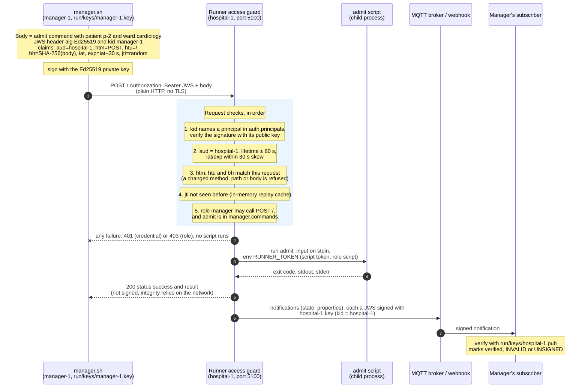

# Security of `./manager.sh admit p-2 cardiology`

The manager signs one request, the runner checks it, and the reply and
the notifications come back. The request is signed; the HTTP reply is
not. Sources: `tools/sign.mjs`, `src/auth/access.guard.ts`,
`src/auth/claims.ts`, `src/auth/roles.ts`, [SECURITY-MODEL.md](../../SECURITY-MODEL.md).

## What each scheme protects

| Step | Scheme | Stops |
| :--- | :----- | :---- |
| Signature | Ed25519 JWS, key of `manager-1` | a caller who is not a listed principal |
| `aud` | token names `hospital-1` | a token sent to another DT |
| `htm`, `htu`, `bh` | token binds method, path and body hash | tampering with, or re-pointing, the request |
| `iat`, `exp`, `jti` | at most 60 s, once only | replay of a captured request |
| Role | `manager`; `admit` is listed in `manager.commands` | the manager steering the DT beyond its rights (`/fsm/transition` gives 403) |
| `RUNNER_TOKEN` | random token, role `script` | scripts calling the runner as anyone else |
| Signed output | `auth.key` of the DT | forged notifications, MQTT replies and wills |

## What it does not cover

- The HTTP reply to the manager is not signed, and the runner serves
  plain HTTP. Anyone on the path can read the request and reply, or alter
  the reply. Put the runner behind TLS or a trusted network.
- The signed request is readable, so the body and token are visible,
  but the token is useless after one use or 30 s.
- A compromised runner process, or its scripts running as the same
  account, can read the signing key; see SECURITY-MODEL.md.
