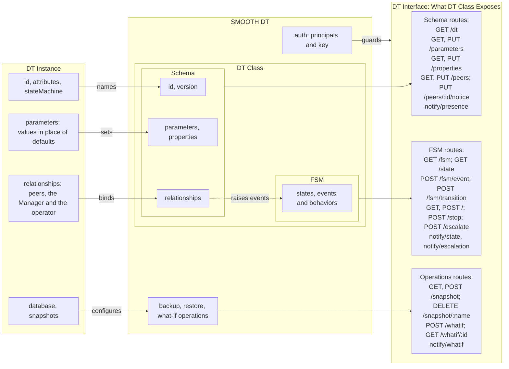
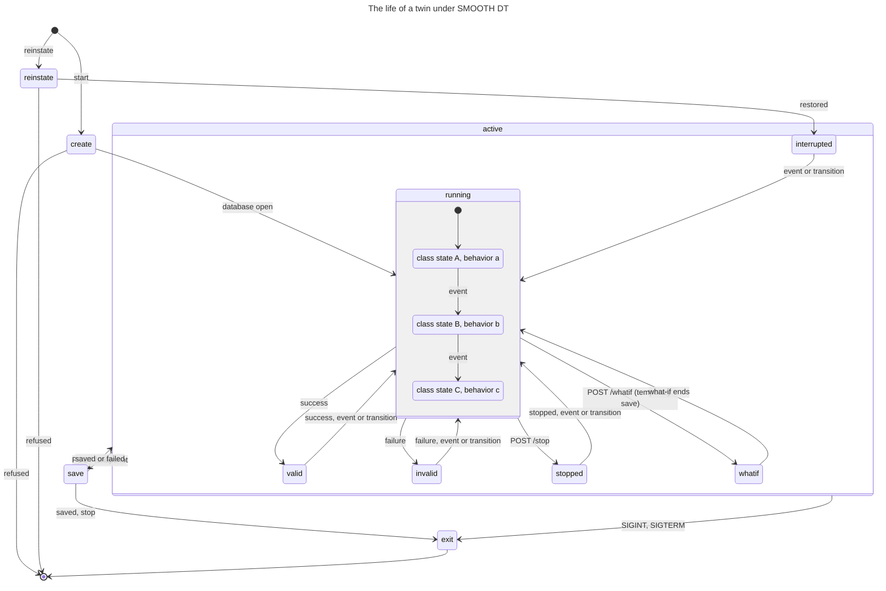

# Figures of the runner

This page holds two figures of the runner: the parts of a digital twin and
the interface they expose, and the life of a twin from start to exit. In
these figures, "SMOOTH DT" names the runner.

## The class, the instance and the interface




The DT Class is the state machine file. Its Schema declares the identity,
parameters, properties and relationships of the twin, and its FSM declares
the states, events and behaviors. The DT Instance, the `runner.yaml`, names
the class, sets the values of its parameters and binds its relationships to
peers, the Manager and the operator. Each part of SMOOTH DT feeds one box of
routes in the DT Interface, and `auth` guards all of them.

## The life of a twin




SMOOTH DT creates a twin and enters running, or reinstates a saved twin and
waits in interrupted until an event or a requested transition. Running
holds the states of the class, each with its behavior; a behavior that ends
leads to valid or invalid, and `POST /stop` leads to stopped. A what-if
starts from a temporary save and returns to running when it ends; the live
machine keeps running meanwhile, which a single state diagram can not show.
A save, or a signal, leaves the active states for exit.

## The life of a twin, in the stages of WLDT

```mermaid
---
title: The life of a twin under SMOOTH DT, in the stages of WLDT
config:
  look: classic
---
stateDiagram-v2
    [*] --> create : start
    [*] --> reinstate : reinstate
    create --> [*] : refused
    reinstate --> [*] : refused
    state "CREATED" as created {
        create
        reinstate
    }
    created --> started : database open or restored
    state "STARTED: active" as started {
        state "machine" as machine {
            [*] --> running : created
            [*] --> interrupted : reinstated
            interrupted --> running : event or transition
            state running {
                direction LR
                [*] --> A
                A --> B : event
                A : class state A, behavior a
                B : class state B, behavior b
            }
            running --> valid : success
            running --> invalid : failure
            state "stopped (Done)" as stopped
            running --> stopped : POST /stop
            valid --> running : success, event or transition
            invalid --> running : failure, event or transition
            stopped --> running : stopped, event or transition
            running --> whatif : POST /whatif
            whatif --> running : what-if ends
        }
        --
        state "binding" as binding {
            state "not bound" as unbound
            state "BOUND" as bound
            [*] --> unbound
            unbound --> bound : every peer online
            bound --> unbound : a peer offline
        }
        --
        state "shadowing" as shadowing {
            state "SYNCHRONIZED: shadowed" as sync
            state "NOT_SYNCHRONIZED: out of sync" as unsync
            [*] --> unsync
            unsync --> sync : POST /sync true (W6)
            sync --> unsync : POST /sync false (W6)
        }
    }
    started --> save : POST /snapshot
    save --> started : saved or failed
    state "STOPPED" as exit
    save --> exit : saved, stop
    started --> exit : SIGINT, SIGTERM
    state "DESTROYED" as destroyed
    exit --> destroyed : process ends
    destroyed --> [*]
```


WLDT keeps the lifecycle of a twin apart from its domain state
([wldt-research-notes.md](wldt-research-notes.md), W5). This figure draws the
life of a twin above in the stages of the WLDT `LifeCycleState`. Create and
reinstate are CREATED; the active states are STARTED; exit is STOPPED, and
the end of the process is DESTROYED. Inside STARTED, three regions run side
by side. The machine holds the states of the class, and its stopped state
plays the part of WLDT's Done: the behavior has ended but the twin still
serves requests. Binding follows the presence of the peers: the twin is
BOUND while every peer is online. Shadowing holds SYNCHRONIZED and
NOT_SYNCHRONIZED, which only a behavior declares, through the `POST /sync`
route that W6 proposes and the runner does not yet have.
