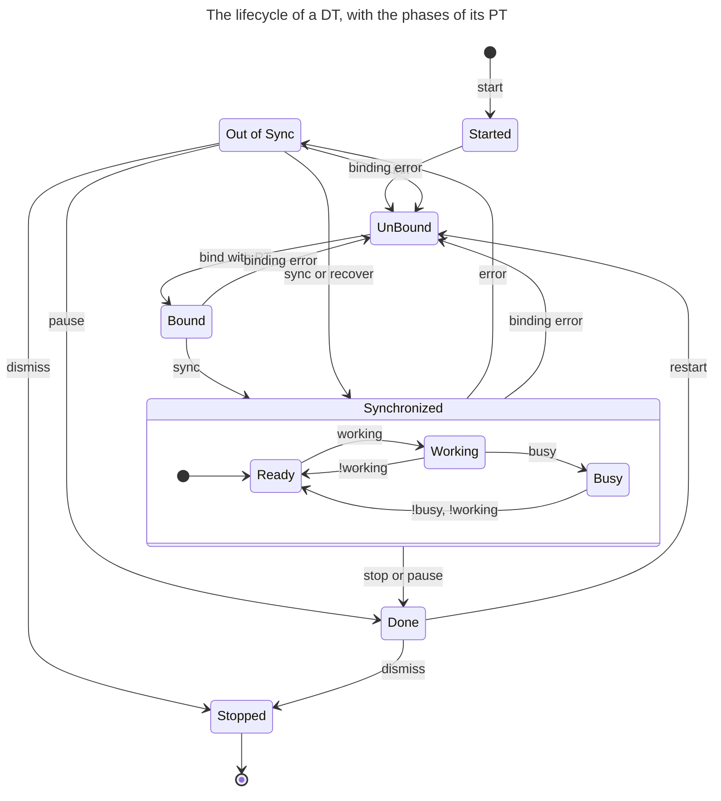
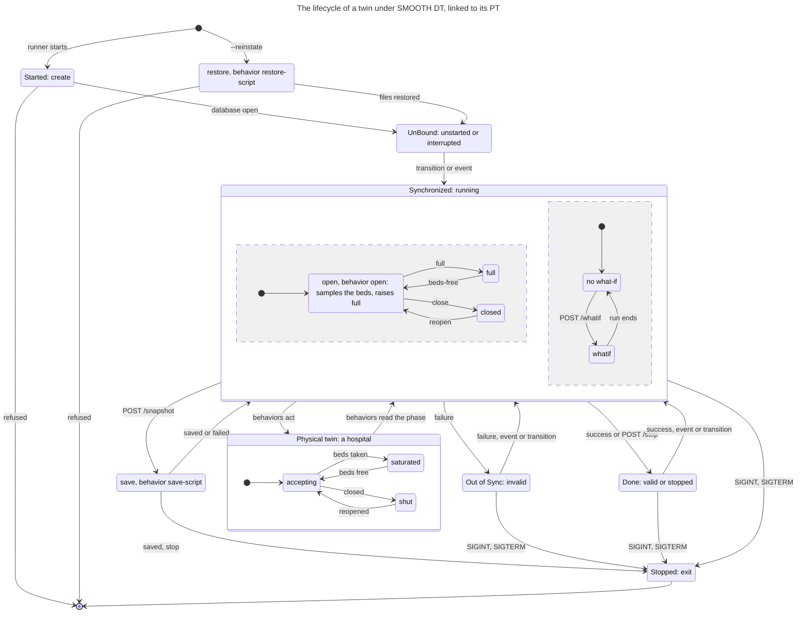

# The Lifecycles of the Physical and the Digital Twin

A digital twin (DT) has a lifecycle of its own as a piece of software,
and its physical twin (PT) has another as a machine, a room or a
hospital. This page summarises what five papers from the WLDT group say
about the two lifecycles and how they link, and then maps the state
machines of the runner, SMOOTH DT, onto that picture. The figures follow
the style of [The life of a twin](figures.md#the-life-of-a-twin), and
each has a drawio file beside its image in [figures/](figures).

## The Papers

| Key   | Paper                                                                                                                                                                                                        |
| :---- | :----------------------------------------------------------------------------------------------------------------------------------------------------------------------------------------------------------- |
| HARM  | Picone, Morandi, Barbone, Burattini, Fogli, Bicocchi, Giannelli, Ricci, "Harmonizing Physical and Digital Twins Lifecycles", ICSA-C 2025, doi:10.1109/ICSA-C65153.2025.00039                                 |
| ENT   | Bellavista, Bicocchi, Fogli, Giannelli, Mamei, Picone, "An Entanglement-Aware Middleware for Digital Twins", ACM Transactions on Internet of Things, 2024                                                    |
| FACES | Picone, Martinelli, Burattini, Giulianelli, Ricci, "The Two Faces of Interoperability: Bridging Cyber and Physical Spaces with Digital Twins", DCOSS-IoT 2025, doi:10.1109/DCOSS-IOT65416.2025.00078         |
| DTC   | Barbone, Burattini, Martinelli, Picone, Ricci, Virdis, "Digital Twin Continuum: a Key Enabler for Pervasive Cyber-Physical Environments", ICCCN 2024, doi:10.1109/ICCCN61486.2024.10637565                   |
| CERT  | Pietri, Martinelli, Turazza, Cavicchioli, Picone, Mamei, "Dynamic Certification of Industrial Digital Twins via Blockchain for Trusted Lifecycle Management", CCNC 2026, doi:10.1109/CCNC65079.2026.11366574 |

## The Lifecycle of the Digital Twin

HARM, ENT, FACES and DTC start from the lifecycle that WLDT
introduced (see [wldt-docs-and-paper.md](wldt-docs-and-paper.md),
section 1.2); CERT has a lifecycle of versions instead. HARM
calls its parts _phases_, so as not to confuse them with the _state_ of
the DT, which is the computed set of properties, events, relationships
and actions, `S_DT = <P, R, E, A, t>`.

- **Started.** The software is instantiated; it has no link with the PT.
- **UnBound.** The internal modules are ready to bind. The DT returns
  here after a binding error, a reboot or a restart.
- **Bound.** The DT reaches the PT and knows what the PT offers. FACES
  makes this step concrete: each physical adapter publishes a Physical
  Asset Description (PAD) once it is connected, and the model moves to
  Bound when it holds every PAD it needs. DTC says the same in the
  words of the orchestrator: bound once the physical interface confirms
  that the asset is ready and connected.
- **Synchronized.** The DT has enough correct data to compute
  `S_DT`. Only here does the DT mirror the PT.
- **Out of Sync.** Data arrive too late or too seldom, and `S_DT` is
  no longer updated. The DT returns to Synchronized when the issue
  clears.
- **Done.** Shadowing has stopped on purpose; the DT still serves its
  history and its last state.
- **Stopped.** The DT is dismissed and holds nothing any more.

ENT gives Synchronized and Out of Sync a measure. It names them
_Entangled_ and _Disentangled_, and moves between them by the Overall
Digital Twin Entanglement, `ODTE = timeliness x reliability x
availability`, against a threshold set by the application. DTC needs
the phase to be observable, because an orchestrator places and scales
DTs by it. CERT looks at a longer time scale: the versions of a DT are
created, updated, validated on a ledger and deprecated, and each state
change carries a hash, so the history of a DT can be audited.

FACES draws the same seven phases in its Figure 2, numbered from 1,
Start, to 7, Stop, with edges that HARM does not draw:

- `pause` leads from Synchronized, and also from Out of Sync, to Done,
  so a DT can stop shadowing on purpose whether or not it is in sync;
- `recover` leads from Out of Sync back to Synchronized;
- `restart` leads from Done back to UnBound, so Done is not a dead end:
  a paused DT binds again before it syncs again;
- only Done is dismissed to Stop, where HARM also dismisses an Out of
  Sync DT.

FACES also answers how UnBound becomes Bound, which it calls an open
question: the PAD of every physical adapter is the binding signal.

## The Lifecycle of the Physical Twin

The PT has phases of its own, which HARM writes `LP_PT`. Its example
is a machine that is Ready, Working or Busy; its industrial DTs add
Start, Resetting, Anomaly, Stopping, Stopped and End. A phase changes
what the DT should expect:

- a PT may send telemetry faster in one phase than in another, as a
  robot arm does during a precise task;
- the same reading may have another range, as an oven has while it
  warms up;
- a PT may send nothing for a while and still be healthy, as when it
  reboots.

A DT that does not know the phase of its PT reads these changes as
failures, and falls Out of Sync when nothing is wrong.

## How the Two Lifecycles Link

HARM nests the lifecycle of the PT inside the Synchronized phase of the
DT. Figure 1 draws its Figure 2 together with the edges of Figure 2 of
FACES. The phase of the DT is then a pair, the phase of the software
and the phase of the PT:

`LP_DT(t) = <LP_PT(t), LP_Soft(t)>`

At any time `t` the DT exposes `<LP_DT(t), S_DT(t), H>`, where `H`
is its history. What each part holds depends on the software phase:

| Software phase   | `LP_PT` | `S_DT`  | History `H`                                 |
| :--------------- | :------ | :------ | :------------------------------------------ |
| Started, Stopped | empty   | empty   | empty                                       |
| UnBound, Bound   | empty   | empty   | from the first sync to the last one         |
| Synchronized     | current | current | from the first sync to now                  |
| Out of Sync      | empty   | empty   | from the first sync to the last one         |
| Done             | empty   | empty   | from the first sync to the end of shadowing |

So the link runs both ways. The PT phase sets the expectations, rate
and ranges, against which the DT judges whether it is still in sync;
and only a synchronized DT can say which phase the PT is in. ENT's
availability factor is where the two meet: a PT that is silent in a
phase that allows silence should not count as unavailable.

_Figure 1. The lifecycle of a DT, after Figure 2 of HARM and Figure 2
of FACES. The PT phases and their events follow Figure 4 of HARM,
where `!working` reads "no longer working"._

## The Runner in This Picture

The runner has three state machines, documented in
[STATE-MACHINE.md](../STATE-MACHINE.md) and
[state-machine-design.md](state-machine-design.md):

- the **life of a twin**: create or reinstate, the active states, save
  and exit ([figures.md](figures.md#the-life-of-a-twin));
- the **machine of `FsmService`**: Unstarted, Running, Idle and
  Stopping, with the status `valid`, `invalid`, `stopped` or
  `interrupted` of the last behavior;
- the **class states**: the states of the state machine file, each with
  a behavior, the script of the same name.

The first two are the software lifecycle, `LP_Soft`. The class
states are where the PT lifecycle, `LP_PT`, belongs: in the hospital
demo (`demo/hospital/hospital.fsm.yaml`) the states `open`, `full`
and `closed` are the phases of the hospital, and the behaviors of
those states read and act on it. The behavior `open`, for one, samples
the free beds, writes them as a property and raises `full` when none
is left.

| Phase of the papers | Runner                                      | Note                                                                                   |
| :------------------ | :------------------------------------------ | :------------------------------------------------------------------------------------- |
| Started             | create, or restore after `--reinstate`      | the file is checked and the database opens; restore runs the behavior `restore-script` |
| UnBound             | Unstarted, or `interrupted` after reinstate | reinstate keeps the history but has no live state, as HARM's UnBound does              |
| Bound               | none                                        | no step checks that the PT is reachable; peer presence binds DTs, not the PT           |
| Synchronized        | Running, in a class state                   | the class state is `LP_PT`; the runner does not check the rate of data (W5, W6)        |
| Out of Sync         | `invalid`, after `failure`                  | a failed behavior, not a measured loss of sync                                         |
| Done                | `valid` after `success`, or `stopped`       | the behavior ended or was stopped; the DT still answers, and `GET /history` serves H   |
| Stopped             | exit                                        | after `SIGINT`, `SIGTERM` or a save with stop                                          |

Figure 2 draws this mapping, simplified, in the layout of Figure 4 of
HARM. Restore and save lie outside Synchronized: restore runs the
behavior `restore-script` before the twin starts, and `POST
/snapshot` saves through `save-script` and returns, or exits after a
save with stop. A what-if runs inside Synchronized, in a region of its
own, because the live machine keeps running beside the copy that
`POST /whatif` starts. A `failure` or `success` with a
transition in the file moves the machine on to the next class state;
without one, the machine stays in `invalid` or `valid`. From Done the
runner goes straight back to Synchronized on an event or a transition,
where FACES restarts through UnBound and binds again: the runner has
no binding step to repeat. `POST /stop` is the `pause` of FACES. On
the left, the PT has phases of its own, which the states of the class
mirror: `open` for accepting, `full` for saturated and `closed` for
shut.

_Figure 2. The lifecycle of a twin under SMOOTH DT, linked to its PT._

## What the Mapping Shows

- **The runner models the PT phases, not the DT phases.** Its class
  states are the `LP_PT` of HARM, written by the author of the twin.
  Its software lifecycle is implicit, spread over presence, health and
  the behavior status; W5 of
  [wldt-research-notes.md](wldt-research-notes.md) proposes a
  `lifecycle` field to make it explicit.
- **Bound and Synchronized need the PT.** The runner only knows that a
  behavior runs, not whether data arrive in time. W6 proposes that the
  behavior declare sync itself; ENT's ODTE would let the runner measure
  it.
- **Out of Sync should depend on the phase.** If sync is measured, the
  expected rate and range should come from the class state, as HARM
  asks, so that a hospital that is `closed` and silent is not out of
  sync.
- **The history is kept in every phase but Stopped**, as HARM's table
  asks: the runner stores it in its database and serves it until exit.

## Figure Sources

