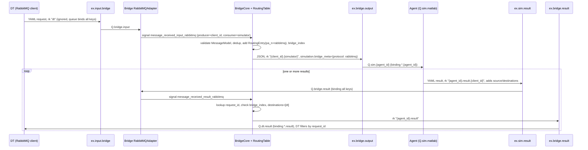
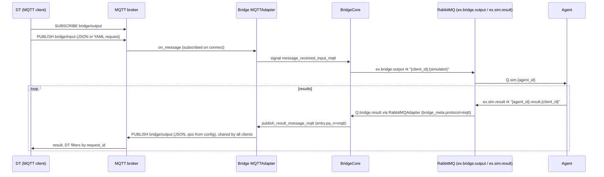
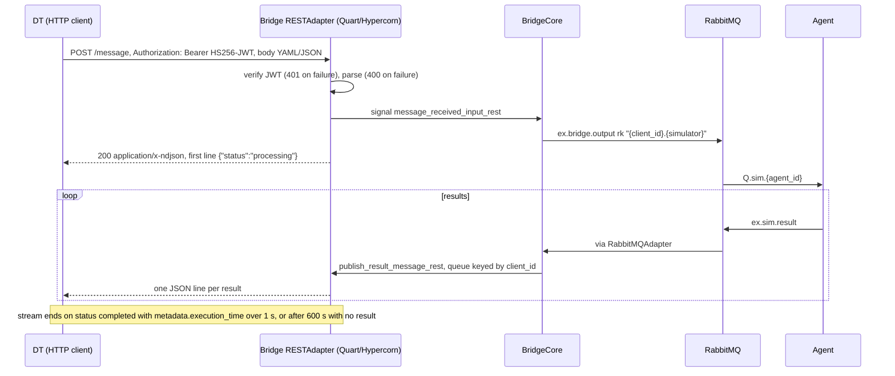
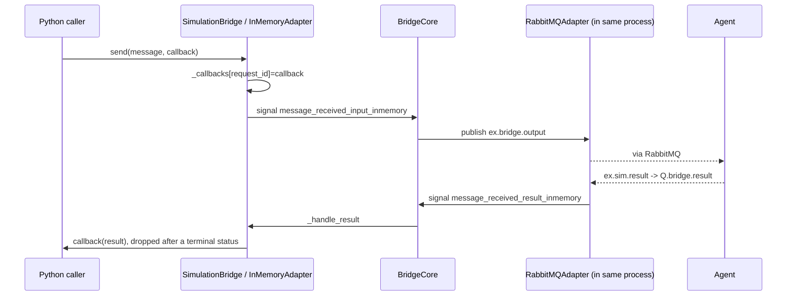
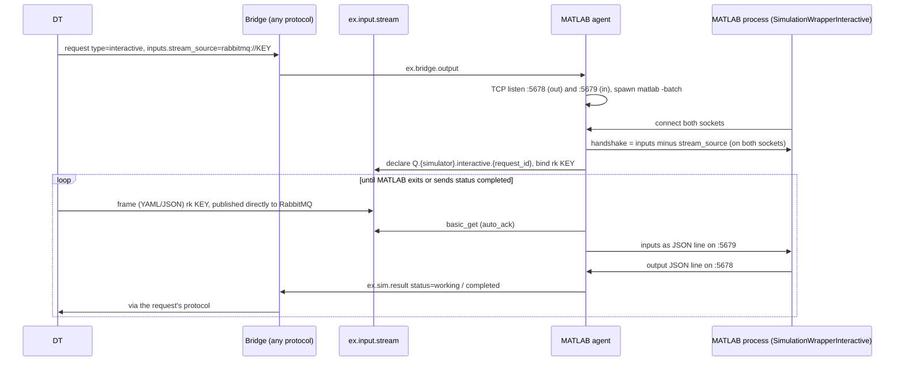

# INTO-CPS Simulation Bridge: Architectural and Protocol Map

Repository: <https://github.com/into-cps-association/simulation-bridge>, commit
`52e7ba5` (2026-06-18). Nothing was installed, built or run; every statement
comes from reading the files. What the runner can take from it is in
[integrated-simulations.md](integrated-simulations.md).

Conventions:

- Each claim cites `path:line` or `path:start-end`, relative to the repository
  root.
- Statements marked _inference_ are my own reading of the code: a consequence, a
  bug or a contradiction that the repository does not state.
- Where the repository's documentation and its code disagree, the code is the
  authority and the disagreement is noted.
- Short file names are used after first mention. They resolve as follows:
  - Bridge files (`bridge_core.py`, `bridge_publisher.py`, `routing_table.py`,
    `*_adapter.py`, `signal_manager.py`, `certs.py`, `models.py`,
    `adapters_signal.json`, `inmemory_signal.json`) are under
    `simulation_bridge/src/`.
  - `config_manager.py` and `config_loader.py` in sections 2 and 6, and
    `config/config.yaml.template`, are the bridge's.
  - Agent files (`message_handler.py`, `rabbitmq_manager.py`, `batch.py`,
    `streaming.py`, `interactive.py`, `matlab_simulator.py`,
    `create_response.py`, `constants.py`, `connect.py`, `agent.py`) are the
    MATLAB agent's, under `agents/matlab/matlab_agent/src/`.
  - Simul8 files are given with their full path, or named with a `simul8`
    qualifier in section 4.5, where `batch.py`, `simul8_simulator.py`,
    `csv_parser.py` and `message_handler.py` mean
    `agents/simul8/simul8_agent/src/...`.
  - `*.m` wrappers are under `agents/matlab/matlab_agent/resources/`. Example
    `.m` and `.yaml.example` files are under
    `agents/matlab/matlab_agent/docs/examples/`.
  - Client files `mqtt_client.py`, `rabbitmq_client.py`, `rest_client.py` and
    `inmemory_client.py`, and their `*_use.yaml.template`, are under
    `simulation_bridge/resources/<protocol>/`. `use_matlab_agent_*.py` are under
    `agents/matlab/matlab_agent/resources/`.

---

## 1. Purpose and components

### 1.1 Purpose

The bridge is "a modular, reusable, and bidirectional middleware" that receives
inputs from Digital Twins (DTs) or Physical Twins (PTs), routes them to
simulators through _Simulator Agents_, and returns the results
(`README.md:3-7`). The design document describes it as an event-driven
middleware that "normalizes and routes [requests] to simulator agents via
RabbitMQ, and forwards simulator results back to the originating
protocol/client" (`DESIGN.md:5`). RabbitMQ is the only transport between the
bridge and the agents (`DESIGN.md:14`, `.github/copilot-instructions.md:12`).

The system has three kinds of component:

| Component                                 | Role                                                                                                                                                                             | Evidence                                                                    |
| :---------------------------------------- | :------------------------------------------------------------------------------------------------------------------------------------------------------------------------------- | :-------------------------------------------------------------------------- |
| Bridge (`simulation_bridge/`)             | Protocol adapters on the client side (north-bound: RabbitMQ, MQTT, REST, in-memory). RabbitMQ on the agent side (south-bound). A routing table correlates results with requests. | `DESIGN.md:9-14`, `DESIGN.md:111-126`                                       |
| Clients (DT / PT / MockPT)                | Send a `simulation:` request through one protocol and receive results through the same protocol                                                                                  | `simulation_bridge/docs/internal_architecture.md:9-47`                      |
| Agents (`agents/matlab`, `agents/simul8`) | One process per simulator. Each consumes its own RabbitMQ queue, runs the simulator and publishes results                                                                        | `README.md:36`, `agents/matlab/DESIGN.md:5`, `agents/simul8/README.md:3-12` |

### 1.2 Versions, Python and dependencies

| Package             | Version                                                                                 | Python                                      | Key runtime dependencies                                                                                                                                                   |
| :------------------ | :-------------------------------------------------------------------------------------- | :------------------------------------------ | :------------------------------------------------------------------------------------------------------------------------------------------------------------------------- |
| `simulation-bridge` | 0.2.0 (`pyproject.toml:3`)                                                              | `^3.12` (`pyproject.toml:29`)               | blinker, pika, paho-mqtt `>=2.1,<3`, quart, hypercorn, pyjwt[crypto], pydantic 2, cryptography, psutil, colorlog (`pyproject.toml:16-33`)                                  |
| `matlab-agent`      | 1.0.1 (`agents/matlab/pyproject.toml:3`, `agents/matlab/matlab_agent/__version__.py:1`) | `^3.10` (`agents/matlab/pyproject.toml:12`) | pika, pydantic, pyyaml, psutil, click, colorlog (`agents/matlab/pyproject.toml:11-20`). The MATLAB Engine API is installed separately (`agents/matlab/README.md:111-133`). |
| `simul8-agent`      | 0.1.0 (`agents/simul8/pyproject.toml:3`)                                                | `^3.10` (`agents/simul8/pyproject.toml:12`) | As for MATLAB, plus `pywin32 310` on win32 only (`agents/simul8/pyproject.toml:21`)                                                                                        |

Locked bridge versions: paho-mqtt 2.1.0 (`poetry.lock:1192-1193`), pika 1.4.1
(`poetry.lock:1224-1225`), quart 0.20.0 (`poetry.lock:1766-1767`), hypercorn
0.17.3 (`poetry.lock:776-777`), pyjwt 2.13.0 (`poetry.lock:1523-1524`), pydantic
2.13.4 (`poetry.lock:1341-1342`), blinker 1.9.0 (`poetry.lock:125-126`).

_Inference_: `fastapi`, `uvicorn`, `requests` and `httpx` are declared as bridge
runtime dependencies (`pyproject.toml:19-30`), but no module under
`simulation_bridge/src` imports them.

_Inference_: the MATLAB agent effectively needs Python 3.12, although it
declares `^3.10`. `agents/matlab/matlab_agent/src/core/interactive.py:164-167`
puts newlines inside f-string replacement fields, which only PEP 701 (Python
3.12) allows. The bridge does the same at
`simulation_bridge/src/protocol_adapters/rest/rest_adapter.py:306-307` and
`:332-333`, which is consistent with its `^3.12`. CI runs Python 3.12 throughout
(`.github/workflows/simulation-bridge-ci.yml:23`,
`.github/workflows/matlab-agent-ci.yml:28`,
`.github/workflows/simul8-agent-ci.yml:28`).

### 1.3 Package layout: bridge (`simulation_bridge/`)

| Module                                               | One-line purpose                                                                                                                                                                                               |
| :--------------------------------------------------- | :------------------------------------------------------------------------------------------------------------------------------------------------------------------------------------------------------------- |
| `__init__.py`                                        | Exports `SimulationBridge`, the in-memory facade (`simulation_bridge/__init__.py:2-4`)                                                                                                                         |
| `src/main.py`                                        | Click CLI `simulation-bridge` with `--config-file/-c`, `--generate-config` and `--generate-project`; starts `BridgeOrchestrator` (`src/main.py:17-84`; script entry `pyproject.toml:50-51`)                    |
| `src/core/bridge_orchestrator.py`                    | Lifecycle: loads config, ensures TLS certs, declares RabbitMQ infrastructure, imports and instantiates the enabled adapters, wires signals, polls adapter liveness every 60 s (`:25-46`, `:48-99`, `:111-138`) |
| `src/core/bridge_core.py`                            | Validates, deduplicates and registers requests, publishes them to `ex.bridge.output`, routes results to the north-bound adapter (`:28-270`)                                                                    |
| `src/core/bridge_publisher.py`                       | Persistent pika publisher. Routing key `{producer}.{consumer}`, injects `simulation.bridge_meta`, retries once after reconnect (`:20-154`)                                                                     |
| `src/core/bridge_infrastructure.py`                  | Declares the exchanges, queues and bindings listed in config (`:15-150`)                                                                                                                                       |
| `src/core/models.py`                                 | Pydantic `SimulationModel` and `MessageModel`: the request schema (`:16-32`)                                                                                                                                   |
| `src/core/routing_table.py`                          | `RoutingTable`, `RoutingEntry`, the `SeedPool` and `generate_bridge_index` (anti-spoofing) (`:27-238`)                                                                                                         |
| `src/protocol_adapters/base/protocol_adapter.py`     | ABC with `_get_config`, `start`, `stop`, `_handle_message` and `is_running` (`:11-75`)                                                                                                                         |
| `src/protocol_adapters/rabbitmq/rabbitmq_adapter.py` | Consumes `Q.bridge.input` and `Q.bridge.result`, emits blinker signals (`:19-200`)                                                                                                                             |
| `src/protocol_adapters/mqtt/mqtt_adapter.py`         | Subscribes to the input topic and publishes results to the output topic (`:22-273`)                                                                                                                            |
| `src/protocol_adapters/rest/rest_adapter.py`         | Quart/Hypercorn `POST {endpoint}` with JWT check; streams NDJSON results (`:21-393`)                                                                                                                           |
| `src/protocol_adapters/inmemory/inmemory_adapter.py` | `InMemoryAdapter` (per-request callbacks) and the `SimulationBridge` facade (`:18-121`)                                                                                                                        |
| `src/protocol_adapters/adapters_signal.json`         | Adapter classes and signal-to-handler map for network mode (`:1-29`)                                                                                                                                           |
| `src/protocol_adapters/inmemory_signal.json`         | The same for in-memory mode: RabbitMQ and in-memory only (`:1-21`)                                                                                                                                             |
| `src/utils/config_loader.py`                         | YAML load, `${VAR}`/`${VAR:default}` substitution, selection of the protocol JSON (`:20-110`)                                                                                                                  |
| `src/utils/config_manager.py`                        | Pydantic config models; falls back to defaults on any load or validation error (`:18-321`)                                                                                                                     |
| `src/utils/signal_manager.py`                        | Connects and disconnects blinker signals named in the protocol JSON (`:14-170`)                                                                                                                                |
| `src/utils/certs.py`                                 | Self-signed RSA-2048/SHA-256 cert and key generation and validation for REST TLS (`:18-368`)                                                                                                                   |
| `src/utils/logger.py`                                | Rotating file log (5 MB × 3) plus coloured console (`:22-23`, `:59-62`)                                                                                                                                        |
| `src/utils/performance_monitor.py`                   | Singleton timing, CPU and RSS metrics to CSV (`:81-366`; columns in `docs/performance.md:21-41`)                                                                                                               |
| `src/utils/template.py`                              | `--generate-config` / `--generate-project` file copying (`:107-227`)                                                                                                                                           |
| `config/config.yaml.template`                        | Default config (`:1-92`)                                                                                                                                                                                       |
| `resources/{mqtt,rabbitmq,rest,inmemory}/`           | Example clients and their `*_use.yaml` templates (section 7)                                                                                                                                                   |
| `resources/simulation.yaml.template`                 | Example request payload (`:1-45`)                                                                                                                                                                              |
| `docs/`                                              | `internal_architecture.md`, `class_diagram.md`, `inmemory_adapter.md`, `performance.md`                                                                                                                        |
| `test/unit`, `test/integration`                      | pytest suites: 348 `test_` functions across both (section 8.4)                                                                                                                                                 |

Repository-level documents: `DESIGN.md` (design and routing table), `QUEUES.md`
(exchanges, queues and bindings), `USERGUIDE.md` (install, configuration, CLI).
`performance/performance_analysis.py` summarises the bridge's metrics CSV per
protocol and simulation type (`performance/README.md:3-10`).

### 1.4 Package layout: MATLAB agent (`agents/matlab/matlab_agent/`)

| Module                                                                                       | One-line purpose                                                                                                                                         |
| :------------------------------------------------------------------------------------------- | :------------------------------------------------------------------------------------------------------------------------------------------------------- |
| `src/main.py`                                                                                | Click CLI `matlab-agent` with `-c`, `--generate-config` and `--generate-project`; reads `agent.agent_id` and starts `MatlabAgent` (`:21-58`, `:201-226`) |
| `src/core/agent.py`                                                                          | `MatlabAgent`: config, `PerformanceMonitor`, `Connect`; `start()` runs the blocking consume loop (`:20-110`)                                             |
| `src/core/batch.py`                                                                          | Batch mode through the MATLAB Engine API (`:24-220`)                                                                                                     |
| `src/core/streaming.py`                                                                      | Streaming mode: TCP server, `matlab -batch` subprocess, NDJSON relay (`:29-389`)                                                                         |
| `src/core/interactive.py`                                                                    | Interactive mode: two TCP servers plus an input queue on `ex.input.stream` (`:42-374`)                                                                   |
| `src/core/matlab_simulator.py`                                                               | MATLAB Engine lifecycle, argument ordering, type conversion (`:31-234`)                                                                                  |
| `src/comm/connect.py`                                                                        | Broker-agnostic wrapper; only `rabbitmq` is implemented (`:18-191`, `:51-57`)                                                                            |
| `src/comm/interfaces.py`, `src/comm/rabbitmq/interfaces.py`                                  | Broker and handler ABCs                                                                                                                                  |
| `src/comm/rabbitmq/rabbitmq_manager.py`                                                      | Connect with retry, declare the input queue, consume, `send_result` (`:22-331`)                                                                          |
| `src/comm/rabbitmq/message_handler.py`                                                       | YAML parse, Pydantic validation, dispatch on `simulation.type`, ack/nack (`:25-276`)                                                                     |
| `src/interfaces/agent.py`, `src/interfaces/config_manager.py`                                | ABCs                                                                                                                                                     |
| `src/utils/config_loader.py` / `config_manager.py`                                           | YAML plus env substitution; flat Pydantic `Config` with defaults (`agents/matlab/matlab_agent/src/utils/config_manager.py:26-160`)                       |
| `src/utils/constants.py`                                                                     | TCP defaults 5678/5679, accept timeout 60 s, `ex.input.stream` (`:4-23`)                                                                                 |
| `src/utils/create_response.py`                                                               | The single result-message builder (`:87-159`)                                                                                                            |
| `src/utils/logger.py`, `src/utils/performance_monitor.py`                                    | Rotating log; per-operation CSV metrics                                                                                                                  |
| `resources/SimulationWrapperStreaming.m`, `resources/SimulationWrapperInteractive.m`         | MATLAB-side TCP wrappers                                                                                                                                 |
| `resources/use_matlab_agent_{batch,streaming,interactive}.py`, `resources/use.yaml.template` | Clients that talk to the agent directly, bypassing the bridge                                                                                            |
| `resources/config/default.yaml.template`                                                     | TCP settings read by the streaming wrapper                                                                                                               |
| `api/simulation.yaml.template`, `config/config.yaml.template`                                | Request and agent-config templates                                                                                                                       |
| `docs/README.md`, `docs/interactive.md`, `docs/examples/*`                                   | Per-mode constraints and examples (batch, streaming, interactive, robotic arm, cooling-fan anomaly detection)                                            |

### 1.5 Package layout: Simul8 agent (`agents/simul8/simul8_agent/`)

The communication layer and utilities are copies of the MATLAB agent's.
`create_response.py` is identical apart from names, and `rabbitmq_manager.py`
differs only in log branches (diffed). The modules that differ:

| Module                                 | One-line purpose                                                                                    |
| :------------------------------------- | :-------------------------------------------------------------------------------------------------- |
| `src/core/batch.py`                    | Batch only (`:26-213`)                                                                              |
| `src/core/simul8_simulator.py`         | COM automation of `Simul8.S8Simulation` through `win32com`/`pythoncom`; CSV in, CSV out (`:38-478`) |
| `src/utils/csv_parser.py`              | Validates the `{columns, r1, r2, ...}` input structure and writes `input.csv` (`:15-140`)           |
| `src/comm/rabbitmq/message_handler.py` | Accepts `batch` or `streaming` in validation (`:45`) but dispatches only `batch` (`:189-214`)       |
| `resources/use_simul8_agent_batch.py`  | Direct-to-agent client (`:84-101`)                                                                  |

---

## 2. Architecture and data flow

### 2.1 Protocols the bridge accepts from clients

| North-bound protocol             | Entry point                                                                      | Enabled by                                                                     | Evidence                                                               |
| :------------------------------- | :------------------------------------------------------------------------------- | :----------------------------------------------------------------------------- | :--------------------------------------------------------------------- |
| RabbitMQ (AMQP/AMQPS)            | Publish to exchange `ex.input.bridge` (any routing key) → queue `Q.bridge.input` | Always present in both protocol JSONs                                          | `config/config.yaml.template:17-22,42-56`; `adapters_signal.json:3-11` |
| MQTT (mqtt/mqtts)                | Publish to topic `mqtt.input_topic` (default `bridge/input`)                     | `adapters_signal.json` `"enabled": true`                                       | `config/config.yaml.template:62-71`; `adapters_signal.json:12-19`      |
| REST (HTTP/1.1 or HTTP/2, HTTPS) | `POST {rest.endpoint}` (default `/message`) with Bearer JWT                      | as above                                                                       | `rest_adapter.py:55`, `:205`; `config/config.yaml.template:73-83`      |
| In-memory (Python callback)      | `SimulationBridge(config).send(msg, callback)`                                   | `simulation_bridge.in_memory_mode: true`, which selects `inmemory_signal.json` | `config_loader.py:91-110`; `inmemory_adapter.py:88-121`                |

Adapters are switched on and off by the `"enabled"` flags in the packaged JSON
files (`signal_manager.py:40-47`), not by `config.yaml`. `config.yaml` must
still contain complete `mqtt` and `rest` sections, because the `Config` model
requires every section (`config_manager.py:126-135`). _Inference_: in network
mode all three adapters always run. Switching one off means editing the
installed package's JSON.

### 2.2 RabbitMQ topology (exact names)

Exchanges declared by the bridge from config, all `topic`, durable, not
auto-delete (`config/config.yaml.template:16-40`,
`bridge_infrastructure.py:101-117`):

| Exchange           | Producer → consumer          | Purpose                                                                                                                                            |
| :----------------- | :--------------------------- | :------------------------------------------------------------------------------------------------------------------------------------------------- |
| `ex.input.bridge`  | RabbitMQ clients → bridge    | Requests                                                                                                                                           |
| `ex.bridge.output` | Bridge → agents              | Normalised requests (`bridge_core.py:252`, `bridge_publisher.py:88`)                                                                               |
| `ex.sim.result`    | Agents → bridge              | Results (`agents/matlab/matlab_agent/config/config.yaml.template:17-19`)                                                                           |
| `ex.bridge.result` | Bridge → RabbitMQ clients    | Results (`bridge_core.py:222-226`)                                                                                                                 |
| `ex.input.stream`  | Any publisher → MATLAB agent | Interactive input frames; declared by the agent, not the bridge (`agents/matlab/matlab_agent/src/utils/constants.py:23`, `interactive.py:262-265`) |

Queues and bindings:

| Queue                                               | Declared by                                                                                            | Bound to           | Binding key                                           | Evidence                                                                          |
| :-------------------------------------------------- | :----------------------------------------------------------------------------------------------------- | :----------------- | :---------------------------------------------------- | :-------------------------------------------------------------------------------- |
| `Q.bridge.input`                                    | Bridge                                                                                                 | `ex.input.bridge`  | `#`                                                   | `config/config.yaml.template:43-56`                                               |
| `Q.bridge.result`                                   | Bridge                                                                                                 | `ex.sim.result`    | `#`                                                   | `config/config.yaml.template:48-60`                                               |
| `Q.sim.{agent_id}` (`Q.sim.matlab`, `Q.sim.simul8`) | Agent                                                                                                  | `ex.bridge.output` | `*.{agent_id}`                                        | `rabbitmq_manager.py:40`, `:151-161`                                              |
| `Q.{agent_id}.interactive.{request_id}`             | MATLAB agent, per interactive run (`agent_id` here is the request's `simulator`, `interactive.py:339`) | `ex.input.stream`  | `stream_source` with the `rabbitmq://` prefix removed | `interactive.py:258-270`                                                          |
| `Q.{dt_id}.result` (example client)                 | RabbitMQ client                                                                                        | `ex.bridge.result` | `*.result`                                            | `resources/rabbitmq/rabbitmq_client.py:86-96`; `rabbitmq_use.yaml.template:20-23` |

Routing-key patterns:

| Hop                         | Routing key                                                                                                                                                 | Evidence                                                                                                                               |
| :-------------------------- | :---------------------------------------------------------------------------------------------------------------------------------------------------------- | :------------------------------------------------------------------------------------------------------------------------------------- |
| Client → `ex.input.bridge`  | Anything. The example uses `digital_twin.routing_key_send`, default `dt`. The bridge binds `#`, so the key is ignored.                                      | `rabbitmq_client.py:105-116`; `config/config.yaml.template:54-56`                                                                      |
| Bridge → `ex.bridge.output` | `{client_id}.{simulator}`, built as `f"{producer}.{consumer}"`, where each adapter sets producer=`simulation.client_id` and consumer=`simulation.simulator` | `bridge_publisher.py:96`; `rabbitmq_adapter.py:97-98`; `mqtt_adapter.py:138-139`; `rest_adapter.py:95-96`; `inmemory_adapter.py:42-43` |
| Agent → `ex.sim.result`     | `{agent_id}.result.{destination}`, where `destination` is the first dot-segment of the incoming routing key, i.e. `client_id`                               | `rabbitmq_manager.py:295-296`; `message_handler.py:132`                                                                                |
| Bridge → `ex.bridge.result` | `{source}.result`, where `source` is the agent id the agent wrote into the result (for example `matlab.result`)                                             | `bridge_core.py:221-226`; `rabbitmq_manager.py:283-287`                                                                                |

QoS and persistence: agents set `prefetch_count` from config (default 1)
(`rabbitmq_manager.py:166-169`); the bridge sets no prefetch
(`QUEUES.md:211-216`). Bridge and agents publish with `delivery_mode=2`
(`bridge_publisher.py:113-120`, `rabbitmq_manager.py:298-302`). The bridge
acknowledges after the signal handler returns and nacks without requeue on any
exception (`rabbitmq_adapter.py:136-156`).

### 2.3 How the destination agent is chosen

**Not by MQTT topic.** For every north-bound protocol the agent is selected by
the request body's `simulation.simulator` field:

1. Each adapter extracts `consumer = simulation.simulator`
   (`rabbitmq_adapter.py:98`, `mqtt_adapter.py:139`, `rest_adapter.py:96`,
   `inmemory_adapter.py:43`).
2. `BridgeCore.handle_input_message` reads `consumer` from the signal's kwargs
   and publishes with it (`bridge_core.py:69-75`). The publisher builds routing
   key `{client_id}.{simulator}` on `ex.bridge.output`
   (`bridge_publisher.py:96`).
3. Each agent's queue `Q.sim.{agent_id}` is bound with `*.{agent_id}`
   (`rabbitmq_manager.py:157-161`). `agent_id` comes from `agent.agent_id` in
   the agent's config (`agents/matlab/matlab_agent/src/main.py:212`). The config
   also has `agent.simulator`
   (`agents/matlab/matlab_agent/config/config.yaml.template:3`), which the agent
   never reads: the Pydantic `Config` has no such field
   (`agents/matlab/matlab_agent/src/utils/config_manager.py:26-31`).

So `simulation.simulator` must equal the target agent's `agent_id`. MQTT uses
one fixed input topic (`mqtt_adapter.py:53`, `:88-90`), REST one fixed path,
RabbitMQ one exchange whose routing key is ignored.

_Inference_: because AMQP topic `*` matches exactly one word, a `client_id` or
`simulator` containing `.` gives a routing key that matches no agent binding,
and RabbitMQ drops the unroutable message silently: the publish is not
`mandatory`, `bridge_publisher.py:113-120`. A `simulator` with no running agent
(no bound queue) is dropped the same way. The client receives nothing in either
case.

### 2.4 How results return to the right client

1. **Registration.** On input, `BridgeCore` records a `RoutingEntry` keyed by
   `request_id`, with `pa_n` (north-bound protocol), `dt` (`client_id`),
   `sim_type`, timeout and a random `bridge_index` (`bridge_core.py:109-124`,
   `routing_table.py:118-133`).
2. **Correlation.** Agents copy `request_id` and `bridge_meta` from the request
   into every result (`create_response.py:112-123`, `batch.py:51-52`,
   `streaming.py:58-59`, `interactive.py:337-338`).
3. **Dispatch.** The bridge consumes `Q.bridge.result`, reads the result's
   top-level `bridge_meta.protocol` and emits
   `message_received_result_{protocol}`, or `..._unknown`
   (`rabbitmq_adapter.py:111-134`). Every one of these signals ends in
   `BridgeCore.handle_result_message` (`adapters_signal.json:6-24`).
4. **Routing.** `handle_result_message` looks the entry up by `request_id`
   alone, checks `bridge_index` if the result carries one, replaces
   `destinations` with `[entry.dt]`, and delivers through the adapter recorded
   in `entry.pa_n` (`bridge_core.py:149-180`). The protocol named in the
   result's `bridge_meta` is therefore only a hint; the routing table decides.
5. **Delivery per protocol** (`bridge_core.py:14-18`, `:218-244`):
   - `rabbitmq`: republished to `ex.bridge.result` with key `{agent_id}.result`.
   - `mqtt`: `MQTTAdapter.publish_result_message_mqtt` publishes JSON to the
     single `output_topic` (`mqtt_adapter.py:225-250`).
   - `rest`: `RESTAdapter.publish_result_message_rest` places the result on the
     asyncio queue of the open stream keyed by `destinations[0]` (= `client_id`)
     (`rest_adapter.py:252-274`, `:224-241`).
   - `inmemory`: `InMemoryAdapter._handle_result` calls the callback registered
     for `request_id` (`inmemory_adapter.py:47-70`).
6. **Removal.** A `batch` entry is removed on the first terminal status
   (`completed`, `failed`, `error`, `aborted`, `cancelled`). `streaming` and
   `interactive` entries stay until their timeout expires
   (`bridge_core.py:19-23`, `:182-193`). Expired entries are purged on each
   input and result (`bridge_core.py:63`, `:153`; `routing_table.py:171-211`). A
   result with no live entry is dropped with a warning
   (`bridge_core.py:167-172`).

_Inference_ (isolation): the bridge correlates by `request_id`, but the last hop
is not per-client for two protocols.

- **MQTT** publishes every result for every client to the one `bridge/output`
  topic (`mqtt_adapter.py:235-240`).
- **RabbitMQ** publishes with routing key `{agent_id}.result`, which carries no
  client id, and the example client queue binds `*.result`
  (`rabbitmq_use.yaml.template:23`). Every DT queue bound that way receives
  every DT's results.

In both cases the client must filter on `request_id` or `destinations`. This is
how `QUEUES.md:143-147` describes it too.

### 2.5 Sequence diagrams

The diagrams below cite the code that implements each arrow in the lists above
them. They are drawn from the code, not copied from the repository.

#### RabbitMQ client



Code: `rabbitmq_client.py:98-116`; `rabbitmq_adapter.py:93-109,142-149`;
`bridge_core.py:51-75,142-147`; `bridge_publisher.py:96-102`;
`rabbitmq_manager.py:157-161,268-316`; `rabbitmq_adapter.py:111-134`;
`bridge_core.py:149-163,218-228`; `rabbitmq_client.py:86-96,137-144`.

#### MQTT client



Code: `mqtt_client.py:92-117`; `mqtt_adapter.py:79-90,110-160`;
`bridge_core.py:218-244`; `mqtt_adapter.py:225-250`.

#### REST client



Code: `rest_client.py:74-99`; `rest_adapter.py:55-129,158-185,252-274`.

#### In-memory (Python, same process)



Code: `inmemory_adapter.py:26-70,88-121`; `inmemory_signal.json:12-19`.

The in-memory mode still needs RabbitMQ and an agent: it instantiates a
`RabbitMQAdapter` (`inmemory_adapter.py:96`). This contradicts
`simulation_bridge/docs/inmemory_adapter.md:3-5` ("without external message
brokers"). _Inference_: `SimulationBridge` never calls
`RabbitMQInfrastructure.setup()`, so `Q.bridge.input` and `Q.bridge.result` must
already exist. `basic_consume` on a missing queue fails
(`rabbitmq_adapter.py:58-67`).

#### Interactive input side-channel (MATLAB only)



Code: `interactive.py:160-212,255-300`; `SimulationWrapperInteractive.m:14-46`;
`use_matlab_agent_interactive.py:122-156`.

Input frames do **not** pass through the bridge: no bridge adapter publishes to
`ex.input.stream`. _Inference_: an MQTT-only or REST-only client cannot drive an
interactive simulation; it also needs a RabbitMQ publisher with access to
`ex.input.stream`.

---

## 3. Message format

### 3.1 Request schema

Requests are YAML or JSON. The RabbitMQ adapter tries YAML, then JSON
(`rabbitmq_adapter.py:69-81`). The MQTT adapter does the same
(`mqtt_adapter.py:119-129`). The REST adapter chooses by `Content-Type`, then
falls back (`rest_adapter.py:132-156`). All of them require a top-level mapping
with a `simulation:` key.

**Bridge validation** (`simulation_bridge/src/core/models.py:16-32`):

| Field (`simulation.*`) | Type     | Required | Notes                                                                                                                                                           |
| :--------------------- | :------- | :------- | :-------------------------------------------------------------------------------------------------------------------------------------------------------------- |
| `request_id`           | str      | yes      | Routing-table key and correlation id (`bridge_core.py:62`, `routing_table.py:161`)                                                                              |
| `client_id`            | str      | yes      | DT identity; becomes the routing-key prefix and `RoutingEntry.dt`                                                                                               |
| `simulator`            | str      | yes      | Must equal the target agent's `agent_id` (section 2.3)                                                                                                          |
| `type`                 | str      | yes      | Unconstrained at the bridge; agents accept `batch`/`streaming`/`interactive` (MATLAB) or `batch`/`streaming` (Simul8)                                           |
| `timestamp`            | datetime | no       | Serialised back as ISO 8601 (`models.py:9-13`, `bridge_publisher.py:100`)                                                                                       |
| `timeout`              | int (s)  | no       | Only sets the routing-entry lifetime, clamped to `[min,max]` (section 4.6). Agents ignore it.                                                                   |
| `file`                 | str      | yes      | Simulator file name, relative to the agent's `simulation.path`                                                                                                  |
| `inputs`               | dict     | yes      | Free-form. MATLAB interactive requires `inputs.stream_source`; Simul8 requires `columns` and `r1..rn` plus an optional `run_time`                               |
| `outputs`              | dict     | yes      | Free-form. MATLAB batch uses its keys as output names and counts (`matlab_simulator.py:103-127`); Simul8 maps key to CSV header (`simul8_simulator.py:296-300`) |
| `bridge_index`         | str      | no       | Overwritten by the bridge (`bridge_core.py:142-147`)                                                                                                            |

Fields the bridge adds or strips before forwarding:

- **Unknown fields are dropped.** `_build_outgoing` re-serialises through
  `MessageModel(...).model_dump()` (`bridge_core.py:145`). The Pydantic default
  `extra='ignore'` therefore removes any other `simulation.*` key and every
  top-level key. _Inference_: this removes the MATLAB batch `function_name`
  (`batch.py:117`), any `path` (`streaming.py:60`), the REST adapter's top-level
  `bridge_meta` with `jwt_sub`/`jwt_iss` (`rest_adapter.py:99-105`), and any
  client-set `bridge_meta`.
- **`simulation.bridge_index`** =
  `sha256(pa_n \0 "rabbitmq" \0 request_id \0 seed)` with a one-time random seed
  (`routing_table.py:103-115`, `bridge_core.py:146`).
- **`simulation.bridge_meta`** = `{"protocol": <north-bound protocol>}`
  (`bridge_publisher.py:97-99`).

Bridge-side rejection is silent:

- An invalid request is logged and dropped (`bridge_core.py:86-93`).
- A duplicate `(request_id, client_id, simulator)` is logged and dropped
  (`bridge_core.py:95-107`, `routing_table.py:144-149`).

_Inference_: no error goes back to the client. A REST caller has already
received HTTP 200 and `{"status":"processing"}` and waits 600 s for a timeout
frame (`rest_adapter.py:163-179`). The dedup key survives until the entry is
removed (`routing_table.py:217-230`). For streaming/interactive the entry lives
until timeout (default 1200 s), so reusing a `request_id` within that window is
dropped as a duplicate. Equal `request_id`s from different clients overwrite
each other's routing entry (`routing_table.py:155-161`).

**Agent validation** (MATLAB,
`agents/matlab/matlab_agent/src/comm/rabbitmq/message_handler.py:25-74`):

- Required: `request_id`, `client_id`, `simulator`, `file`, `inputs`.
- Optional: `type` (default `batch`), `outputs`, `bridge_meta`.
- `type` must be in `{batch, streaming, interactive}` (`:47-55`).
- `interactive` requires `inputs.stream_source` (`:57-68`).
- `inputs` and `outputs` allow extra keys (`:25-33`).

Simul8 is the same, except that it accepts `batch`/`streaming`
(`agents/simul8/simul8_agent/src/comm/rabbitmq/message_handler.py:45`) and has
no `stream_source` check.

Request example quoted from the repository
(`agents/matlab/matlab_agent/docs/examples/batch-simulation/api/simulation_batch.yaml.example:1-20`):

```yaml
simulation:
  request_id: abcdef12345
  client_id: dt
  simulator: matlab
  type: batch
  file: SimulationBatch.m
  timestamp: '2024-01-01T00:00:00Z'
  timeout: 60
  inputs:
    x_i: 10
    y_i: 9
    z_i: 0
    v_x: 1
    v_y: 14
    v_z: 3
    t: 10
  outputs:
    x_f: Final x position
    y_f: Final y position
    z_f: Final z position
```

Interactive example
(`agents/matlab/matlab_agent/docs/examples/interactive-simulation/api/simulation_interactive.yaml.example:1-18`):

```yaml
simulation:
  request_id: njdsnjkdsnjakjnsa
  client_id: dt
  simulator: matlab
  type: interactive
  file: InteractiveSimulation.m
  inputs:
    stream_source: 'rabbitmq://streaming.inputs.sim123'
    REQUIRED: ['t', 'x', 'y', 'vx', 'vy']
    PAUSE_IO: 0.01
    MAX_STEPS: 90
  outputs:
    predicted: { x_next: float, y_next: float }
    misc: { distance_from_origin: float, timestamp: float }
```

Simul8 example
(`agents/simul8/simul8_agent/docs/examples/batch_simulation/api/simulation_batch.yaml.example:1-14`):
`inputs: {run_time: 500, columns: [co2, energy], r1: [25, 100], r2: [25, 200]}`,
`outputs: {total_co2: Total CO2, total_energy: Total Energy}`.

### 3.2 Result / response schema

Agents build every result with `create_response`
(`agents/matlab/matlab_agent/src/utils/create_response.py:87-159`; the Simul8
copy is identical). `RabbitMQManager.send_result` then adds `source` and
`destinations` (`rabbitmq_manager.py:283-287`) and serialises the result as
**YAML** (`:293`, content type `application/x-yaml`, `:298-302`). The bridge
re-emits JSON for MQTT, REST and RabbitMQ (`mqtt_adapter.py:238`,
`rest_adapter.py:167`, `bridge_publisher.py:100`).

| Field                                         | When present                                                                                                                                                                    | Evidence                                                                                   |
| :-------------------------------------------- | :------------------------------------------------------------------------------------------------------------------------------------------------------------------------------ | :----------------------------------------------------------------------------------------- |
| `simulation.name`                             | always (= request `file`)                                                                                                                                                       | `create_response.py:113-116`                                                               |
| `simulation.type`                             | always                                                                                                                                                                          | same                                                                                       |
| `simulation.outputs`                          | success template: batch outputs, or `data` for non-batch                                                                                                                        | `create_response.py:16-26`                                                                 |
| `status`                                      | always (values in 3.3)                                                                                                                                                          | `create_response.py:117-120`                                                               |
| `bridge_meta`                                 | always: echo of `simulation.bridge_meta`, else the string `'unknown'`                                                                                                           | `create_response.py:121`, `message_handler.py:173`                                         |
| `request_id`                                  | always (`'unknown'` on some error paths, section 8)                                                                                                                             | `create_response.py:122`                                                                   |
| `timestamp`                                   | always: `datetime.now().strftime("%Y-%m-%dT%H:%M:%SZ")`                                                                                                                         | `create_response.py:126-128`                                                               |
| `sequence`                                    | streaming and interactive frames, 0-based                                                                                                                                       | `create_response.py:131-132`, `streaming.py:302-316`, `interactive.py:157,241`             |
| `metadata`                                    | when the template has `include_metadata` (only `success` does by default): `execution_time`, `memory_usage`, `matlab_version` / `simul8_version`, `matlab_memory`, `matlab_cpu` | `create_response.py:135-136`, `matlab_simulator.py:176-191`, `streaming.py:327-342`        |
| `progress.percentage`, `progress.message`     | progress template                                                                                                                                                               | `create_response.py:55-74`                                                                 |
| `data`                                        | streaming and progress frames, interactive                                                                                                                                      | `create_response.py:73-84`                                                                 |
| `output`                                      | interactive, non-final frames: raw MATLAB payload                                                                                                                               | `interactive.py:234-236`                                                                   |
| `error.{message,code,type,details,traceback}` | error template; `code` from `error_codes` (400/404/500/504)                                                                                                                     | `create_response.py:29-52`, `agents/matlab/matlab_agent/config/config.yaml.template:51-60` |
| `source`, `destinations`                      | always (agent id; `[client_id]`, then rewritten by the bridge to `[entry.dt]`)                                                                                                  | `rabbitmq_manager.py:283-287`, `bridge_core.py:158-160`                                    |
| any other kwarg                               | copied verbatim and can override earlier keys, for example `status`                                                                                                             | `create_response.py:151-157`                                                               |

_Inference_: the timestamp is local time labelled `Z`. It is UTC only if the
agent host runs in UTC.

Result example quoted from the repository
(`agents/simul8/simul8_agent/docs/README.md:130-141`):

```yaml
Result:
  {
    'bridge_meta': { 'protocol': 'rabbitmq' },
    'destinations': ['dt'],
    'metadata':
      { 'execution_time': 37.36859941482544, 'simul8_version': '31.0.0.4750' },
    'request_id': 'simul8',
    'simulation':
      {
        'name': 'simulation_batch.s8',
        'outputs': { 'co2': 50, 'energy': 300 },
        'type': 'batch',
      },
    'source': 'simul8',
    'status': 'completed',
    'timestamp': '2025-10-27T02:06:30Z',
  }
```

The same README later shows a different shape,
`{"status": "success", "outputs": {...}}` (`:243-251`). The code emits the first
shape. `success` is never sent as a status, because `create_response` maps the
success template to `completed` (`create_response.py:117-118`).

REST adds its own frames to the NDJSON stream:

- `{"status":"processing"}` first (`rest_adapter.py:163`);
- `{"status":"timeout","error":"No response received within timeout"}` after 600
  s with no result (`:177-179`);
- `{"status":"error","error":...}` on a stream exception (`:180-183`).

### 3.3 Status values actually emitted

| `status`                         | Emitted by                                                                                              | Terminal for bridge?          | Evidence                                                                                                                                                       |
| :------------------------------- | :------------------------------------------------------------------------------------------------------ | :---------------------------- | :------------------------------------------------------------------------------------------------------------------------------------------------------------- |
| `processing`                     | REST adapter, synthetic first line                                                                      | n/a (never enters the bridge) | `rest_adapter.py:163`                                                                                                                                          |
| `in_progress`                    | MATLAB batch at 0% and 50%; streaming frames whose MATLAB JSON has a `progress` key; Simul8 batch at 0% | no                            | `batch.py:62-76`; `streaming.py:275-289`; `agents/matlab/matlab_agent/config/config.yaml.template:62-66`; `agents/simul8/simul8_agent/src/core/batch.py:60-65` |
| `Simulation Started`             | MATLAB streaming, first frame after the MATLAB process is spawned                                       | no                            | `streaming.py:254-267`                                                                                                                                         |
| `streaming`                      | MATLAB streaming data frames (no `streaming` template exists, so the template type is used)             | no                            | `streaming.py:275-289`; `create_response.py:119`                                                                                                               |
| `working`                        | MATLAB interactive frames                                                                               | no                            | `interactive.py:219-232`                                                                                                                                       |
| `completed`                      | success in every mode; MATLAB interactive final frame                                                   | yes                           | `create_response.py:117-118`; `interactive.py:220-221`                                                                                                         |
| `error`                          | every error path                                                                                        | yes                           | `agents/matlab/matlab_agent/config/config.yaml.template:51-52`                                                                                                 |
| `timeout`                        | REST adapter, synthetic                                                                                 | n/a                           | `rest_adapter.py:178`                                                                                                                                          |
| `failed`, `aborted`, `cancelled` | never emitted by either agent; listed as terminal by bridge and in-memory adapter                       | yes                           | `bridge_core.py:19-20`; `inmemory_adapter.py:59-61`                                                                                                            |

There is no numeric progress for streaming beyond what the MATLAB script sends:
`percentage` defaults to the sequence number (`streaming.py:283`).

---

## 4. Simulation types

### 4.1 Definitions

`README.md:40-47` documents only Batch and Streaming. The code and the MATLAB
docs add Interactive:

- **batch**: "Inputs are provided at the start, the simulation runs to
  completion without intermediate monitoring, and results are delivered only at
  the end" (`README.md:46`).
- **streaming**: "input parameters are sent once at the beginning, and results
  are transmitted continuously in real-time" (`agents/matlab/README.md:6`).
- **interactive**: "bidirectional communication with MATLAB during simulation
  execution ... both input parameters and output results flow in real-time"
  (`agents/matlab/README.md:7`).

The bridge treats `streaming` and `interactive` alike: long default timeout,
entry kept past `completed` (`bridge_core.py:21-23`, `:126-140`, `:182-193`).

### 4.2 MATLAB batch

1. A new MATLAB Engine is started for every request:
   `matlab.engine.start_matlab()`, `clear; clc`, `addpath(sim_path)`, with 3
   attempts 1 s apart (`matlab_simulator.py:75-88`, `batch.py:130-145`).
2. The function name is the request's `function_name`, else the file stem
   (`matlab_simulator.py:53`, `batch.py:117`). The bridge strips `function_name`
   (section 3.1), so through the bridge it is always the file stem.
3. Inputs are ordered by parsing the MATLAB `function ... = name(args)`
   signature; unmatched keys keep dictionary order
   (`matlab_simulator.py:129-174`). The docs still say YAML order must match
   exactly (`docs/README.md:23`).
4. Python → MATLAB conversion: lists become `matlab.double`, numbers become
   float, bools and strings pass through (`matlab_simulator.py:193-209`). The
   call is `eng.feval(name, *args, nargout=len(outputs))`
   (`matlab_simulator.py:103-104`). Results are mapped to output names
   (`:113-127`) and converted back (`:211-223`).
5. Messages: `in_progress` 0% after engine construction, `in_progress` 50% after
   the engine starts, then `completed` with `outputs` and `metadata`
   (`batch.py:62-94`). The engine quits in `finally` (`batch.py:104-108`,
   `matlab_simulator.py:225-234`).
6. The message is acknowledged after the run (`message_handler.py:210-217`).

_Inference_: with `outputs` as a dict, as the bridge model requires, and a
single non-struct MATLAB return, `outputs[0]` at `matlab_simulator.py:121`
raises `KeyError`.

### 4.3 MATLAB streaming

1. The agent listens on TCP `localhost:5678`. Port from `tcp.output_port`; host
   from `tcp.output_host`, which the config does not define, so the default is
   always `localhost` (`streaming.py:199-201`, `:147-152`;
   `constants.py:10-14`).
2. It spawns
   `matlab -batch "addpath('<path>');port=<port>;cd('<path>');run('<file>');"`
   (`streaming.py:218-238`). It immediately sends a `Simulation Started` frame
   (`:254-267`).
3. It waits up to 120 s for MATLAB to connect (`streaming.py:154-158`, `:296`),
   then sends the request `inputs` as one JSON line (`:297-299`).
4. MATLAB side: `SimulationWrapperStreaming` connects to
   `cfg.tcp.host:cfg.tcp.output_port`. These come from `config/default.yaml`
   next to the wrapper, not from the `port` variable the agent sets
   (`SimulationWrapperStreaming.m:17-41`;
   `resources/config/default.yaml.template:1-12`). It reads the first line as
   inputs (`:43-44`) and writes one JSON line per `send_output` (`:51-53`).
5. Each newline-delimited JSON object becomes a `streaming` frame (or
   `in_progress` if it has a `progress` key) with an incrementing `sequence`
   (`streaming.py:273-316`).
6. **End**: when MATLAB closes the socket, recv returns empty
   (`streaming.py:304-307`). The agent sends `completed` with
   `simulation.outputs={'status':'completed'}` and `metadata`
   (`streaming.py:96-111`), then terminates the MATLAB process if it is still
   alive (`:160-171`).
7. The message is acknowledged before the run starts
   (`message_handler.py:218-228`).

Example output frame from MATLAB (`step`, `agents`, `distance`):
`docs/examples/streaming-simulation/SimulationStreaming.m:66-71`.

### 4.4 MATLAB interactive

1. Two TCP servers on `tcp.host`: output `tcp.output_port` (5678, MATLAB →
   agent) and input `tcp.input_port` (5679, agent → MATLAB)
   (`interactive.py:147-154`).
2. MATLAB is spawned with `addpath; cd; run(file)` (`:160-174`). Both accepts
   wait at most 60 s (`:57-67`, `constants.py:4`).
3. Handshake: the request `inputs` minus `stream_source` is sent on both sockets
   (`interactive.py:203-212`). The wrapper reads it from the output socket
   (`SimulationWrapperInteractive.m:43-51`).
4. Input channel: the agent declares `ex.input.stream` and the durable queue
   `Q.{simulator}.interactive.{request_id}`, bound with `stream_source` minus
   `rabbitmq://` (`interactive.py:258-270`).
5. In a loop it drains the queue with `basic_get(auto_ack=True)` and forwards
   each frame's `simulation.inputs` (or the whole frame) as a JSON line to
   MATLAB (`:278-286`, `:243-253`). The frame format is documented as
   `simulation: {inputs: {...}}` (`docs/interactive.md:3-11`).
6. MATLAB's `get_input()` polls up to 2 s and returns the last inputs if nothing
   new has arrived (`SimulationWrapperInteractive.m:55-77`).
7. Output: each JSON line from MATLAB is relayed as `working` with `data`, raw
   `output` and `sequence` (`interactive.py:215-241`, `:289-296`).
8. **End**: MATLAB sends `{"status":"completed", ...}` through
   `send_completed()` (`SimulationWrapperInteractive.m:97-106`). The agent
   relays it as `completed` and returns (`interactive.py:289-294`). The loop
   also stops if the MATLAB process exits (`:274-277`).
9. The TCP servers close and MATLAB is terminated (`interactive.py:107-117`,
   `:302-305`, `:372-374`).

_Inference_: the loop has no sleep. It polls `basic_get` and a zero-timeout
`select` continuously (`interactive.py:273-296`, `:75`), which will hold a CPU
core at 100%. The per-request queue is durable and never deleted, so one queue
leaks per interactive run.

### 4.5 Simul8 batch (the only Simul8 mode)

The README states batch only (`agents/simul8/README.md:6-7`); see also
`api/simulation.yaml.template:12` ("The only simulation type available"). A
`streaming` request passes validation but fails dispatch with
`Unknown simulation type`
(`agents/simul8/simul8_agent/src/comm/rabbitmq/message_handler.py:45`,
`:189-214`).

1. `inputs.run_time` is removed from the inputs (default 500) (`batch.py:131`).
   The remaining `{columns, r1..rn}` is validated and written as `input.csv`
   next to the `.s8` file (`simul8_simulator.py:222-260`;
   `csv_parser.py:15-67`).
2. COM: `pythoncom.CoInitialize()`, `Dispatch("Simul8.S8Simulation")` and
   `WithEvents` (`simul8_simulator.py:85-105`). On `OnS8SimulationOpened` it
   calls `RunSim(run_time)`; on `OnS8SimulationEndRun` it stops pumping
   (`:107-121`).
3. The agent pumps COM messages until EndRun (`:143-145`), then reads
   `OUTPUT.csv` from the `.s8` folder (`:148-152`).
4. The model's Visual Logic must read `input.csv` and write the output CSV
   (`docs/README.md:22-73`).
5. Output mapping: by **header text**, `results[key] = csv[header_name]`, with
   `"0"` when missing (`simul8_simulator.py:262-302`). Values are strings.
   `docs/README.md:118-119` and `:147-149` say "by position", which contradicts
   the code.
6. Cleanup deletes `input.csv`/`OUTPUT.csv` (`:357-378`), closes COM with 5 s
   and 3 s sleeps, and then **terminates every process whose name contains
   `s8.exe`** on the host (`:380-478`).

_Inference_: `batch.py:85-87` sends the success result twice (`send_result`,
then `_send_response`). The bridge removes a batch entry on the first
`completed`, so it drops the second with a warning.

### 4.6 Timeouts, cancellation, stop

- **Bridge routing timeout** (`bridge_core.py:126-140`,
  `routing_table.py:16-20`): `simulation.timeout` if given; else
  `max_timeout_seconds` for streaming/interactive; else 60 s for batch. The
  value is clamped to `[min_timeout_seconds=30, max_timeout_seconds=1200]`
  (`config/config.yaml.template:4-6`). It only governs routing. Results arriving
  after expiry are discarded (`bridge_core.py:167-172`). _Inference_: a batch
  simulation that runs longer than its routing timeout (60 s if `timeout` is
  omitted) loses its result. Runs longer than 20 minutes need
  `max_timeout_seconds` raised.
- **Agent timeouts**: TCP accept only, 120 s for streaming (`streaming.py:154`)
  and 60 s for interactive (`interactive.py:60`). The request's `timeout` is not
  used by either agent: no reference to it exists in `agents/*/…/src` apart from
  error-code mapping (`batch.py:216-217`). The Simul8 COM pump has no timeout
  (`simul8_simulator.py:143-145`).
- **REST stream timeout**: 600 s without a result (`rest_adapter.py:166`,
  `:177-179`).
- **Cancellation / stop**: no cancel, stop or abort message exists in the bridge
  or the agents. The only request type is the `simulation:` request
  (`models.py:30-32`). Stopping an agent (Ctrl+C) closes its connection
  (`agent.py:82-94`). _Inference_: a running simulation cannot be cancelled
  remotely. An interactive run ends only through MATLAB-side logic (`MAX_STEPS`
  in the example, `InteractiveSimulation.m:18`, `:81`) or by the process
  exiting.

### 4.7 Concurrency

- **Agent**: one blocking pika consumer per process with `prefetch_count=1`
  (`rabbitmq_manager.py:166-169`, `:210-218`). Each mode runs synchronously
  inside the delivery callback (`message_handler.py:210-238`), so a process runs
  one simulation at a time.
- **Ports**: streaming and interactive bind fixed TCP ports with `SO_REUSEADDR`
  (`streaming.py:149-152`, `interactive.py:51-55`), and the MATLAB wrappers
  hard-code or config those ports (`SimulationWrapperInteractive.m:16-19`).
  _Inference_: one streaming/interactive run per host. Several agent processes
  with the same `agent_id` would share `Q.sim.{agent_id}` as competing
  consumers, but they collide on ports if co-located.
- **Simul8**: `input.csv`/`OUTPUT.csv` are fixed names in the model folder, and
  cleanup kills every `s8.exe`. _Inference_: one run per host.
- **Heartbeats** (_inference_): long synchronous work inside a pika
  `BlockingConnection` callback does not service AMQP heartbeats (heartbeat 600
  s, `agents/matlab/matlab_agent/config/config.yaml.template:10`). Very long
  runs risk a broker-side disconnect.
- **Bridge**: RabbitMQ consumption runs on one consumer thread
  (`rabbitmq_adapter.py:158-173`); MQTT on paho's thread; REST on an asyncio
  loop (`rest_adapter.py:196-222`). The routing table is lock-protected
  (`routing_table.py:139-238`).

### 4.8 Support matrix

| Mode        | MATLAB agent                                | Simul8 agent                | Bridge                          |
| :---------- | :------------------------------------------ | :-------------------------- | :------------------------------ |
| batch       | yes, Engine API                             | yes, COM                    | yes                             |
| streaming   | yes, subprocess + TCP                       | no (validates, then errors) | yes                             |
| interactive | yes, subprocess + 2×TCP + `ex.input.stream` | no (fails validation)       | yes, but input frames bypass it |

---

## 5. Agent internals

- **Identity / registration**: `agent.agent_id` in the agent config
  (`agents/matlab/matlab_agent/config/config.yaml.template:1-3`;
  `agents/matlab/matlab_agent/src/main.py:212`). There is no registration,
  discovery or announcement. The agent declares its queue and binding itself
  (`rabbitmq_manager.py:124-173`), and the bridge never learns which agents
  exist. _Inference_: the bridge cannot report "unknown simulator".
- **Connection**: pika `BlockingConnection` with PLAIN credentials, 5 attempts 2
  s apart (`rabbitmq_manager.py:45-122`). TLS uses
  `ssl.create_default_context()` with a TLS 1.2 minimum and the system CA store;
  there are no client certificates and no CA path option (`:67-80`). A channel
  failure during setup calls `sys.exit(1)` (`:124-127`, `:170-173`).
- **Configuration**: YAML plus `${VAR}`/`${VAR:default}` substitution
  (`agents/matlab/matlab_agent/src/utils/config_loader.py:90-120`). It is
  flattened into a Pydantic `Config` with defaults
  (`agents/matlab/matlab_agent/src/utils/config_manager.py:26-160`). On any load
  or validation error the agent silently uses defaults (`:288-297`). Sections:
  `agent`, `rabbitmq`, `simulation.path`, `exchanges.input/output`, `queue`,
  `logging`, `performance`, `tcp`, `response_templates`
  (`agents/matlab/matlab_agent/config/config.yaml.template:1-66`).
- **Launching the simulator**:
  - MATLAB batch uses `matlab.engine.start_matlab()` per request
    (`matlab_simulator.py:81`).
  - MATLAB streaming and interactive spawn the `matlab -batch ...` CLI
    (`streaming.py:220-234`, `interactive.py:161-174`), so `matlab` must be on
    `PATH`.
  - Simul8 uses COM `Dispatch("Simul8.S8Simulation")`
    (`simul8_simulator.py:94`).
  - The MATLAB Engine package is not a declared dependency; it is installed
    manually (`agents/matlab/README.md:111-149`). Tests stub `matlab`
    (`agents/matlab/matlab_agent/test/conftest.py:11-21`).
- **File and path handling**: `simulation.path` from the agent config is the
  model folder; `file` from the request is joined to it
  (`message_handler.py:95-97`, `matlab_simulator.py:51-73`,
  `agents/simul8/simul8_agent/src/core/batch.py:112-124`). The only check is
  that the file exists (and, for interactive, that the name is at most 120
  characters, `interactive.py:134-138`). _Inference_ (security): `file` is not
  sanitised. `../` escapes the folder, and in streaming/interactive the name is
  interpolated unescaped into a MATLAB command string inside `run('...')`
  (`streaming.py:220-227`, `interactive.py:161-167`).
- **Security**:
  - Broker credentials are in plain config.
  - Agents trust any message on their queue; there is no authentication of the
    bridge. `bridge_index` is never checked or echoed by agents (no reference
    under `agents/`), so the bridge's check is skipped by its backward-compat
    rule (`bridge_core.py:173-179`).
  - The error template's `include_stacktrace` defaults to `false`
    (`agents/matlab/matlab_agent/config/config.yaml.template:53`).
- **Error handling**:
  - YAML or validation errors produce an `error` result to the source and a nack
    without requeue (`message_handler.py:134-207`).
  - An unknown type produces an error and a nack (`:239-254`).
  - Any other exception produces an error with `request_id='unknown'` and a nack
    (`:256-276`).
  - Batch errors map exceptions to
    `missing_file`/`matlab_start_failure`/`execution_error`/`timeout`/`invalid_config`
    (`batch.py:209-220`).
- **Logging**: a rotating file log at `logging.file` plus console
  (`agents/matlab/matlab_agent/src/utils/logger.py:18-89`). Optional performance
  CSV under `performance.log_dir` (`performance_monitor.py:46-120`).
- **Health / heartbeat**: only the AMQP heartbeat (`rabbitmq_manager.py:79`,
  `:87`). There is no health endpoint, liveness message or status query in
  either agent. The bridge orchestrator checks its own adapters' `is_running`
  every 60 s (`bridge_orchestrator.py:15`, `:122-129`).

---

## 6. Bridge configuration

`config.yaml` (template `simulation_bridge/config/config.yaml.template:1-92`;
annotated in `USERGUIDE.md:110-209`; models in
`simulation_bridge/src/utils/config_manager.py:27-135`):

| Section / key                                                                 | Default                                                              | Meaning                                                                                                                                                                                    |
| :---------------------------------------------------------------------------- | :------------------------------------------------------------------- | :----------------------------------------------------------------------------------------------------------------------------------------------------------------------------------------- |
| `simulation_bridge.bridge_id`                                                 | `simulation_bridge`                                                  | Logged only (`bridge_orchestrator.py:35-36`)                                                                                                                                               |
| `simulation_bridge.in_memory_mode`                                            | `false`                                                              | Selects `inmemory_signal.json` (`config_loader.py:96-108`)                                                                                                                                 |
| `simulation_bridge.routing.max_timeout_seconds` / `min_timeout_seconds`       | 1200 / 30                                                            | Routing-entry clamp (`config_manager.py:113-116`)                                                                                                                                          |
| `rabbitmq.host/port/vhost/username/password/tls`                              | localhost/5672/`/`/guest/guest/false                                 | One broker for both north-bound and south-bound traffic (`simulation_bridge/config/config.yaml.template:8-14`)                                                                             |
| `rabbitmq.infrastructure.exchanges/queues/bindings`                           | section 2.2                                                          | Declared at start-up (`bridge_infrastructure.py:67-150`). The adapter consumes **every** queue listed but handles only the two hard-coded names (`rabbitmq_adapter.py:58-67`, `:142-147`). |
| `mqtt.host/port/keepalive/input_topic/output_topic/qos/username/password/tls` | localhost/1883/60/`bridge/input`/`bridge/output`/0/guest/guest/false | `simulation_bridge/config/config.yaml.template:62-71`. TLS is `tls_set()` with no CA or cert arguments, so the system CA store is used (`mqtt_adapter.py:50-52`).                          |
| `rest.host/port/endpoint/debug`                                               | localhost/5000/`/message`/false                                      | Hypercorn bind, ALPN `h2`,`http/1.1` (`rest_adapter.py:196-211`). `debug` is unused.                                                                                                       |
| `rest.certfile/keyfile`                                                       | `certs/cert.pem`, `certs/key.pem`                                    | TLS is on when both are set (`rest_adapter.py:207-209`)                                                                                                                                    |
| `rest.jwt.secret/algorithm/max_token_age_seconds`                             | `CHANGE_ME...`/HS256/3600                                            | REST authentication (`simulation_bridge/config/config.yaml.template:80-83`)                                                                                                                |
| `logging.level/format/file`                                                   | INFO/…/`logs/sim_bridge.log`                                         | `simulation_bridge/config/config.yaml.template:85-88`                                                                                                                                      |
| `performance.enabled/file`                                                    | false / `performance_log/performance_metrics.csv`                    | `docs/performance.md:5-41`                                                                                                                                                                 |

Details:

- **Environment substitution**: `${VAR}` or `${VAR:default}`
  (`config_loader.py:57-88`). _Inference_: only the first placeholder in a
  string is replaced (`:74-86`).
- **Fallback**: a missing or invalid config silently becomes defaults with empty
  RabbitMQ infrastructure (`config_manager.py:217-229`, `:244-296`).
  _Inference_: a typo in `config.yaml` starts a bridge with no queues.
- **Certificates**: `ensure_certificates()` runs at every start with default
  paths `certs/cert.pem`/`certs/key.pem`, whatever `rest.certfile` says. It
  validates the existing pair, or generates a self-signed cert with CN/SAN =
  `rest.host`, regenerating within 30 days of expiry
  (`bridge_orchestrator.py:38`; `certs.py:83-84`, `:184-188`, `:305-368`).
  _Inference_: non-default cert paths are served but never generated or
  validated.
- **REST endpoint**: one route, `POST {endpoint}`. The response is
  `200 application/x-ndjson`, one JSON object per line
  (`rest_adapter.py:55-129`). `QUEUES.md:183` mentions a "SSE stream GET"
  endpoint, which does not exist in the code.

How clients authenticate:

- **RabbitMQ and MQTT**: only the broker's own username and password (and TLS).
  The bridge performs no per-client authentication. The request's `client_id` is
  taken from the body (`rabbitmq_adapter.py:97`, `mqtt_adapter.py:138`).
- **REST**: `Authorization: Bearer <JWT>`. The token must be a 3-part JWS. The
  header may contain only `alg/typ/cty/kid`; `typ` must be `JWT` if present.
  JWE, nested JWTs and `alg=none` are rejected, and `alg` must equal the
  configured algorithm. The signature is verified with the shared `secret`, and
  `exp`, `iat` and `sub` are required with 5 s leeway. `iat` age must be at most
  `max_token_age_seconds` (`rest_adapter.py:280-388`). `iss` and `aud` are not
  checked. The example client signs HS256 with a secret of at least 32
  characters and a 900 s TTL (`resources/rest/rest_client.py:31-61`).

**Multi-tenancy**: none.

- One vhost and one set of credentials.
- `client_id` is self-declared, and the REST JWT `sub` is not bound to
  `client_id` (`rest_adapter.py:94-105`; the metadata is also dropped, section
  3.1).
- One shared MQTT output topic; RabbitMQ results fan out to every `*.result`
  queue (section 2.4).
- The routing table is a single global map keyed by `request_id`
  (`routing_table.py:139-142`).

---

## 7. Client-side usage (example clients)

| Client                                                                   | Publishes                                                                                                               | Subscribes                                                                     | Correlation                                                                                         | Evidence                                                                                                                     |
| :----------------------------------------------------------------------- | :---------------------------------------------------------------------------------------------------------------------- | :----------------------------------------------------------------------------- | :-------------------------------------------------------------------------------------------------- | :--------------------------------------------------------------------------------------------------------------------------- |
| MQTT (`resources/mqtt/mqtt_client.py`)                                   | `json.dumps(payload)` to `input_topic` (`bridge/input`)                                                                 | `output_topic` (`bridge/output`), subscribed before publishing                 | None: prints every message on the topic                                                             | `mqtt_client.py:92-117`, `:58-68`; `mqtt_use.yaml.template:1-12`                                                             |
| RabbitMQ (`resources/rabbitmq/rabbitmq_client.py`)                       | YAML to `ex.input.bridge`, rk `dt`, `content_type=application/x-yaml`, persistent                                       | Declares `Q.dt.result` bound to `ex.bridge.result` with `*.result`; manual ack | None: prints every result; logs the routing key's first segment as "source"                         | `rabbitmq_client.py:66-135`; `rabbitmq_use.yaml.template:9-29`                                                               |
| REST (`resources/rest/rest_client.py`)                                   | `POST url` with `Content-Type: application/x-yaml`, `Accept: application/x-ndjson`, Bearer JWT; httpx with HTTP/2 extra | Same HTTP response, read line by line                                          | The connection itself. The bridge keys the stream by `client_id`.                                   | `rest_client.py:74-99`; `rest_use.yaml.template:20-35`; `rest/requirements.txt:1-3`                                          |
| In-memory (`resources/inmemory/inmemory_client.py`)                      | `SimulationBridge(bridge_config).send(data, callback)`                                                                  | Callback                                                                       | `request_id` (`inmemory_adapter.py:28-33`)                                                          | `inmemory_client.py:33-65`; `inmemory_use.yaml.template:1-2`                                                                 |
| Direct-to-agent (MATLAB/Simul8 `use_*_agent_*.py`, bypassing the bridge) | YAML to `ex.bridge.output`, rk `dt.matlab`; sets `simulation.bridge_meta.protocol=rabbitmq`                             | `Q.dt.matlab.result` bound to `ex.sim.result` with `matlab.result.dt`          | Completion = `status: completed`; the interactive client also publishes frames to `ex.input.stream` | `use_matlab_agent_batch.py:76-108`; `use_matlab_agent_interactive.py:76-118`, `:122-178`; `use_simul8_agent_batch.py:84-101` |

Correlation guidance from the code:

- Every result carries `request_id`, `destinations` (`[client_id]`) and `source`
  (agent id) (sections 3.2 and 2.4).
- A client sharing a topic or queue must filter on `request_id`.
- The bridge's dedup and routing rules mean `request_id` must be unique across
  all clients (section 3.1).

REST stream lifetime:

- The stream closes only when a result has `status == completed` **and**
  `metadata.execution_time > 1` (`rest_adapter.py:171-175`).
- `error` does not close it, and neither does a `completed` without `metadata`,
  such as the MATLAB interactive final frame. That frame is built from the
  `completed` template type, which has no `include_metadata`
  (`interactive.py:223-232`, `create_response.py:135`).
- _Inference_: in those cases the REST client waits for the 600 s idle timeout.
- Streams are keyed by `client_id` (`rest_adapter.py:122-123`). _Inference_: a
  second concurrent REST request with the same `client_id` replaces the first
  stream's queue. The first stream starves; the second receives both requests'
  results and closes on whichever completes first.
- The input signal is sent before the stream queue is registered
  (`rest_adapter.py:115-123`). _Inference_: a result arriving in that window is
  lost ("No active stream", `:226-229`).

---

## 8. Limitations, known issues, platform requirements, tests

### 8.1 Platform and licences

- **Bridge**: pure Python 3.12 (`pyproject.toml:29`), cross-platform (CI on
  Ubuntu, Windows and macOS,
  `.github/workflows/simulation-bridge-ci.yml:11-14`). It needs a RabbitMQ
  server (`USERGUIDE.md:80-104`) and, with the MQTT adapter enabled, an MQTT
  broker. _Inference_: `MQTTAdapter.__init__` connects its publisher at
  construction (`mqtt_adapter.py:68-74`).
- **MATLAB agent**:
  - Needs a licensed MATLAB with the Engine API matching the release; the
    example uses R2024b with `matlabengine==24.2.2`
    (`agents/matlab/README.md:111-149`).
  - Needs `matlab` on `PATH` for streaming/interactive (`streaming.py:221`).
  - CI runs on all three OSes with MATLAB stubbed
    (`.github/workflows/matlab-agent-ci.yml:11-14`; `test/conftest.py:11-21`).
  - The streaming wrapper calls `yamlread` (`SimulationWrapperStreaming.m:65`).
    _Inference_: that function must exist on the MATLAB path; it is not shipped
    in the repository.
- **Simul8 agent**:
  - **Windows-only**: `pythoncom`/`win32com` imports at module load
    (`simul8_simulator.py:20-22`), `pywin32` on win32
    (`agents/simul8/pyproject.toml:21`), CI on `windows-latest` only
    (`.github/workflows/simul8-agent-ci.yml:11-14`).
  - Needs an installed, licensed Simul8 registering the `Simul8.S8Simulation`
    COM class (`simul8_simulator.py:94`).
  - A corrupted `gen_py` cache needs manual deletion
    (`agents/simul8/README.md:348-354`).

### 8.2 Defects and risks found in the code (_inference_ unless quoted)

1. **MATLAB and Simul8 batch errors are unroutable.** `_handle_error` takes
   `bridge_meta` and `request_id` from `response_templates`, which never
   contains them, so both are `'unknown'`
   (`agents/matlab/matlab_agent/src/core/batch.py:203-204`;
   `agents/simul8/simul8_agent/src/core/batch.py:194-195`). The bridge finds no
   routing entry and drops the error (`bridge_core.py:207-216`). The client
   never sees batch failures; a REST client gets a 600 s timeout.
2. **Simul8 progress frames carry `request_id='unknown'`**: they are sent
   without IDs (`agents/simul8/simul8_agent/src/core/batch.py:60-65`) and
   dropped by the bridge.
3. **Streaming exceptions double-ack.** The streaming handler acks first
   (`message_handler.py:219`), then re-raises (`streaming.py:125`). The outer
   handler sends a second error with `request_id='unknown'` and `basic_nack`s an
   already-acked tag (`message_handler.py:256-276`). RabbitMQ treats that as a
   channel error (unknown delivery tag), which closes the channel. The
   interactive controller is built outside its `try` (`interactive.py:330-340`),
   so a missing file follows the same path.
4. **`sim` can be unbound in the Simul8 `finally`** if `Simul8Simulator(...)`
   raises (`agents/simul8/simul8_agent/src/core/batch.py:54`, `:94`).
5. **The REST adapter blocks orchestrator start-up.** `BridgeOrchestrator.start`
   calls each adapter's `start()` in turn (`bridge_orchestrator.py:117-118`).
   `RESTAdapter.start()` runs `asyncio.run(serve(...))`, which blocks until the
   server stops, and sets `_running=True` only afterwards
   (`rest_adapter.py:213-222`). The liveness loop (`:122-129`) is unreachable
   while REST runs, and REST `is_running` stays `False`. `_start_adapters_async`
   exists but is unused (`:101-109`). `internal_architecture.md:71-77` describes
   a monitoring main thread that this order defeats.
6. **Silent drops**: invalid or duplicate input, unroutable routing keys,
   unknown simulators, expired entries and mismatched `bridge_index` produce
   only logs (sections 2.3, 3.1, 4.6). Nothing reaches the client.
7. **The anti-spoofing token is inert** with the shipped agents. They never echo
   `bridge_index`, so validation is skipped (`bridge_core.py:173-179`;
   `DESIGN.md:137`).
8. **Results fan out**: shared MQTT topic and `*.result` binding (section 2.4).
9. **No cancellation, no agent-side timeout, no health or registration
   protocol** (sections 4.6 and 5).
10. **One run per agent host** for streaming/interactive (fixed ports) and
    Simul8 (fixed CSV names, kill-all `s8.exe`) (section 4.7).
11. **The interactive loop busy-waits; per-request queues leak** (section 4.4).
12. **Documentation drift**:
    - `README.md:42-47` lists only batch and streaming.
    - `simulation_bridge/resources/simulation.yaml.template:30-33` says
      `stream_source` is mandatory for streaming; the code requires it only for
      interactive (`message_handler.py:57-68`).
    - Simul8 output mapping is described as positional but is by header
      (`docs/README.md:118-119` vs `simul8_simulator.py:296-300`).
    - A REST GET/SSE endpoint is listed (`QUEUES.md:183`) that does not exist.
    - In-memory mode is described as broker-free
      (`docs/inmemory_adapter.md:3-5`) but is not.
    - The class diagram shows a `simulation_bridge_id` constructor argument that
      the code does not take (`docs/class_diagram.md:12` vs
      `bridge_orchestrator.py:25`).
    - `agents/matlab/README.md:332` points to `matlab_agent/tests/README.md`;
      the folder is `test/`.
13. **Timestamps** are local time labelled `Z` (`create_response.py:126-128`).
14. The only TODO in the repository is in a Simul8 test
    (`agents/simul8/simul8_agent/tests/unit/test_csv_parser.py:205`). No issue
    tracker data is in the clone.

### 8.3 What is solid

- The bridge separates protocol concerns (adapters) from routing (one
  `BridgeCore`), wired declaratively through JSON (`DESIGN.md:98-107`).
- The routing table is thread-safe and expires entries
  (`routing_table.py:136-238`).
- REST JWT validation is strict (`rest_adapter.py:280-388`).
- Messages are persistent and acks are explicit (`QUEUES.md:222-225`).

### 8.4 Test coverage

Counts are `def test_` functions found by grep.

- **Bridge**: 348 tests under `simulation_bridge/test`.
  - `pytest.ini:1-3` runs `simulation_bridge/test/` with branch coverage to
    `coverage.xml`.
  - `.coveragerc:4-16` omits `agents/`, `resources/` (the example clients), docs
    and tests.
  - The "integration" test mocks pika (142 `patch`/`MagicMock` uses in
    `simulation_bridge/test/integration/test_integration.py`; e.g. `:54`). No
    test runs against a real broker.
  - Routing-table behaviour is covered: streaming/interactive entries kept past
    terminal, `bridge_index` mismatch discarded, missing index allowed
    (`simulation_bridge/test/unit/test_bridge_core_result.py:84-218`,
    `test_routing_table.py:32-182`). JWT rules are covered
    (`test_rest_adapter.py:325-410`).
- **MATLAB agent**: 202 tests. The repository's own coverage table reports 96%
  (`agents/matlab/matlab_agent/test/README.md:70`, older file layout). MATLAB is
  stubbed (`test/conftest.py:11-21`).
- **Simul8 agent**: 178 tests. COM is patched
  (`agents/simul8/simul8_agent/tests/unit/test_simul8_simulator.py:112`).
- **CI**:
  - Runs on pull requests touching each component only.
  - Steps: pylint `--fail-under=9`, pytest, Codecov upload, wheel and sdist
    build (`.github/workflows/simulation-bridge-ci.yml:3-84`,
    `matlab-agent-ci.yml:3-95`, `simul8-agent-ci.yml:3-83`).
  - No workflow runs on push or tag. No end-to-end test with RabbitMQ, MATLAB or
    Simul8 exists.

---

## 9. Notes for a DT-runner integration (all _inference_)

These follow from sections 2 to 8 and are not repository statements.

- **Pick a north-bound protocol.**
  - A NestJS runner can use REST (one long-lived NDJSON response per request) or
    MQTT (publish `bridge/input`, subscribe `bridge/output`, filter by
    `request_id`). Both work without exposing RabbitMQ.
  - RabbitMQ gives the most control, and is **required** for interactive input
    frames (`ex.input.stream`).
  - Using RabbitMQ also means declaring a per-runner queue bound to
    `ex.bridge.result` with `*.result` and filtering by `request_id`.
- **Request content.**
  - Generate a globally unique `request_id`.
  - Set `client_id` to a dot-free DT id, and `simulator` to the agent's
    `agent_id`.
  - Always set `timeout`, which defaults to 60 s for batch, within the bridge's
    clamp.
  - Treat `completed` and `error` as terminal. Do not rely on `failed`,
    `aborted` or `cancelled`.
  - Expect intermediate statuses `in_progress`, `Simulation Started`,
    `streaming` and `working`.
- **Runner-side guards.** The runner should enforce its own deadline per state,
  because:
  - batch errors are currently unroutable (8.2 item 1);
  - REST streams may idle for 600 s (section 7);
  - nothing can cancel a run (section 4.6).
- **Per-client isolation**, if needed, has to come from deployment (separate
  bridge, vhost or topics) or bridge changes. The current code provides none.
