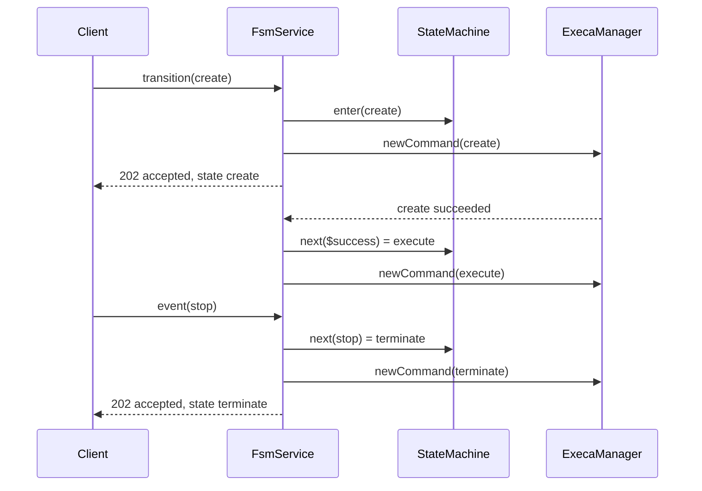

# Design: State Machine for Script Transitions

## Problem

A digital twin (DT) runs as a sequence of scripts, for example
_create_, _execute_ and _terminate_. Today a client must call the runner
once for each script, and must decide by itself which script comes
next. The owner asked for:

1. A finite state machine (FSM) that moves a DT from one script to
   another automatically.
1. An API call with which the user moves the machine to a named script.
   Once that script starts, the state machine controls the transitions.
1. A state machine given per DT in a file inside the script folder, not
   hard coded in the runner.
1. Events defined per DT, received on an API endpoint, that determine
   the transitions.

## Context

The runner is a NestJS service. It runs the permitted scripts of one
`location` folder through `ExecaManager`, keeps their history in SQLite
(`Queue`), and serves one API over HTTP and, optionally, over MQTT. One
runner serves one DT, so one script folder holds one state machine.

## Design

### State Machine File

The runner reads the file that the `stateMachine` key of `runner.yaml`
names, relative to `runner.yaml` or absolute, at startup. Before issue
01 the file was `state-machine.yaml` in the `location` folder (D1).

```yaml
events: [start, stop, reset] # the events clients may send
states: # each state runs the script of the same name
  create:
    transitions:
      $success: execute # raised when the create script succeeds
      $failure: terminate # raised when the create script fails
  execute:
    transitions:
      stop: terminate
  terminate:
    transitions:
      reset: create
```

- A state is a script. Entering a state runs the script of that name.
- `transitions` maps an event to the state it leads to. YAML refuses duplicate
  keys, so each state has at most one transition per event: the
  machine is deterministic.
- `events` lists the events of the DT. Clients may send only these.
- `$success`, `$failure` and `$stopped` are completion events. The
  runner raises one of them when the script of the current state
  exits: `$stopped` when the runner stopped it (D19). Clients can not
  send them.
- A transition value is a state name, or `{ state, stop: true }`, which
  stops the script of the state that the machine leaves before the
  script of the next state runs (D20).
- `parameters` declares the parameters of the DT, which a Manager reads
  and, if `controllable`, sets over the API (D21, D22). Each has a
  `type` (`string`, `number`, `boolean` or `enum` with `values`), a
  `default`, and an optional `event` raised when its value changes.

### Validation

The runner refuses to start when the file is invalid, as it does for an
invalid `mqtt` section. The file is valid when:

- it holds only `events`, `states` and `parameters`, and each state
  holds only `transitions`;
- every state and event name matches `^[A-Za-z0-9][\w.-]{0,63}$`, so
  that a name can not be a path, a command-line flag or an object
  property such as `__proto__` (zod skips a `__proto__` record key, so
  the runner looks for it in the parsed YAML first);
- every state is a permitted command of `runner.yaml`;
- every transition leads to a declared state;
- every event of a transition is declared in `events`, or is a
  completion event;
- a transition object holds only `state` and `stop: true`, and is not
  the transition of a completion event, whose script has already
  exited;
- no cycle is made of `$success` and `$failure` transitions alone.
  `$stopped` is left out: it follows only a stop from outside, so a
  loop through it can not run by itself;
- every parameter name matches the name pattern and is not
  `__proto__`, has a known `type`, a `default` of that type (a finite
  number for `number`, one of `values` for `enum`), an `event` declared
  in `events` if any, and no other key;
- no two parameter names give the same variable name, `DT_PARAM_`
  followed by the name in upper case with `.` and `-` as `_`.

`events` may be left out, and a state without transitions may be left
empty, as in `terminate:`. Without a `stateMachine` key, the state
machine is off and its endpoints answer 404 to well-formed requests. A
key that names a missing file stops the runner.

### API

| HTTP                   | MQTT topic           | Request body          |
| :--------------------- | :------------------- | :-------------------- |
| `POST /fsm/transition` | `<topic>/transition` | `{"state": "create"}` |
| `POST /fsm/event`      | `<topic>/event`      | `{"event": "stop"}`   |
| `GET /fsm`             | `<topic>/fsm`        | ignored               |
| `POST /stop`           | `<topic>/stop`       | `{"name": "execute"}` |
| `GET /state`           | `<topic>/state`      | ignored               |
| `GET /parameters`      | `<topic>/parameters` | ignored               |

A transition or event request is answered once the script of the new
state has started, without waiting for it to finish. The body names
the outcome, since MQTT has no status codes, and the current state:

```json
{ "status": "accepted", "state": "execute" }
```

| Status                | HTTP | Meaning                                              |
| :-------------------- | :--- | :--------------------------------------------------- |
| `accepted`            | 202  | the machine entered the state and started its script |
| `invalid state`       | 400  | the state is not in the file                         |
| `invalid event`       | 400  | the event is not in `events`                         |
| `invalid request key` | 400  | the request key belongs to another request           |
| `busy`                | 409  | a transition request while the state's script runs   |
| `no transition`       | 409  | the current state has no transition for the event    |
| `script running`      | 409  | the script of the target state is still running      |
| `no state machine`    | 404  | `runner.yaml` has no `stateMachine`                  |
| `stopping`            | 503  | the runner is shutting down                          |

A malformed body or request key gets the `Validation Failed` response
of the existing API, before any other check. `GET /fsm` answers:

```text
{"state": "execute", "status": "running", "entry": 3, "events": ["reset", "start", "stop"]}
```

`status` is `running`, `valid`, `invalid` or `stopped` for the script
of the current state, and `none` before the first transition, when
`state` is `null`. `entry` counts the entries into states, `0` before
the first, so that two entries into the same state can be told apart.

`GET /state` joins the body of `GET /fsm`, or `null` without a state
machine, with the identity of the digital twin, its parameters and the
latest command without its logs, in one document.

`POST /stop` stops the running command of the given name, or every
running command without one, and answers
`{ "stopped": ["execute"] }` once their processes have exited. It
belongs to the command API rather than the machine, and needs no
state machine.

`GET /parameters` answers with the value and declaration of each
parameter. `PUT /parameters`, or `<topic>/set-parameters`, takes
`{"scope": "multi"}`; it checks the whole body first and answers `400`
with every problem, changing nothing. Otherwise it stores and applies
the changed values, raises their events, and answers `200` with the
document of `GET /parameters`. Both routes answer `404` with the
`no state machine` body without a machine.

### Behaviour

1. A transition request moves an idle machine to any declared state.
   The machine is idle before its first transition and whenever the
   script of its current state has finished.
1. An event moves the machine along the transition of the current
   state for that event, whether or not the script of the current state
   is still running.
1. Entering a state starts its script through `ExecaManager`, so the
   permitted-command check and the history apply unchanged.
1. When the script exits, the runner raises `$success`, `$failure` or
   `$stopped`, if the machine is still in the same entry of that
   state. A completion of an earlier entry is ignored.
1. A plain transition does not stop the script of the state it leaves.
   The script of the next state, such as _terminate_, is responsible
   for stopping it.
1. On a transition with `stop: true` the runner refuses with
   `script running` if the script of another target state runs (D8),
   enters the target at once, which makes the completion of the old
   script stale, and replies `accepted`. It then stops the script of
   the state it left, waits until it has exited, and runs the script
   of the target, unless shutdown began or a later entry happened
   meanwhile. A self-transition thus restarts the script.

### Components

| Unit                     | Responsibility                                       |
| :----------------------- | :--------------------------------------------------- |
| `fsm/definition.ts`      | read, parse and check the state machine file         |
| `fsm/name.ts`            | name pattern of states, events, parameters and ids   |
| `fsm/parameters.ts`      | parameter schema, checks, values and changes         |
| `fsm/script-outcome.ts`  | runs a state's script; failed if it can not start    |
| `fsm/state-machine.ts`   | pure machine: current state, entry count, next state |
| `fsm/recent-replies.ts`  | bounded store of replies to repeated requests        |
| `fsm/fsm.service.ts`     | runs scripts, raises completion events, replies      |
| `fsm/fsm.controller.ts`  | HTTP routes                                          |
| `ParametersController`   | HTTP routes of the parameters                        |
| `dto/fsm.dto.ts`         | request schemas and reply bodies                     |
| `mqtt/*`                 | the request topics of these routes                   |
| `DescriptorService`      | builds the document of `GET /state`                  |
| `dto/state.dto.ts`       | the state document and its latest command            |
| `dto/parameters.dto.ts`  | parameters body schema and document                  |
| `ExecaManager.isRunning` | tells whether a script is running                    |
| `ExecaManager.stop`      | stops running scripts and waits until they exit      |
| `Queue.setParameter`     | records each parameter change with its time          |



## Decisions

Fable reviewed a draft of this design. D7, D8, D11, D13, D14, the name
pattern and the single definition unit came from its review; its
proposal to derive the events from the transitions was declined (D4).

| #   | Decision                                                                  | Reason                                                                                                                                                                                                                                                                                                                                                          |
| :-- | :------------------------------------------------------------------------ | :-------------------------------------------------------------------------------------------------------------------------------------------------------------------------------------------------------------------------------------------------------------------------------------------------------------------------------------------------------------- |
| D1  | YAML file that the `stateMachine` key of `runner.yaml` names              | The owner asked for a file in the script folder. YAML matches `runner.yaml` and `js-yaml` is already a dependency. Amended by issue 01 (S5): the fixed name `state-machine.yaml` in `location` gave way to a key, so that `runner.yaml`, the operator's file, names the DT author's file.                                                                       |
| D2  | A state is a script of the same name                                      | The owner speaks of transitions between scripts. A separate `script` key can be added later if two states must share a script.                                                                                                                                                                                                                                  |
| D3  | Nested `transitions` maps instead of a list of transitions                | Duplicate YAML keys are an error, so a state can not have two transitions for one event, as in XState. The key is not XState's `on`, which YAML 1.1 parsers and yamllint read as `true`.                                                                                                                                                                        |
| D4  | Explicit `events` list                                                    | The owner asked for events defined per DT. The list separates an unknown event (400) from an event without a transition in the current state (409), and catches a misspelt event in `transitions` at startup. Fable proposed deriving it; this was declined.                                                                                                    |
| D5  | `$success` and `$failure` completion events                               | They give automatic transitions from one script to the next without a client. Clients can not send them: `events` only holds names that match the name pattern, which has no `$`, so a request for them is `invalid event`.                                                                                                                                     |
| D6  | No initial state                                                          | The user's transition request starts the machine.                                                                                                                                                                                                                                                                                                               |
| D7  | A transition request is accepted only when the machine is idle            | The owner said the state machine takes control once the script starts. An override at any time would compete with the machine. A hung script is left by an event, so the README asks for one out of each long state. A Manager that must force a state calls `POST /stop` first, which leaves the machine idle only in a state without a `$stopped` transition. |
| D8  | A state whose script is running can not be entered (409 `script running`) | `ExecaManager` joins a run in progress, so entering such a state would not run its script and would attach the completion of an earlier entry. A transition with `stop: true` into the current state is the exception: it stops the script first (D20).                                                                                                         |
| D9  | Replies do not wait for the script                                        | A long _execute_ would hold the request open. The state is reported by `GET /fsm`.                                                                                                                                                                                                                                                                              |
| D10 | Leaving a state stops its script only on a transition with `stop: true`   | The runner can stop a script (D18), but the scripts of existing DTs stop one another, and a state whose script should outlive it must stay possible. The DT author marks the transitions that stop.                                                                                                                                                             |
| D11 | Reject cycles of completion transitions at startup                        | With fast scripts such a cycle would run forever and add a history row each time.                                                                                                                                                                                                                                                                               |
| D12 | The machine lives in memory                                               | Nothing asks for recovery after a restart, and the scripts do not survive a restart either. The machine starts unstarted.                                                                                                                                                                                                                                       |
| D13 | `Idempotency-Key` replays the reply in memory, for accepted requests      | MQTT QoS 1 can deliver a request twice, which would apply an event twice. The header and user property have the names of `POST /`, but the keys are a namespace of their own, apart from the keys of `POST /` in the database. It keeps the last 256 accepted replies; a refused request changed nothing and is checked again.                                  |
| D14 | Stop accepting requests in `beforeApplicationShutdown`                    | `ExecaManager` closes the database in `onApplicationShutdown`; a completion must not start a script after that.                                                                                                                                                                                                                                                 |
| D15 | 202 Accepted for accepted requests                                        | The script has started, not finished.                                                                                                                                                                                                                                                                                                                           |
| D16 | MQTT topics `transition`, `event` and `fsm` next to the existing ones     | One level under the base topic, so the `<topic>/+/response` subscription of the README covers them.                                                                                                                                                                                                                                                             |
| D17 | A required `id`, and one strict schema for all of `runner.yaml`           | Added by issue 01. A Manager and the runner's notifications must name the DT, and the port or base topic does not. The `id` follows the name pattern of states. An unknown key of `runner.yaml` is an error, as in the state machine file.                                                                                                                      |
| D18 | A stop sends `SIGTERM`, then `SIGKILL` after `stopGrace` (5 s)            | execa's `forceKillAfterDelay` gives a script time to clean up and still ends one that ignores `SIGTERM`. `POST /stop` answers once the processes have exited, so a following request of the same command starts it afresh.                                                                                                                                      |
| D19 | A run ends `success`, `failed` or `stopped` (`RunOutcome`)                | A boolean can not tell a deliberate stop from a crash. A run is `stopped` only when the runner's own stop reached the process; a kill from outside stays a failure, and a deliberate stop never counts as a crash for escalation (06).                                                                                                                          |
| D20 | `$stopped` completion event and transitions with `stop: true`             | `$stopped` lets the DT author choose what follows a stop; without a `$stopped` transition the machine stays idle. A stop transition enters its target before the old script exits, so the reply does not wait (D9) and the old completion is stale; a self-transition with `stop: true` restarts the script.                                                    |
| D21 | Parameters are declared in the state machine file                         | Added by issue 04 (S4). The DT author knows which settings the scripts read and which a Manager may change; `runner.yaml` is the operator's file. Parameters thus need a state machine file, and a DT without one has none.                                                                                                                                     |
| D22 | A parameter change raises only its declared event                         | Added by issue 04 (S6). The runner never restarts a script on its own; a DT author who wants a restart links the parameter to an event with a self-transition and `stop: true`. A body is checked whole, stored, applied, and then its events are raised once each in declaration order. The reply does not depend on the events.                               |

## Assumptions

- A1: One runner serves one DT, so one machine per runner is enough.
- A2: The scripts of a state machine are also listed in `commands`;
  the machine adds no way around that list.
- A3: Scripts may run long. The DT's own scripts stop one another, or
  the runner stops them on `POST /stop` or a transition with
  `stop: true`. A script ends its children on `SIGTERM`, as the runner
  waits until its output pipes close.
- A4: Events come from clients over HTTP or MQTT. Script exit is the
  only event the runner raises by itself; a parameter change raises
  the event its declaration names, on a client's request (D22).
- A5: A script that is permitted but missing fails when it runs, and
  raises `$failure`. The runner does not check that scripts exist at
  startup, as on Windows it runs the `.ps1` version.
- A6: Changing the state machine file, or the `stateMachine` key that
  names it, takes effect on a restart.
- A7: A manual `POST /` of the script of the current state joins the
  machine's run. A manual run of another script does not affect the
  machine.
- A8: Anyone who can call the API can drive the machine, as anyone can
  call `POST /` today. Access control stays with the network and the
  MQTT broker.

## Error Handling

- A missing or invalid file stops the runner at startup with a
  message naming the file and each problem.
- A script that fails to start, as when the database is closed, counts
  as a failed script.
- A completion transition into a state whose script is running is
  skipped with a warning; the machine stays where it is, idle.
- An event that a parameter change raises and the machine refuses is
  logged, at debug level for `no transition` and as a warning
  otherwise; the parameter change stands.

## Testing

- Unit: the definition validator (each rule), the pure machine, the
  reply store, the service with a fake `ExecaManager` (each status,
  completion events, stale completions, shutdown, repeated keys), the
  MQTT routes.
- End to end: the controller in the Nest module, over HTTP with real
  scripts in a temporary folder, moving through `$success` to the next
  script, with each refusal and a repeated request key.

## Implementation Plan

1. Add `ExecaManager.isRunning`, with a test.
1. Add `fsm/definition.ts` with tests for each validation rule.
1. Add `fsm/state-machine.ts` and `fsm/recent-replies.ts` with tests.
1. Add `dto/fsm.dto.ts` and `fsm/fsm.service.ts` with tests against a
   fake `ExecaManager`.
1. Add `fsm/fsm.controller.ts`, register the units in `AppModule`, load
   the file in `main.ts` before the database opens, and add end-to-end
   tests.
1. Add the MQTT topics, with handler and service tests.
1. Document the file and the API in `README.md`, the developer page
   `docs/developer/codebase/runner.md`, and the request files in `api/`.
1. Run `yarn syntax`, prettier, `yarn build` and `yarn test`.

## Out of Scope

Guards, actions, timers, hierarchical or parallel states; persisting
the machine across restarts; more than one machine per runner.
