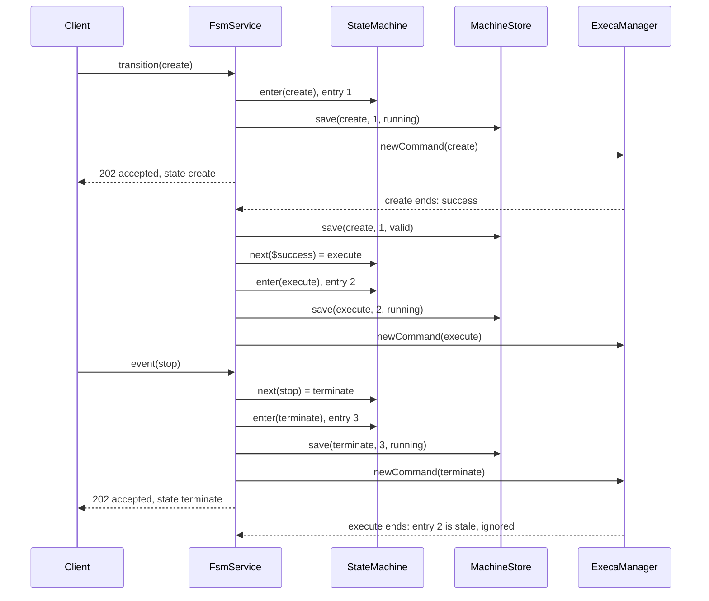
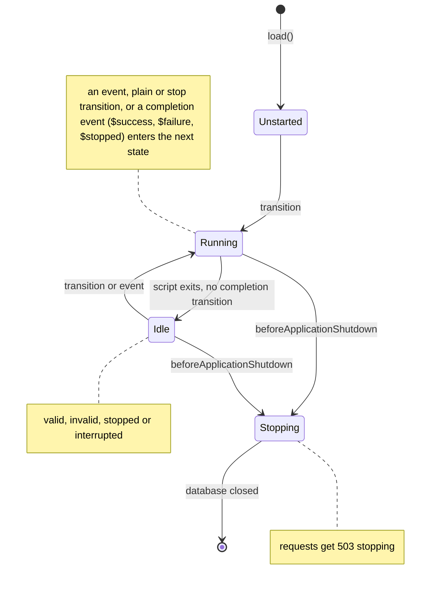
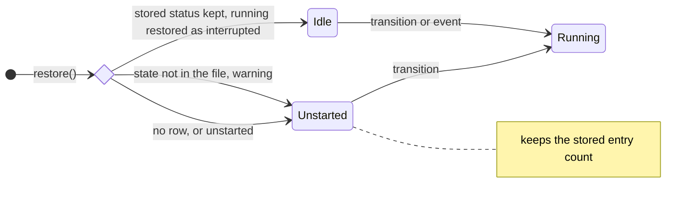

# Design: State Machine for Script Transitions

This document is for developers of the runner: how the state machine
is built, why, and where to change it. How a digital twin (DT) author
writes and drives a state machine is in the user guide,
[STATE-MACHINE.md](../STATE-MACHINE.md); the whole API is in
[API.md](../api/API.md). The facts of the user-level contract that the
code must keep are repeated here, so that this document can be read
alone.

## Problem

A digital twin runs as a sequence of scripts, for example _create_,
_execute_ and _terminate_. Without a state machine a client must call
the runner once for each script, and must decide by itself which
script comes next. The owner asked for:

1. A finite state machine (FSM) that moves a DT from one script to
   another automatically.
1. An API call with which the user moves the machine to a named script.
   Once that script starts, the state machine controls the transitions.
1. A state machine given per DT in a file, not hard coded in the
   runner.
1. Events defined per DT, received on an API endpoint, that determine
   the transitions.

Later issues added parameters (04), the state document and its
notifications (02, 03), command input and outcome (05), escalation
(06), presence (07), the script context (08), persistence across
restarts (09), stopping scripts (10), full history and metrics (11),
the health route (12), peers (13), access control (15a), signed
output (15b), peer events (16), script resources (17a), the
process tree (17b), scripts as a second account (18), properties
with the grouped `runner.yaml` (19), and the state machine file as a
class that instances share (21). Their
files are in
[docs/issues](issues/README.md).

## Context

The runner is a NestJS service for one DT. It runs the permitted
scripts of one `location` folder through `ExecaManager`, keeps their
history in SQLite (`Queue`), and serves one API over HTTP and,
optionally, over MQTT. One runner serves one DT, so one runner has one
state machine.

`main.ts` starts the runner in this order, and the order matters:

1. `Config.loadConfig` reads `runner.yaml`; `toLayout` first moves the
   keys of before 0.11 to their paths under `relationships` (D42).
1. `FsmService.load()` reads and checks the state machine file, before
   the database opens, so that an invalid file stops the runner before
   it touches the database. `loadConfigured` reads it as the instance
   of `runner.yaml`: with its parameter values and its peers (D44).
1. `Queue.open` opens the database file, if `runner.yaml` names one.
1. `FsmService.restore()` marks the unfinished commands `interrupted`
   and resumes the stored machine (see [Persistence](#persistence)).
   It runs before any request can arrive.
1. `MqttService.start()`, then `app.listen`, which runs the
   `onModuleInit` and `onApplicationBootstrap` hooks.
   `DescriptorService` starts the metrics and loads `Peers`, which
   signals each enabled peer, so that `PeerWatch` follows its notify
   topics, and restores the stored values of `Properties`; the `Notifier`
   subscribes to changes and sends the startup state document, which is
   thus the restored one. `PeerEventsService` declares the subscriptions
   of the loaded file; the first notice of a peer needs I/O, so it
   arrives after the hooks.
1. `FsmService.setRunnerApi` gives the scripts `RUNNER_URL` and, with
   access control, `RUNNER_TOKEN`.

## Components

| Unit                         | Responsibility                                                         |
| :--------------------------- | :--------------------------------------------------------------------- |
| `fsm/definition.ts`          | parse and check the state machine file into a `Definition`             |
| `fsm/class.ts`               | `class` schema; `instantiate`: the definition of one instance (D44)    |
| `fsm/load.ts`                | `loadDefinition`: reads the file as the instance of `runner.yaml`      |
| `fsm/name.ts`                | name pattern of states, events, parameters and ids; reserved names     |
| `fsm/completion-cycle.ts`    | finds a loop of completion transitions                                 |
| `fsm/parameters.ts`          | parameter schema and checks; `Parameters` holds and changes values     |
| `fsm/value-schema.ts`        | the JSON Schema keywords of a declaration, and the check of a value    |
| `fsm/properties.ts`          | property schema and checks; `Properties` keeps the latest values       |
| `fsm/proto.ts`               | finds a `__proto__` key in the parsed file, which zod would skip       |
| `fsm/script-context.ts`      | `env` schema and checks; `RunnerContext` builds a script environment   |
| `fsm/manager.ts`             | schema and check of the manager commands                               |
| `fsm/escalation.ts`          | escalation section; `Escalations` raises triggers and requests         |
| `fsm/state-machine.ts`       | pure machine: current state, entry count, next state; `machineOf`      |
| `fsm/requests.ts`            | answers transition and event requests, with their request keys         |
| `fsm/recent-replies.ts`      | bounded store of replies to repeated requests                          |
| `fsm/script-outcome.ts`      | runs a state's script and writes its exit row (D50)                    |
| `fsm/metrics.ts`             | `Metrics`: counts entries, time, completions, requests, escalations    |
| `fsm/stop-chain.ts`          | runs scripts after the stops of stop transitions, in order             |
| `fsm/subscriptions.ts`       | subscriptions schema, checks and `bind`; `PeerEvents` keeps conditions |
| `fsm/peer-events.service.ts` | `PeerEventsService`: raises the events of peers' notices               |
| `fsm/recovery.ts`            | pure: the machine to resume from the stored row                        |
| `fsm/machine-store.ts`       | stores the machine, and restores it at startup                         |
| `fsm/fsm.service.ts`         | `FsmService`: runs scripts, raises completion events, replies          |
| `fsm/fsm.controller.ts`      | HTTP routes `/fsm`, `/fsm/transition`, `/fsm/event`                    |
| `parameters.controller.ts`   | HTTP routes `GET` and `PUT /parameters`                                |
| `properties.controller.ts`   | HTTP routes `GET` and `PUT /properties`                                |
| `dto/fsm.dto.ts`             | request schemas, reply bodies, status codes, `ScriptStatus`            |
| `dto/state.dto.ts`           | the state document and its latest command                              |
| `dto/history.dto.ts`         | history query schema and records                                       |
| `dto/metrics.dto.ts`         | the reply of `GET /metrics`                                            |
| `dto/timeline.dto.ts`        | timeline kinds, query schema, rows, and the `input` a role may see     |
| `dto/parameters.dto.ts`      | parameters body schema and document                                    |
| `dto/properties.dto.ts`      | properties body schema, document and the entry of the state document   |
| `config/layout.ts`           | `toLayout`: moves the `runner.yaml` keys of before 0.11 (D42)          |
| `descriptor.service.ts`      | builds `GET /dt`, `GET /state`, `GET /metrics`; forwards signals       |
| `peers/peers.ts`             | `Peers`: the listed peers, their switches and their last notices       |
| `peers/peers.config.ts`      | the `relationships.peers` schema, unique and not the runner            |
| `peers/peer-watch.ts`        | `PeerWatch`: follows enabled peers' notices on the broker              |
| `peers/peer-notice.ts`       | `readNotice`: checks a peer's envelope, and its JWS with a key         |
| `peers/peers.controller.ts`  | HTTP routes `GET` and `PUT /peers`                                     |
| `auth/auth.config.ts`        | the `auth` schema: principals, roles and the signing key               |
| `auth/access.ts`             | `Access`: verifies HTTP tokens, MQTT envelopes and the script token    |
| `auth/access.guard.ts`       | `AccessGuard`: the role check of every HTTP route                      |
| `auth/roles.ts`              | `ROUTE_ROLES` of HTTP and MQTT; the manager command check              |
| `auth/caller-context.ts`     | the caller and source of the request in progress (D49)                 |
| `auth/jws.ts`, `claims.ts`   | compact JWS parsing and verification, and the claims of a token        |
| `auth/signer.ts`             | `Signer`: plain JSON, or a JWS with `auth.key`                         |
| `notify/webhook.client.ts`   | posts notifications to the `notify.url` of the Manager, with retries   |
| `health.service.ts`          | the reply of `GET /health`                                             |
| `notify/changes.ts`          | `Changes`: a plain signal of a possible change of the document         |
| `notify/notifier.service.ts` | sends state, escalation and presence notifications                     |
| `notify/state-hold.ts`       | `StateHold`: holds documents that differ in property values only       |
| `mqtt/*`                     | the request topics of the routes, and the notification topics          |
| `mqtt/request-topics.ts`     | `RequestTopics`: topic to route, with the write topics of before 0.11  |
| `execa-manager.service.ts`   | runs, joins and stops commands; closes the database at shutdown        |
| `queue.service.ts`           | SQLite: commands, request keys, parameters, machine, peers, properties |
| `queue.machine.ts`           | the SQL of the `machine` row and of marking commands interrupted       |
| `queue.history.ts`           | the SQL of a command record, of the history and of command counts      |
| `queue.peers.ts`             | the SQL of the switches of `PUT /peers`                                |
| `queue.properties.ts`        | the SQL of the latest value of each property                           |
| `queue.timeline.ts`          | `Timeline`: writes and reads the rows of the timeline (D47, D48)       |
| `timeline.controller.ts`     | HTTP route `GET /timeline`                                             |
| `resources/*`                | measures the CPU time, peak memory and processes of each script's tree |
| `scripts/*`                  | the `scripts` section, its startup checks and the `setpriv` launch     |

`FsmService` owns plain objects rather than injected services:
`Requests`, `Changes`, `RunnerContext`, `Escalations`, `StopChain` and
`MachineStore`. Each was kept out of the Nest container so that no
constructor reaches Qlty's limit of four parameters and no dependency
cycle forms; `DescriptorService` forwards the signals of `FsmService`
and `Queue` to the `Notifier`, and owns `Metrics`, `Peers` and
`Properties` for the same reason. `Properties` signals each write
through its own `Changes`, which `DescriptorService` forwards too.
`PeerEventsService` is the one injectable that receives both
`FsmService` and `DescriptorService`; it owns `PeerEvents` and
registers with `Peers` in its constructor, as `PeerWatch` does.

## Data Flow

A transition request, the completion that follows, and an event. The
file is the one of [The State Machine File](#the-state-machine-file),
where `stop` is a plain transition, so _execute_ keeps running and its
completion is stale once the machine has left its entry:



- `enter` refuses a state whose script `ExecaManager` still runs
  (`script running`), as `newCommand` would join that run instead of
  starting the script for the new entry (D8).
- `run` calls `newCommand` synchronously, so the queue has signalled
  the new command before `enter` emits the change of the machine; the
  `Notifier` sends one document per entry and skips the unchanged one.
- The reply does not wait for the script (D9), and does not depend on
  the write of the machine, which only logs a failure.
- Each state change and script exit emits a change through `Changes`;
  the `Notifier` sends the state document when it differs from the last
  one sent.

A transition with `stop: true` enters its target at once and replies;
`StopChain` then stops the script of the state left, waits until it
has exited, and runs the script of the target, unless shutdown began or
a later entry happened. The stops of several stop transitions are
chained, so that a later target does not start while an earlier script
still exits. A plain entry runs its script at once.

## The State Machine File

`runner.yaml` names the file with `stateMachine`, relative to
`runner.yaml` or absolute (D1). `FsmService.load()` reads it once, at
startup.

```yaml
events:
  - stop
  - reset
states:
  create:
    transitions:
      $success: execute
      $failure: terminate
  execute:
    transitions:
      stop: terminate
  terminate:
    transitions:
      reset: create
```

- A state is a script of the same name (D2). `transitions` maps an
  event to the next state (D3); YAML refuses duplicate keys, so the
  machine is deterministic.
- `events` lists the events that clients may send (D4).
- `$success`, `$failure` and `$stopped` are completion events, raised
  by the runner when the script of the current state exits (D5, D19).
- A transition value is a state name, or `{ state, stop: true }`, which
  stops the script of the state left before the next one runs (D20).
- `parameters` declares the parameters of the DT (D21, D22),
  `properties` the values that scripts and sensors write (D37, D38),
  `env` the variables of the scripts (D23), `escalation` the triggers
  the runner escalates by itself (D25), `manager.commands` the
  commands a Manager may submit (D24), and `subscriptions` the events
  that the notices of listed peers raise (D34).
- `states` may be left out. The file then only declares `parameters`,
  `properties` and `manager.commands`, and the DT has no machine (D41).
- The file is a class, which the optional `class` section names with
  an `id` and a `version` (D44). `loadDefinition` returns the
  definition of one instance: `parseDefinition` checks the file, and
  `instantiate` puts the values of `parameters` in `runner.yaml` in
  place of the defaults (D45) and binds each subscription to a
  relationship to the peers that have it (D46). The rest of the runner
  sees a `Definition` whose subscriptions all name a peer.

### Validation

`loadDefinition` refuses the file, and the runner does not start, when:

- it holds a key other than `class`, `events`, `states`, `parameters`,
  `properties`, `env`, `escalation`, `manager` and `subscriptions`, a
  state a key other than
  `transitions` and `env`, `escalation` a key other than the booleans
  `onFailure` and `onNoTransition`, or `manager` a key other than
  `commands`;
- `class` holds a key other than `id` and `version` or misses one, or
  one of them is not a string of 1 to 200 characters for `id` and 1 to
  64 for `version`, without spaces (D44);
- a command of `manager.commands` is not permitted by `runner.yaml`;
- a state or event name does not match `^[A-Za-z0-9][\w.-]{0,63}$`, so
  that a name can not be a path, a command-line flag or an object
  property such as `__proto__` (zod skips a `__proto__` record key, so
  the runner looks for it in the parsed YAML first);
- a state is not a permitted command of `runner.yaml`;
- a transition leads to an undeclared state, or its event is neither
  declared in `events` nor a completion event;
- a transition object holds more than `state` and `stop: true`, or is
  the transition of a completion event, whose script has already
  exited;
- `$success` and `$failure` transitions alone form a cycle
  (`completion-cycle.ts`, D11). `$stopped` is left out: it follows only
  a stop from outside, so a loop through it can not run by itself;
- a parameter has a bad name or `__proto__`, a `type` other than
  `string`, `number`, `integer` and `boolean`, a key other than `type`,
  `enum`, `minimum`, `maximum`, `default`, `controllable` and `event`,
  a keyword that does not apply to its type, a `default` that does not
  fit the declaration (a finite number for `number`, one of `enum`,
  within the bounds), or an `event` not in `events`. `type: enum` with
  `values` is read as `type: string` with `enum`, with a warning, until
  0.12 (D38);
- a property has a bad name or, at any depth, `__proto__`; a `type`
  other than those and `object` and `array`; a keyword other than those
  of `value-schema.ts`, or one that does not apply to its type; a
  `number` or `integer` without `unit`, an `array` without `items` or an
  `object` without `properties`, also nested; an `enum` value not of
  the type, a `minimum` above the `maximum`, or a `required` name that
  is not among the `properties` (D38);
- a name is both a parameter and a property, or a parameter or a
  property is named `set` or `response` (D43);
- the file has no states but has `events` or `subscriptions` (D41);
- two parameter names give the same variable name, `DT_PARAM_`
  followed by the name in upper case with `.` and `-` as `_`;
- an `env` name does not match `^[A-Z][A-Z0-9_]*$` or starts with `DT_`
  or `RUNNER_`, a value is not a string, a finite number or a boolean,
  or a `${NAME}` in a value names neither a runner variable
  (`RUNNER_URL`, `RUNNER_TOKEN`, `DT_ID`, `DT_STATE`, `DT_ENTRY`) nor
  the variable of a
  declared parameter;
- a subscription has a key other than `peer`, `relationship`, `when`
  and `event`, names both a `peer` and a `relationship` or neither, or
  misses `when` or `event`; its `when` is not exactly one of
  `{ state: <name> }` and `{ online: <boolean> }`; its `peer` is not
  the `id` of a peer of `runner.yaml`, enabled or not; its `event` is
  not in `events`; or two subscriptions have the same `peer` or
  `relationship`, `when` and `event`. Strict objects refuse a
  `__proto__` key, so `hasProtoKey` needs no entry for them. A
  `relationship` that no peer of `runner.yaml` has is not refused: it
  is logged, and its subscriptions are idle (D46);
- `parameters` of `runner.yaml` names a parameter that the file does
  not declare, or gives a value that does not fit its declaration; the
  message then starts `Invalid parameters in runner.yaml for <file>:`
  (D45). Without a file, `parameters` alone stops the runner.

`known(config)` passes `loadDefinition` the permitted commands, the
peer ids, the parameter values and, for each relationship, the ids of
its peers.

`events` may be left out, and a state without transitions may be left
empty. Without `stateMachine`, and with a file without states, the
machine is off, and its routes answer `404` to well-formed requests.
`runner.yaml` is checked alike by `config.schema.ts`, after `toLayout`:
a section set under its old key and its new path, a peer id `set` or
`response`, and a `stateInterval` that is not a whole number of `0` or
more stop the runner (D40, D42, D43). The error names the file and every
problem; js-yaml errors and an empty file are wrapped to name the file.

## Lifecycle

`FsmService` keeps the machine (`StateMachine`, or `undefined` without
a file and for a file without states, D41), the `status` of the
current state's script, and `stopping`, set by
`beforeApplicationShutdown`.



- **Unstarted**: `state` is `null`, `status` `none`, `entry` `0` (D6).
  A transition request may name any declared state; an event gets
  `no transition`.
- **Running**: `status` is `running`. A transition request gets `busy`
  (D7); an event moves the machine along its transition, with or
  without `stop: true`.
- **Idle**: the script has exited and no completion transition moved
  the machine on, or the machine was restored (see
  [Persistence](#persistence)). `status` is `valid`,
  `invalid` (a failed script, D27), `stopped` (a stop request, D20) or
  `interrupted` (a restart, D28). A transition request or an event
  moves it.
- **Stopping**: `Requests` answers every transition and event with
  `stopping`. No new script starts: `run` checks `stopping` before it
  starts a script, so the target of a stop transition waiting in the
  `StopChain` does not start. A script that exits stores its status and
  emits a change, but `complete` does not run (D14).

Every entry increments `entry`, so `run` and the completion of a script
can tell their entry from a later one: a completion whose entry is no
longer the machine's is ignored.

## Requests

The controllers and the MQTT handler call the same `FsmService`
methods, `parameters()` and `setParameters` among them, so both
protocols share one contract.
A transition or event reply is `{ status, state }`, where `state` is the
state after the request or `null`:

| Status                | HTTP | Meaning                                              |
| :-------------------- | :--- | :--------------------------------------------------- |
| `accepted`            | 202  | the machine entered the state and started its script |
| `invalid state`       | 400  | the state is not in the file                         |
| `invalid event`       | 400  | the event is not in `events`                         |
| `invalid request key` | 400  | the request key belongs to another request           |
| `busy`                | 409  | a transition request while the state's script runs   |
| `no transition`       | 409  | the current state has no transition for the event    |
| `script running`      | 409  | the script of the target state is still running      |
| `no state machine`    | 404  | no `stateMachine` key, or a file without states      |
| `stopping`            | 503  | the runner is shutting down                          |

`FSM_STATUS_CODES` in `dto/fsm.dto.ts` maps each status to its code;
MQTT has no codes, so the body names the outcome (D15, D16). A
malformed body or request key gets the `Validation Failed` response of
`ZodValidationPipe`, before any other check.

- `Requests.reply` keeps the replies of accepted requests with an
  `Idempotency-Key` in a `RecentReplies` of 256 (D13). A repeat gets the
  first reply; a refused request changed nothing and is checked again;
  a key of another request gets `invalid request key`.
- `GET /fsm` returns `StateMachine.describe(status)`:
  `{ state, status, entry, events }`, with the events sorted.
- `GET /state` (`DescriptorService.state`) joins the machine, or
  `null`, with the id, the parameter values, the `{ value, time }` of
  each property and the latest command.
- `PUT /parameters` checks the whole body (`Parameters.check`), stores
  the changes in one transaction, commits them, emits a change, and
  raises each declared event once, in declaration order, through
  `Requests.raise`, which logs a refusal and never escalates (D22).
- `PUT /properties` checks the whole body (`Properties.set`), where
  `null` fits every declaration, stores the values in one row each with
  one `time` and the caller as `by`, applies them and emits a change.
  It raises no event and needs no machine, only the declarations
  (D37). `GET /properties` answers `404` `no state machine` without a
  file, as `GET /parameters` does.
- Over MQTT, `RequestTopics` maps each topic to its route: a write
  route to `<base>/<resource>/set`, and until 0.12 the old
  `set-parameters` and `set-peers` topics too, with one warning at the
  first request on each (D43).
- `POST /stop` belongs to the command API: `ExecaManager.stop` stops
  the named command or all, and resolves once they have exited (D18).
  The machine follows `$stopped` when the stopped script is the current
  state's.
- `POST /escalate` needs no machine; `Escalations.request` keeps its
  own 256 request keys (D25).

## Behaviour

1. A transition request moves an idle machine to any declared state.
1. An event moves the machine along the transition of the current
   state for that event, whether or not the script of that state is
   still running. An event without a transition escalates once per
   entry with `onNoTransition`; an event that a parameter raises never
   does.
1. Entering a state starts its script through `ExecaManager`, so the
   permitted-command check and the history apply unchanged. The script
   gets the environment of `RunnerContext` and no stdin.
1. When the script exits, the runner sets the status from the outcome
   (`success` `valid`, `failed` `invalid`, `stopped` `stopped`), stores
   it, and raises `$success`, `$failure` or `$stopped`, if the machine
   is still in the same entry. A `$failure` without a transition
   escalates with `onFailure`.
1. A plain transition does not stop the script of the state it leaves
   (D10). A completion transition into a state whose script runs is
   skipped with a warning, through `logStay`.
1. On a transition with `stop: true` the runner refuses with
   `script running` if the script of another target state runs (D8),
   enters the target at once, which makes the completion of the old
   script stale, and replies `accepted`. `StopChain` then stops the
   script of the state left, waits until it has exited, and runs the
   script of the target, unless shutdown began or a later entry
   happened. A self-transition thus restarts the script.
1. On a restart the runner marks every unfinished command
   `interrupted` and resumes the stored machine (D12, D28).

## Persistence

`Queue` keeps seven tables in one SQLite database, in memory unless
`runner.yaml` names a file:

| Table          | Rows                                                                 |
| :------------- | :------------------------------------------------------------------- |
| `commands`     | each command: name, status, logs, exit code, resources, times, by    |
| `request_keys` | the `Idempotency-Key` of each `POST /` request, and its command      |
| `parameters`   | each parameter change, with its value as JSON and its time           |
| `machine`      | one row (`id` 1): the state (`NULL` unstarted), entry, script status |
| `peers`        | each switch of `PUT /peers`; a peer's latest overrides the file      |
| `properties`   | one row per property: its latest value as JSON, its time and `by`    |
| `timeline`     | what entered, changed and was sent, in order; it only grows (D47)    |

`CREATE TABLE IF NOT EXISTS` never changes an existing file, so new
columns come from a guarded `ALTER TABLE` (as 05's `exit_code` and
15a's `by`) and new tables from the schema itself (as 09's `machine`,
13's `peers`, 19's `properties` and 22's `timeline`).

A write of a property replaces its row (an upsert), so the table does
not grow with the rate of the writes; a write that changes a value is
also a `properties` row of the timeline (D47).
`DescriptorService.onModuleInit` loads the rows into `Properties`
with their stored `time` and `by`, and warns once about the values
that no longer fit their declarations, which are dropped (D37).
Without a state machine file nothing is loaded.

`MachineStore.save` writes the machine with `INSERT OR REPLACE` at each
entry, with status `running`, and at each script exit; at an entry it
also writes the `entry` row of the timeline. A failed write is logged
and the reply stands. `FsmService.restore()` calls
`MachineStore.restore`, which:

1. marks every `commands` row without `finished_at` as `interrupted`,
   finished at the startup time, with or without a state machine: no
   script survives a restart;
1. without a definition, logs a stored row and keeps it, so that a
   later start with the state machine resumes it;
1. otherwise applies `recover` and writes the result back at once, so a
   `running` row does not stay;
1. restores the values of controllable parameters that still fit their
   declarations (`Parameters.restore`), and warns once about the rest.



`recover` keeps the stored entry count in every case, so entry numbers
never repeat for a Manager. No script starts on recovery, so a crash in
a script can not loop through restarts (D28), and no notification of
its own is sent: the `Notifier`'s startup document is the restored one.

At shutdown, Nest runs every `beforeApplicationShutdown` hook (the
`FsmService` sets `stopping`, the `Notifier` and `MqttService` leave),
then `ExecaManager.onApplicationShutdown`, which waits for the running
scripts, then one turn of the event loop (`setImmediate`), and closes
the database. `FsmService.run` stores a script's status a few
microtasks after the run settles; the turn lets that write land. The
invariant: nothing between a run settling and that write may await
I/O.

## Decisions

Fable reviewed a draft of this design. D7, D8, D11, D13, D14, the name
pattern and the single definition unit came from its review; its
proposal to derive the events from the transitions was declined (D4).

| #   | Decision                                                                                       | Reason                                                                                                                                                                                                                                                                                                                                                                                                                                                                                                                                                                                                                                                                                                                                                                                                                                                                                                                                                                   |
| :-- | :--------------------------------------------------------------------------------------------- | :----------------------------------------------------------------------------------------------------------------------------------------------------------------------------------------------------------------------------------------------------------------------------------------------------------------------------------------------------------------------------------------------------------------------------------------------------------------------------------------------------------------------------------------------------------------------------------------------------------------------------------------------------------------------------------------------------------------------------------------------------------------------------------------------------------------------------------------------------------------------------------------------------------------------------------------------------------------------- |
| D1  | YAML file that the `stateMachine` key of `runner.yaml` names                                   | The owner asked for a file in the script folder. YAML matches `runner.yaml` and `js-yaml` is already a dependency. Amended by issue 01 (S5): the fixed name `state-machine.yaml` in `location` gave way to a key, so that `runner.yaml`, the operator's file, names the DT author's file. Amended by issue 21: the file is a class, which several `runner.yaml` files may name, each for its own instance (D44).                                                                                                                                                                                                                                                                                                                                                                                                                                                                                                                                                         |
| D2  | A state is a script of the same name                                                           | The owner speaks of transitions between scripts. A separate `script` key can be added later if two states must share a script.                                                                                                                                                                                                                                                                                                                                                                                                                                                                                                                                                                                                                                                                                                                                                                                                                                           |
| D3  | Nested `transitions` maps instead of a list of transitions                                     | Duplicate YAML keys are an error, so a state can not have two transitions for one event, as in XState. The key is not XState's `on`, which YAML 1.1 parsers and yamllint read as `true`.                                                                                                                                                                                                                                                                                                                                                                                                                                                                                                                                                                                                                                                                                                                                                                                 |
| D4  | Explicit `events` list                                                                         | The owner asked for events defined per DT. The list separates an unknown event (400) from an event without a transition in the current state (409), and catches a misspelt event in `transitions` at startup. Fable proposed deriving it; this was declined.                                                                                                                                                                                                                                                                                                                                                                                                                                                                                                                                                                                                                                                                                                             |
| D5  | `$success` and `$failure` completion events                                                    | They give automatic transitions from one script to the next without a client. Clients can not send them: `events` only holds names that match the name pattern, which has no `$`, so a request for them is `invalid event`.                                                                                                                                                                                                                                                                                                                                                                                                                                                                                                                                                                                                                                                                                                                                              |
| D6  | No initial state                                                                               | The user's transition request starts the machine.                                                                                                                                                                                                                                                                                                                                                                                                                                                                                                                                                                                                                                                                                                                                                                                                                                                                                                                        |
| D7  | A transition request is accepted only when the machine is idle                                 | The owner said the state machine takes control once the script starts. An override at any time would compete with the machine. A hung script is left by an event, so the README asks for one out of each long state. A Manager that must force a state calls `POST /stop` first, which leaves the machine idle only in a state without a `$stopped` transition.                                                                                                                                                                                                                                                                                                                                                                                                                                                                                                                                                                                                          |
| D8  | A state whose script is running can not be entered (409 `script running`)                      | `ExecaManager` joins a run in progress, so entering such a state would not run its script and would attach the completion of an earlier entry. A transition with `stop: true` into the current state is the exception: it stops the script first (D20).                                                                                                                                                                                                                                                                                                                                                                                                                                                                                                                                                                                                                                                                                                                  |
| D9  | Replies do not wait for the script                                                             | A long _execute_ would hold the request open. The state is reported by `GET /fsm`.                                                                                                                                                                                                                                                                                                                                                                                                                                                                                                                                                                                                                                                                                                                                                                                                                                                                                       |
| D10 | Leaving a state stops its script only on a transition with `stop: true`                        | The runner can stop a script (D18), but the scripts of existing DTs stop one another, and a state whose script should outlive it must stay possible. The DT author marks the transitions that stop.                                                                                                                                                                                                                                                                                                                                                                                                                                                                                                                                                                                                                                                                                                                                                                      |
| D11 | Reject cycles of completion transitions at startup                                             | With fast scripts such a cycle would run forever and add a history row each time.                                                                                                                                                                                                                                                                                                                                                                                                                                                                                                                                                                                                                                                                                                                                                                                                                                                                                        |
| D12 | The machine is stored in the database and resumed                                              | Amended by issue 09. A DT that forgets its state reports a wrong one to a Manager after a restart. One `machine` row in the database of `Queue` holds the state, entry and status, written at each entry and script exit; a failed write is only logged. In memory, the machine starts unstarted.                                                                                                                                                                                                                                                                                                                                                                                                                                                                                                                                                                                                                                                                        |
| D13 | `Idempotency-Key` replays the reply in memory, for accepted requests                           | MQTT QoS 1 can deliver a request twice, which would apply an event twice. The header and user property have the names of `POST /`, but the keys are a namespace of their own, apart from the keys of `POST /` in the database. It keeps the last 256 accepted replies; a refused request changed nothing and is checked again.                                                                                                                                                                                                                                                                                                                                                                                                                                                                                                                                                                                                                                           |
| D14 | Stop accepting requests in `beforeApplicationShutdown`                                         | `ExecaManager` closes the database in `onApplicationShutdown`; a completion must not start a script after that.                                                                                                                                                                                                                                                                                                                                                                                                                                                                                                                                                                                                                                                                                                                                                                                                                                                          |
| D15 | 202 Accepted for accepted requests                                                             | The script has started, not finished.                                                                                                                                                                                                                                                                                                                                                                                                                                                                                                                                                                                                                                                                                                                                                                                                                                                                                                                                    |
| D16 | MQTT topics `transition`, `event` and `fsm` next to the existing ones                          | One level under the base topic, so the `<topic>/+/response` subscription of the README covers them. Amended by issue 03: notifications go two levels down, on `<base>/notify/<kind>`. The runner subscribes to its exact request topics, so a notification is never taken for a request. Amended by issue 13: it also follows its peers' notify topics (D31). Amended by issue 19: the three write routes are one level under their read topics (D43).                                                                                                                                                                                                                                                                                                                                                                                                                                                                                                                   |
| D17 | A required `id`, and one strict schema for all of `runner.yaml`                                | Added by issue 01. A Manager and the runner's notifications must name the DT, and the port or base topic does not. The `id` follows the name pattern of states. An unknown key of `runner.yaml` is an error, as in the state machine file. Amended by issue 19: `notify` and `peers` moved under `relationships` (D42).                                                                                                                                                                                                                                                                                                                                                                                                                                                                                                                                                                                                                                                  |
| D18 | A stop sends `SIGTERM`, then `SIGKILL` after `stopGrace` (5 s)                                 | execa's `forceKillAfterDelay` gives a script time to clean up and still ends one that ignores `SIGTERM`. `POST /stop` answers once the processes have exited, so a following request of the same command starts it afresh.                                                                                                                                                                                                                                                                                                                                                                                                                                                                                                                                                                                                                                                                                                                                               |
| D19 | A run ends `success`, `failed` or `stopped` (`RunOutcome`)                                     | A boolean can not tell a deliberate stop from a crash. A run is `stopped` only when the runner's own stop reached the process; a kill from outside stays a failure, and a deliberate stop never counts as a crash for escalation (06).                                                                                                                                                                                                                                                                                                                                                                                                                                                                                                                                                                                                                                                                                                                                   |
| D20 | `$stopped` completion event and transitions with `stop: true`                                  | `$stopped` lets the DT author choose what follows a stop; without a `$stopped` transition the machine stays idle. A stop transition enters its target before the old script exits, so the reply does not wait (D9) and the old completion is stale; a self-transition with `stop: true` restarts the script.                                                                                                                                                                                                                                                                                                                                                                                                                                                                                                                                                                                                                                                             |
| D21 | Parameters are declared in the state machine file                                              | Added by issue 04 (S4). The DT author knows which settings the scripts read and which a Manager may change; `runner.yaml` is the operator's file. Parameters thus need a state machine file, and a DT without one has none. Amended by issue 19: the file may have no states, so that a DT without a machine can declare (D41), and the types are those of JSON Schema (D38). Amended by issue 21: the `default` is that of the class, and `runner.yaml` may give a declared parameter the value of its instance (D45).                                                                                                                                                                                                                                                                                                                                                                                                                                                  |
| D22 | A parameter change raises only its declared event                                              | Added by issue 04 (S6). The runner never restarts a script on its own; a DT author who wants a restart links the parameter to an event with a self-transition and `stop: true`. A body is checked whole, stored, applied, and then its events are raised once each in declaration order. The reply does not depend on the events.                                                                                                                                                                                                                                                                                                                                                                                                                                                                                                                                                                                                                                        |
| D23 | Scripts get the runner's context as environment variables                                      | Added by issue 08. Every script language reads its environment, and nothing goes on the command line. Values are those at the script's start (S6). A declared `env` interpolates only runner variables, so a file means the same on every host. Events return over HTTP through `RUNNER_URL`, not stdout (open question 13).                                                                                                                                                                                                                                                                                                                                                                                                                                                                                                                                                                                                                                             |
| D24 | The commands a Manager may submit are listed in the state machine file                         | Added by issue 05 (S4). The DT author knows which scripts a Manager may run, as with parameters (D21). The list is shown on `GET /dt`. Enforced by issue 15a (D29): with `auth`, a principal in the role `manager` gets 403 for any other command.                                                                                                                                                                                                                                                                                                                                                                                                                                                                                                                                                                                                                                                                                                                       |
| D25 | Escalation triggers are opt-in; a request needs no machine                                     | Added by issue 06 (S4); D23 is 08's, D24 05's. Only the DT author knows when its adaptation is exhausted, so the runner escalates by itself only on the declared triggers, a repeated event once per entry. `POST /escalate` needs no machine, so a plain DT escalates too. An escalation is not retained, so a late Manager does not act on an old one.                                                                                                                                                                                                                                                                                                                                                                                                                                                                                                                                                                                                                 |
| D26 | Presence: an online notice per connect, an offline notice, a will                              | Added by issue 07. A Manager learns of a runner without asking. The online notice carries the descriptor and is published on each connect, as the broker keeps only the last; the webhook hears it once. The graceful end at shutdown drops the will, which covers a crash, a kill or a lost connection with `time: null`.                                                                                                                                                                                                                                                                                                                                                                                                                                                                                                                                                                                                                                               |
| D27 | Command input goes to stdin, is not stored, and a failed script is told from a refused command | Added by issue 05. Stdin keeps input off the command line of a remote execution service. The input may hold personal data and nothing reads it back. A permitted script that fails is `failed` (200, with its result); `invalid command` (400) stays for a command that is not permitted. The machine's `ScriptStatus` keeps `invalid` for a failed script.                                                                                                                                                                                                                                                                                                                                                                                                                                                                                                                                                                                                              |
| D28 | A script running at a restart is `interrupted`, not run again                                  | Added by issue 09. No script survives a restart, and a rerun could repeat a side effect or loop in a crash. The machine is idle in its state (D7), so a transition or an event moves it on; a stored state the file no longer has starts the machine afresh with its entry count.                                                                                                                                                                                                                                                                                                                                                                                                                                                                                                                                                                                                                                                                                        |
| D29 | Callers are listed principals with keys and roles                                              | Added by issue 15a (S9 to S11). Without `auth.principals` nothing changes. With it, each request but `health` carries a JWS bound to the DT, the request and one minute; over MQTT the payload is the JWS. `runner.yaml` holds public keys only. One `ROUTE_ROLES` serves HTTP and MQTT; scripts use `RUNNER_TOKEN`. Amended by issue 19: a third role of principals, `sensor`, calls only the property routes (D39).                                                                                                                                                                                                                                                                                                                                                                                                                                                                                                                                                    |
| D30 | Full history records, and metrics as counters in memory                                        | Added by issue 11 (S14). A Manager measures a DT network from the outcomes of commands with their times, so `GET /history` returns the stored records with `since` and `limit`; `since` is compared to the second, as times are stored. `GET /metrics` counts from the signals that `FsmService` already has (`onChange`, `onAnswer`, `onEscalation`) and from a query of the commands above the highest id of the start, so nothing new is stored and a restart resets the counters. Metrics stay out of the state document, so a counter sends no notification. `escalations` is top level, as `POST /escalate` needs no machine (D25).                                                                                                                                                                                                                                                                                                                                |
| D31 | A DT lists its peers in `runner.yaml`, and the runner follows their notices                    | Added by issue 13 (S8). No runner can read the relation `R` of the network, so the operator lists the peers by base topic and URL. The runner follows their presence and state notices, verified by a `publicKey`; a notice raises no event of its own. `PUT /peers` only switches listed peers, stored in `Queue`; `GET /dt` shows the enabled ones. Amended by issue 16: a subscription turns a notice into an event (D34). Amended by issue 21: a peer may have a `relationship`, which subscriptions name and `GET /peers` shows (D46).                                                                                                                                                                                                                                                                                                                                                                                                                              |
| D32 | Outbound messages are a JWS of today's JSON when `auth.key` is set                             | Added by issue 15b (S12, S15). A receiver with the DT's public key checks the origin and integrity of each notification, MQTT response and will. A compact JWS of the unchanged JSON needs no canonical JSON and works over MQTT 3.1.1, which has no user properties. No `exp`, so a retained notice stays verifiable. HTTP replies stay JSON.                                                                                                                                                                                                                                                                                                                                                                                                                                                                                                                                                                                                                           |
| D33 | Script resources come from own reads of the direct child, as lower bounds                      | Added by issue 17a. A Manager adjusts fidelity to load, so each run reports its CPU seconds and peak memory and the runner decides nothing. Own reads rather than `pidusage`, which on Windows runs `wmic` or a PowerShell per poll and has no peak: `/proc` every 500 ms on Linux, one PowerShell sampler per run on Windows. Only the direct child counts (17b adds the tree). A figure is the last sample, a lower bound, or `null`; no version change, as no shape breaks. Fidelity is a DT author's convention on a declared parameter (17c), and the runner reserves no parameter name. Amended by issue 17b: the figures cover the whole process tree (D36).                                                                                                                                                                                                                                                                                                      |
| D34 | Peer subscriptions raise events of the file when a condition on a peer turns true              | Added by issue 16 (S13). P2's peer-to-peer coordination needs a mechanism, and events are what moves a DT. A subscription names a listed peer, one condition on its `state` or `online`, and an event; the runner raises the event when the condition turns true, so a peer that keeps reporting `full` raises one event, which bounds the rate. The event takes a client's path without a request key, escalating as one (D25). A change seen before the first transition is not replayed; a state reads `GET /peers` at entry. Disabling a peer forgets its conditions. Amended by issue 21: a subscription names a listed peer or a relationship, which the runner binds to the peers that have it (D46).                                                                                                                                                                                                                                                             |
| D35 | With `scripts.user`, scripts run as a second account through `setpriv`                         | Added by issue 18. A hostile DT author, or a caller who abuses a script through its input, must not reach `runner.yaml`, the key, the database or the runner's environment. On Linux the runner, started unprivileged with `CAP_SETUID`, `CAP_SETGID` and `CAP_KILL` ambient, starts each script through `setpriv`, which sets the account and clears every capability, in the run directory and with an allow-listed environment. It checks its rights and the layout at startup and refuses to start on any mismatch; it never changes a mode. Without the setting nothing changes.                                                                                                                                                                                                                                                                                                                                                                                    |
| D36 | Script resources cover the process tree, found afresh at each sample                           | Added by issue 17b. A script that starts a simulator works below the direct child, and on Windows the direct child is always `powershell.exe`, so D33 under-reported. Each sample walks the tree down from the direct child: on Linux through `/proc/<pid>/task/*/children`, or a scan of every `stat` where the kernel lacks those files, chosen once per runner process; on Windows from one CIM query of `Win32_Process`, whose rows give the figures too, in the one sampler per run of D33. Only world-readable files are read, so a script of another account is measured alike. A process is named by its pid and start time; the CPU time is the sum of the last value of every process seen, the peak the largest sum of one sample and never below the kernel peak of one process, and `processes` the largest tree. The tree is measured, not managed: a stop still signals the direct child only (D18). No version change, as `processes` is an added field. |
| D37 | Declared properties, which scripts and sensors write and the runner never interprets           | Added by issue 19. P1's state of a DT is `(x_i, λ_i, θ_i)`, and the state document had the machine and the parameters but nothing for `x_i`, the state mirrored from the physical twin, which only the scripts know. They hand the runner the latest values with `PUT /properties`; the runner checks each against its declaration, stamps it with `time` and `by`, stores the latest in one row per name, shows it and publishes it in the state document. It never reads a value: a write raises no event, there is no `DT_PROP_*` variable, as a copy would go stale in a long run, and no `default`, so a property is `null` until written. `null` is a value of every type, for a value that is not known. A first plan's `source: sensed` or `computed` key was dropped, as nothing acted on it.                                                                                                                                                                   |
| D38 | Values are declared with JSON Schema types; a property number names its unit, a parameter none | Added by issue 19 (C2). `type`, `enum`, `minimum`, `maximum`, `items`, `properties` and `required` are the part of JSON Schema that a Thing Description of the W3C Web of Things uses, so a declaration maps to one; `value-schema.ts` builds the zod check from them, without a new dependency, and refuses any other keyword. `unit` is required on every `number` and `integer` of a property, nested ones too, with `'1'` for a number without a dimension, so that a missing unit is always an error. Parameters take the scalar part and no unit: a parameter is a setting of a policy, not a measurement. Amends D21: an enum is `type: string` with `enum`, which changes the reply of `GET /parameters`; `type: enum` with `values` loads in 0.11 with a warning.                                                                                                                                                                                               |
| D39 | A role `sensor` may call only the property routes and `health`                                 | Added by issue 19 (S9, S10). A feeder outside the runner, such as a gateway of the physical twin, needs a credential that can do nothing else. `set-properties` is open to `client`, `script` and `sensor`, and not to `manager`: a Manager tunes `θ_i` and must not write `x_i`. Every role reads `properties`. Amends D29.                                                                                                                                                                                                                                                                                                                                                                                                                                                                                                                                                                                                                                             |
| D40 | A state notification that differs in property values only waits for `stateInterval`            | Added by issue 19. A feed may write many times a second, and each write changes the state document (D37). `StateHold` holds a document whose only change is in `properties` until `stateInterval` ms (1000) after the last one sent; a change of the machine, the parameters or the command is sent at once with the held values, so control changes are never delayed. The setting is in `runner.yaml`, as rates are the operator's call.                                                                                                                                                                                                                                                                                                                                                                                                                                                                                                                               |
| D41 | A state machine file may have no states, and then only declares                                | Added by issue 19. Amends D21: the declarations live in the DT author's file, which needed a state, so a DT that only runs commands could have neither parameters nor properties. `states` is optional; `machineOf` gives no machine for such a file, so the machine routes answer `no state machine` and `GET /dt` shows `stateMachine: false`, as without a file. `events` and `subscriptions` are refused without states, as nothing would take them.                                                                                                                                                                                                                                                                                                                                                                                                                                                                                                                 |
| D42 | `notify` and `peers` of `runner.yaml` are grouped under `relationships`                        | Added by issue 19, which took in issue 20. Amends D17 and S4 of [docs/issues](issues/README.md): the operator's file had twelve top-level keys of three kinds, and the keys that say who the DT deals with move to `relationships.manager.notify` and `relationships.peers`. `mqtt` stays, as it carries the API too, and so do `auth` and `scripts`. `toLayout` moves an old key before the schema runs, so the code knows one layout and a problem is reported at the new path; 0.11 warns for each old key and refuses a section set twice, and 0.12 drops the old keys.                                                                                                                                                                                                                                                                                                                                                                                              |
| D43 | An MQTT write topic is under its read topic; `set` and `response` are reserved names           | Added by issue 19. Amends D16: `parameters/set`, `properties/set` and `peers/set` make one resource one subtree, which a broker can grant as `<base>/properties/#` to a sensor. A read stays the bare noun, and all three resources follow one pattern. The route names of `ROUTE_ROLES` and of the 403 messages do not change. The default response topic of a write is two levels down, so `<topic>/+/response` no longer matches it. No parameter, property or peer id may be `set` or `response`, which leaves room for a topic per name. `set-parameters` and `set-peers` answer in 0.11 with one warning each (`RequestTopics`) and go in 0.12.                                                                                                                                                                                                                                                                                                                    |
| D44 | The state machine file is a class that instances share, and names it with `class`              | Added by issue 21. Two DTs of one kind needed two copies of one file, which drift apart. The file holds what the DT author writes with the scripts, the declarations and the behaviour; `runner.yaml` holds what the operator sets for one DT, so several runners may name one file. The optional `class` section gives an `id` and a `version`, words without spaces, which `GET /dt` and the presence notice show, or `null`. A Manager can thus tell which DTs are of one kind; the runner never interprets the id and never compares versions. The interface of a class, what a caller sees of it, is not exported.                                                                                                                                                                                                                                                                                                                                                  |
| D45 | `runner.yaml` gives parameters their values for its instance; the file has no placeholders     | Added by issue 21. Amends D21. Instances of one class differ in values such as a capacity. `parameters` of `runner.yaml` maps names to values, and `instantiate` puts each in place of the `default` of its declaration, for any declared parameter, controllable or not. So the file stays plain YAML that is valid by itself, without placeholders or templates, and the check of a default checks the value: an undeclared name or a value that does not fit stops the runner, as does `parameters` without a file. A stored value of a controllable parameter still wins at a restart, as over any default.                                                                                                                                                                                                                                                                                                                                                          |
| D46 | A subscription may name a relationship, bound to peers at start; without a peer it is idle     | Added by issue 21. Amends D34. A shared file can not name the peer ids of each instance. A peer of `runner.yaml` may have one `relationship`, and a subscription names either a `peer` or a `relationship`. `bind` makes one subscription for each peer of the relationship at start, so `PeerEvents` is unchanged and each peer has its own edge; a peer reached twice with one condition and event is followed once. A relationship that no peer has is no error, as another instance may have such a peer: its subscriptions are idle, with one line in the log. `GET /peers` shows the relationship of each peer, or `null`.                                                                                                                                                                                                                                                                                                                                         |
| D47 | A timeline table records what enters the DT, what changes in it and what it sends              | Added by issue 22, beside D30; amends D27, as the `command` row holds the input. The machine row is written over at each entry, and the metrics live in memory, so why a DT is in its state had no answer after a restart. `timeline(seq, time, kind, by, data)` only grows: one row for each request, command, stop, change of parameters, properties or peers, notice of a peer, entry, exit, start, shutdown and notification sent. An entry names its `cause`, the request row or the `exit` row whose completion led to it, so no completion needs an event row. A state notification is a row with its `cause`, not its document, which follows from the rows. `Queue` owns the plain class `Timeline`, so every writer that holds the queue reaches it without a new injection. A write that fails is logged and stops nothing. `GET /timeline` and MQTT `timeline` read it; only a `client` sees the `input` of a command.                                       |
| D48 | A row is written once, and completed at most once in the step that wrote it                    | Added by issue 22. A request row is written before it is handled, so that it comes before the rows that it causes, and the reply exists only after. `Timeline.request` completes it with its `reply`, and `Timeline.command` a command row with its `run`, which `ExecaManager` names through `onRun` in the same synchronous step. Nothing else is updated, so a reader that pages with `after` misses no change. `json_set` completes a row, as `json_patch` drops a key whose value is `null`.                                                                                                                                                                                                                                                                                                                                                                                                                                                                        |
| D49 | The caller of a request is carried in an `AsyncLocalStorage`                                   | Added by issue 22. The writers of rows, such as `Queue` and `Requests`, are reached through many calls that do not take the caller. `AccessGuard` sets `by` with `enterWith`, the MQTT handler runs each route in `callerContext.run`, and `PeerEventsService` and `Requests.raiseAll` mark the `source` of the events that a peer or a parameter raises. No signature changes, and a constructor stays under four parameters. Without access control there is no caller, so `by` is `null` and a script's event reads `client`.                                                                                                                                                                                                                                                                                                                                                                                                                                         |
| D50 | Each entry has one exit row, written as its run ends, before the run is stored                 | Added by issue 22. The machine row is not stored for a run that a stop transition or a later entry made stale, so an exit row written with it missed those entries. `CommandOptions.ended` is called by `ExecaManager` as a run ends and before `Queue.complete` signals it, and `scriptOutcome` writes the exit row there: the state notification of that end names the exit as its `cause`. A script that never started is `stopped` with `run` `null`; after a shutdown its stored entry still says `running`, and a restart shows it `interrupted`.                                                                                                                                                                                                                                                                                                                                                                                                                  |

## Assumptions

- A1: One runner serves one DT, so one machine per runner is enough.
  Amended by issue 13: the runner knows the peers that its operator
  lists, and follows their notices, but still never manages them (D31).
  Amended by issue 21: several runners may name one state machine
  file; each still serves one DT, an instance of that class (D44).
- A2: The scripts of a state machine are also listed in `commands`;
  the machine adds no way around that list.
- A3: Scripts may run long. The DT's own scripts stop one another, or
  the runner stops them on `POST /stop` or a transition with
  `stop: true`. A script ends its children on `SIGTERM`, as the runner
  waits until its output pipes close.
- A4: Events come from clients over HTTP or MQTT. Script exit is the
  only event the runner raises by itself; a parameter change raises
  the event its declaration names, on a client's request (D22).
  Amended by issue 03: the runner also publishes its state unasked,
  over MQTT and a webhook, whenever the state document changes; a
  notification raises no event. Amended by issue 08: a script is such
  a client; it raises events over HTTP through `RUNNER_URL` (D23).
  Amended by issue 07: the runner also announces itself unasked when it
  connects and when it leaves (D26).
  Amended by issue 06: the runner also sends an escalation by itself
  on the triggers that the DT author declares (D25); an escalation
  raises no event either. Amended by issue 13: a peer's notice raises
  no event either (D31). Amended by issue 16: the runner also raises an
  event by itself when the condition of a subscription to a listed peer
  turns true; the event takes the path of a client's event (D34).
  Amended by issue 21: the subscription may name a relationship, and
  then follows every listed peer that has it (D46).
  Amended by issue 19: a write of a property raises no event; a script
  that wants the machine to react raises one itself (D37).
- A5: A script that is permitted but missing fails when it runs, and
  raises `$failure`. The runner does not check that scripts exist at
  startup, as on Windows it runs the `.ps1` version.
- A6: Changing the state machine file, or the `stateMachine` key that
  names it, takes effect on a restart.
- A7: A manual `POST /` of the script of the current state joins the
  machine's run. A manual run of another script does not affect the
  machine.
- A8: Anyone who can call the API can drive the machine, as anyone can
  call `POST /` today. Access control stays with the network and the
  MQTT broker. Amended by issue 15a: with `auth.principals`, only the
  listed principals and the runner's own scripts can call the API, each
  in its role (D29); the broker's access control remains the outer
  wall. Without `auth.principals`, A8 holds as written.
  Amended by issue 15b: with `auth.key`, a receiver can also tell that
  a notification or an MQTT response came from the DT unchanged (D32).
  A signature does not show that a message is new, so the broker's
  access control still limits who can replay one.

## Error Handling

- A missing or invalid file stops the runner at startup with a message
  naming the file and each problem. So does a value of `parameters` in
  `runner.yaml` that the file does not declare or allow (D45).
- A relationship of a subscription that no peer has is logged once at
  startup, and is no error (D46).
- A script that fails to start, as when the database is closed, counts
  as a failed script (`script-outcome.ts`).
- A completion transition into a state whose script is running is
  skipped with a warning; the machine stays where it is, idle.
- An event that a parameter change raises and the machine refuses is
  logged, at debug level for `no transition` and as a warning
  otherwise; the parameter change stands.
- A failed write of the machine is logged; the reply stands. A stored
  state, parameter value or property value that the file no longer
  allows is dropped with a warning at startup.
- A `runner.yaml` key, a parameter enum or an MQTT write topic of
  before 0.11 is taken with a warning, once per key, per file or per
  topic (D38, D42, D43).
- A webhook or broker failure never fails a request: notifications are
  queued or retried, and logged.

## Testing

Run `yarn test` (`--maxWorkers=2` on a loaded Windows host); bare
`jest` misses the `pretest` step that copies the test scripts. The
tests of the state machine:

- Unit, with a fake `ExecaManager` and `Queue` from
  `test/unit/fsm.fixture.ts`: the definition rules
  (`fsm.definition.spec.ts`, `fsm.declared-env.spec.ts`,
  `fsm.manager.spec.ts`, `fsm.subscriptions.spec.ts`,
  `fsm.class.spec.ts`, `fsm.relationships.spec.ts`), the pure units
  (`fsm.state-machine`, `fsm.peer-events`,
  `fsm.recovery`, `fsm.recent-replies`, `fsm.parameters*`,
  `fsm.value-schema`, `fsm.properties*`, `fsm.stateless`,
  `fsm.escalation`, `fsm.machine-store`, `fsm.metrics`), and the service
  (`fsm.service*.spec.ts`: each status, completion events, stale
  completions, stop transitions, shutdown, request keys, parameters,
  escalation, script environment, restore, peer events), with
  `peer-events.service.spec.ts` for the wiring to `Peers`.
- Integration, with a real SQLite: `queue.machine.spec.ts`,
  `queue.migration.spec.ts`, `queue.history.spec.ts`,
  `queue.properties.spec.ts`, `config.layout.spec.ts`, and the manager's
  shutdown and restart behaviour in `execa-manager.restart.spec.ts`.
- End to end, with the Nest module and real scripts in a temporary
  folder (`test/e2e/fsm.util.ts`): `fsm.spec.ts`, `fsm.stop.spec.ts`,
  `parameters.spec.ts`, `properties.spec.ts`,
  `properties.access.spec.ts`, `mqtt.write-topics.spec.ts`,
  `escalation.spec.ts`, `script-context.spec.ts`,
  `state.spec.ts`, `history.spec.ts`, `metrics.spec.ts`,
  `peer-events.spec.ts`, which follows a peer on a local aedes broker,
  and
  `restart.spec.ts`, which restarts a runner on
  its database file with `startStoredRunner`.
- Around the machine: the layout of `runner.yaml` in
  `config.layout.spec.ts`, the hold of notifications in
  `notify.state-hold.spec.ts` and `notifier.properties.spec.ts`, the
  request topics in `mqtt.request-topics.spec.ts`; access control in
  `auth.*.spec.ts` (unit) and `test/e2e/auth*.spec.ts`; peers in `peers*.spec.ts`,
  `peer-notice*.spec.ts`, `peer-watch.spec.ts`, `queue.peers.spec.ts`
  and `test/e2e/mqtt.peers*.spec.ts`; signed output in `signer.spec.ts`,
  `mqtt.signed.spec.ts`, `webhook.signed.spec.ts`,
  `config.key.spec.ts` and `test/e2e/signed.spec.ts`; the script
  account in `scripts.*.spec.ts`, `script-context.base.spec.ts`,
  `config.scripts.spec.ts` and `test/e2e/script-user.spec.ts`, which
  runs only in CI, as it needs a passwordless `sudo`.
- `mqtt.broker.spec.ts` runs only in CI, against Mosquitto with MQTT 5;
  a change to a reply shape must be checked there too.
- `dist.spec.ts` starts the build, which catches an import without its
  `.js` suffix that ts-jest resolves.

eslint lints the `.ts` files (`yarn syntax`), but ts-jest runs tests
that do not type-check, so run
`npx tsc --noEmit --noUnusedLocals --noUnusedParameters` as well.

## Changing the Implementation

- A new key of the state machine file: its schema and checks in
  `definition.ts` or a unit beside it, a rule in
  [Validation](#validation), a test per rule, and the user guide.
- A new status or reply: `dto/fsm.dto.ts` and its code, the README,
  the user guide, `api/*.http`, and `mqtt.broker.spec.ts`.
- A new table or column: `queue.service.ts` with a guarded migration
  and a test that opens a file of the earlier version.
- Behaviour of `FsmService`: the file is near the 250-line limit, so
  move a unit out before adding; keep functions under Qlty's
  complexity 5, and constructors under four parameters.
- A breaking change to a route bumps the minor version in
  `package.json` and gets a line in the README.

## Out of Scope

Guards, actions, timers, hierarchical or parallel states; more than
one machine per runner. Reading a property value: no transition,
subscription or escalation depends on one, and the runner reads no
earlier value (D37); the timeline only records them (D47).
Placeholders or templates in the state machine file, an export of the
interface of a class, and any reading of a class id or comparison of
class versions (D44, D45).
