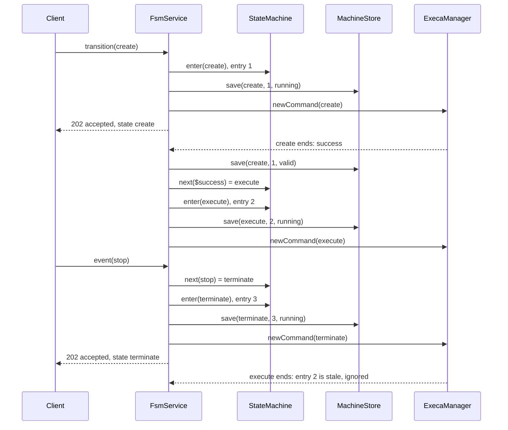
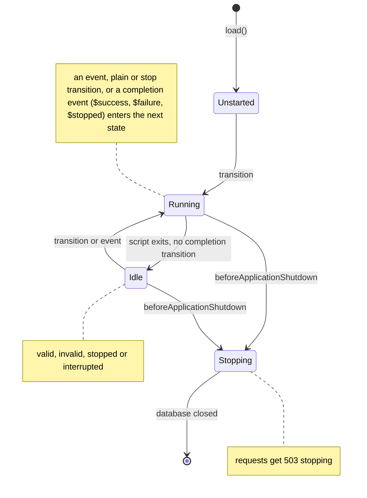
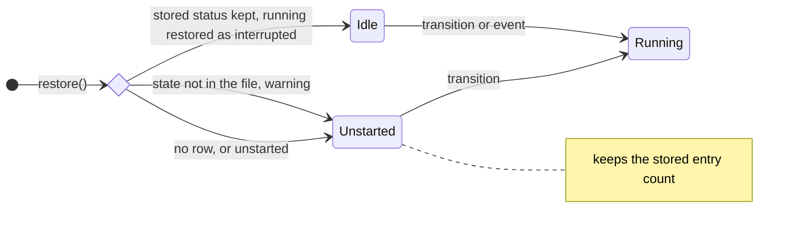

# Design: State Machine for Script Transitions

This document is for developers of the runner: how the state machine
is built, why, and where to change it. How a digital twin (DT) author
writes and drives a state machine is in the user guide,
[STATE-MACHINE.md](../STATE-MACHINE.md); the whole API is in
[API.md](../API.md). The facts of the user-level contract that the
code must keep are repeated here, so that this document can be read
alone.

## Problem

A digital twin runs as a sequence of scripts, for example _create_,
_execute_ and _terminate_. Without a state machine a client must call
the runner once for each script, and must decide by itself which
script comes next. The owner asked for:

1. A finite state machine (FSM) that moves a DT from one script to
   another automatically.
1. An API call with which the user moves the machine to a named script.
   Once that script starts, the state machine controls the transitions.
1. A state machine given per DT in a file, not hard coded in the
   runner.
1. Events defined per DT, received on an API endpoint, that determine
   the transitions.

Later issues added parameters (04), the state document and its
notifications (02, 03), command input and outcome (05), escalation
(06), presence (07), the script context (08), persistence across
restarts (09) and stopping scripts (10). Their files are in
[docs/issues](issues/README.md).

## Context

The runner is a NestJS service for one DT. It runs the permitted
scripts of one `location` folder through `ExecaManager`, keeps their
history in SQLite (`Queue`), and serves one API over HTTP and,
optionally, over MQTT. One runner serves one DT, so one runner has one
state machine.

`main.ts` starts the runner in this order, and the order matters:

1. `Config.loadConfig` reads `runner.yaml`.
1. `FsmService.load()` reads and checks the state machine file, before
   the database opens, so that an invalid file stops the runner before
   it touches the database.
1. `Queue.open` opens the database file, if `runner.yaml` names one.
1. `FsmService.restore()` marks the unfinished commands `interrupted`
   and resumes the stored machine (see [Persistence](#persistence)).
   It runs before any request can arrive.
1. `MqttService.start()`, then `app.listen`, which runs the
   `onModuleInit` and `onApplicationBootstrap` hooks: the `Notifier`
   subscribes to changes and sends the startup state document, which is
   thus the restored one.
1. `FsmService.setRunnerUrl` gives the scripts `RUNNER_URL`.

## Components

| Unit                         | Responsibility                                                       |
| :--------------------------- | :------------------------------------------------------------------- |
| `fsm/definition.ts`          | read, parse and check the state machine file into a `Definition`     |
| `fsm/name.ts`                | name pattern of states, events, parameters and ids                   |
| `fsm/completion-cycle.ts`    | finds a loop of completion transitions                               |
| `fsm/parameters.ts`          | parameter schema and checks; `Parameters` holds and changes values   |
| `fsm/script-context.ts`      | `env` schema and checks; `RunnerContext` builds a script environment |
| `fsm/manager.ts`             | schema and check of the manager commands                             |
| `fsm/escalation.ts`          | escalation section; `Escalations` raises triggers and requests       |
| `fsm/state-machine.ts`       | pure machine: current state, entry count, next state                 |
| `fsm/requests.ts`            | answers transition and event requests, with their request keys       |
| `fsm/recent-replies.ts`      | bounded store of replies to repeated requests                        |
| `fsm/script-outcome.ts`      | runs a state's script; `failed` if it can not start                  |
| `fsm/stop-chain.ts`          | runs scripts after the stops of stop transitions, in order           |
| `fsm/recovery.ts`            | pure: the machine to resume from the stored row                      |
| `fsm/machine-store.ts`       | stores the machine, and restores it at startup                       |
| `fsm/fsm.service.ts`         | `FsmService`: runs scripts, raises completion events, replies        |
| `fsm/fsm.controller.ts`      | HTTP routes `/fsm`, `/fsm/transition`, `/fsm/event`                  |
| `parameters.controller.ts`   | HTTP routes `GET` and `PUT /parameters`                              |
| `dto/fsm.dto.ts`             | request schemas, reply bodies, status codes, `ScriptStatus`          |
| `dto/state.dto.ts`           | the state document and its latest command                            |
| `dto/parameters.dto.ts`      | parameters body schema and document                                  |
| `descriptor.service.ts`      | builds `GET /dt` and `GET /state`; forwards change signals           |
| `notify/changes.ts`          | `Changes`: a plain signal of a possible change of the document       |
| `notify/notifier.service.ts` | sends state, escalation and presence notifications                   |
| `mqtt/*`                     | the request topics of the routes, and the notification topics        |
| `execa-manager.service.ts`   | runs, joins and stops commands; closes the database at shutdown      |
| `queue.service.ts`           | SQLite: commands, request keys, parameter changes, the machine row   |
| `queue.machine.ts`           | the SQL of the `machine` row and of marking commands interrupted     |

`FsmService` owns plain objects rather than injected services:
`Requests`, `Changes`, `RunnerContext`, `Escalations`, `StopChain` and
`MachineStore`. Each was kept out of the Nest container so that no
constructor reaches Qlty's limit of four parameters and no dependency
cycle forms; `DescriptorService` forwards the signals of `FsmService`
and `Queue` to the `Notifier`.

## Data Flow

A transition request, the completion that follows, and an event. The
file is the one of [The State Machine File](#the-state-machine-file),
where `stop` is a plain transition, so _execute_ keeps running and its
completion is stale once the machine has left its entry:



- `enter` refuses a state whose script `ExecaManager` still runs
  (`script running`), as `newCommand` would join that run instead of
  starting the script for the new entry (D8).
- `run` calls `newCommand` synchronously, so the queue has signalled
  the new command before `enter` emits the change of the machine; the
  `Notifier` sends one document per entry and skips the unchanged one.
- The reply does not wait for the script (D9), and does not depend on
  the write of the machine, which only logs a failure.
- Each state change and script exit emits a change through `Changes`;
  the `Notifier` sends the state document when it differs from the last
  one sent.

A transition with `stop: true` enters its target at once and replies;
`StopChain` then stops the script of the state left, waits until it
has exited, and runs the script of the target, unless shutdown began or
a later entry happened. The stops of several stop transitions are
chained, so that a later target does not start while an earlier script
still exits. A plain entry runs its script at once.

## The State Machine File

`runner.yaml` names the file with `stateMachine`, relative to
`runner.yaml` or absolute (D1). `FsmService.load()` reads it once, at
startup.

```yaml
events:
  - stop
  - reset
states:
  create:
    transitions:
      $success: execute
      $failure: terminate
  execute:
    transitions:
      stop: terminate
  terminate:
    transitions:
      reset: create
```

- A state is a script of the same name (D2). `transitions` maps an
  event to the next state (D3); YAML refuses duplicate keys, so the
  machine is deterministic.
- `events` lists the events that clients may send (D4).
- `$success`, `$failure` and `$stopped` are completion events, raised
  by the runner when the script of the current state exits (D5, D19).
- A transition value is a state name, or `{ state, stop: true }`, which
  stops the script of the state left before the next one runs (D20).
- `parameters` declares the parameters of the DT (D21, D22), `env` the
  variables of the scripts (D23), `escalation` the triggers the runner
  escalates by itself (D25), and `manager.commands` the commands a
  Manager may submit (D24).

### Validation

`loadDefinition` refuses the file, and the runner does not start, when:

- it holds a key other than `events`, `states`, `parameters`, `env`,
  `escalation` and `manager`, a state a key other than `transitions`
  and `env`, `escalation` a key other than the booleans `onFailure` and
  `onNoTransition`, or `manager` a key other than `commands`;
- a command of `manager.commands` is not permitted by `runner.yaml`;
- a state or event name does not match `^[A-Za-z0-9][\w.-]{0,63}$`, so
  that a name can not be a path, a command-line flag or an object
  property such as `__proto__` (zod skips a `__proto__` record key, so
  the runner looks for it in the parsed YAML first);
- a state is not a permitted command of `runner.yaml`;
- a transition leads to an undeclared state, or its event is neither
  declared in `events` nor a completion event;
- a transition object holds more than `state` and `stop: true`, or is
  the transition of a completion event, whose script has already
  exited;
- `$success` and `$failure` transitions alone form a cycle
  (`completion-cycle.ts`, D11). `$stopped` is left out: it follows only
  a stop from outside, so a loop through it can not run by itself;
- a parameter has a bad name or `__proto__`, an unknown `type`, a
  `default` not of that type (a finite number for `number`, one of
  `values` for `enum`), an `event` not in `events`, or another key;
- two parameter names give the same variable name, `DT_PARAM_`
  followed by the name in upper case with `.` and `-` as `_`;
- an `env` name does not match `^[A-Z][A-Z0-9_]*$` or starts with `DT_`
  or `RUNNER_`, a value is not a string, a finite number or a boolean,
  or a `${NAME}` in a value names neither a runner variable
  (`RUNNER_URL`, `DT_ID`, `DT_STATE`, `DT_ENTRY`) nor the variable of a
  declared parameter.

`events` may be left out, and a state without transitions may be left
empty. Without `stateMachine` the machine is off, and its routes answer
`404` to well-formed requests. The error names the file and every
problem; js-yaml errors and an empty file are wrapped to name the file.

## Lifecycle

`FsmService` keeps the machine (`StateMachine`, or `undefined` without
a file), the `status` of the current state's script, and `stopping`,
set by `beforeApplicationShutdown`.



- **Unstarted**: `state` is `null`, `status` `none`, `entry` `0` (D6).
  A transition request may name any declared state; an event gets
  `no transition`.
- **Running**: `status` is `running`. A transition request gets `busy`
  (D7); an event moves the machine along its transition, with or
  without `stop: true`.
- **Idle**: the script has exited and no completion transition moved
  the machine on, or the machine was restored (see
  [Persistence](#persistence)). `status` is `valid`,
  `invalid` (a failed script, D27), `stopped` (a stop request, D20) or
  `interrupted` (a restart, D28). A transition request or an event
  moves it.
- **Stopping**: `Requests` answers every transition and event with
  `stopping`. No new script starts: `run` checks `stopping` before it
  starts a script, so the target of a stop transition waiting in the
  `StopChain` does not start. A script that exits stores its status and
  emits a change, but `complete` does not run (D14).

Every entry increments `entry`, so `run` and the completion of a script
can tell their entry from a later one: a completion whose entry is no
longer the machine's is ignored.

## Requests

The controllers and the MQTT handler call the same `FsmService` and
`ParametersController` methods, so both protocols share one contract.
A transition or event reply is `{ status, state }`, where `state` is the
state after the request or `null`:

| Status                | HTTP | Meaning                                              |
| :-------------------- | :--- | :--------------------------------------------------- |
| `accepted`            | 202  | the machine entered the state and started its script |
| `invalid state`       | 400  | the state is not in the file                         |
| `invalid event`       | 400  | the event is not in `events`                         |
| `invalid request key` | 400  | the request key belongs to another request           |
| `busy`                | 409  | a transition request while the state's script runs   |
| `no transition`       | 409  | the current state has no transition for the event    |
| `script running`      | 409  | the script of the target state is still running      |
| `no state machine`    | 404  | `runner.yaml` has no `stateMachine`                  |
| `stopping`            | 503  | the runner is shutting down                          |

`FSM_STATUS_CODES` in `dto/fsm.dto.ts` maps each status to its code;
MQTT has no codes, so the body names the outcome (D15, D16). A
malformed body or request key gets the `Validation Failed` response of
`ZodValidationPipe`, before any other check.

- `Requests.reply` keeps the replies of accepted requests with an
  `Idempotency-Key` in a `RecentReplies` of 256 (D13). A repeat gets the
  first reply; a refused request changed nothing and is checked again;
  a key of another request gets `invalid request key`.
- `GET /fsm` returns `StateMachine.describe(status)`:
  `{ state, status, entry, events }`, with the events sorted.
- `GET /state` (`DescriptorService.state`) joins the machine, or
  `null`, with the id, the parameter values and the latest command.
- `PUT /parameters` checks the whole body (`Parameters.check`), stores
  the changes in one transaction, commits them, emits a change, and
  raises each declared event once, in declaration order, through
  `Requests.raise`, which logs a refusal and never escalates (D22).
- `POST /stop` belongs to the command API: `ExecaManager.stop` stops
  the named command or all, and resolves once they have exited (D18).
  The machine follows `$stopped` when the stopped script is the current
  state's.
- `POST /escalate` needs no machine; `Escalations.request` keeps its
  own 256 request keys (D25).

## Behaviour

1. A transition request moves an idle machine to any declared state.
1. An event moves the machine along the transition of the current
   state for that event, whether or not the script of that state is
   still running. An event without a transition escalates once per
   entry with `onNoTransition`; an event that a parameter raises never
   does.
1. Entering a state starts its script through `ExecaManager`, so the
   permitted-command check and the history apply unchanged. The script
   gets the environment of `RunnerContext` and no stdin.
1. When the script exits, the runner sets the status from the outcome
   (`success` `valid`, `failed` `invalid`, `stopped` `stopped`), stores
   it, and raises `$success`, `$failure` or `$stopped`, if the machine
   is still in the same entry. A `$failure` without a transition
   escalates with `onFailure`.
1. A plain transition does not stop the script of the state it leaves
   (D10). A completion transition into a state whose script runs is
   skipped with a warning, through `logStay`.
1. On a transition with `stop: true` the runner refuses with
   `script running` if the script of another target state runs (D8),
   enters the target at once, which makes the completion of the old
   script stale, and replies `accepted`. `StopChain` then stops the
   script of the state left, waits until it has exited, and runs the
   script of the target, unless shutdown began or a later entry
   happened. A self-transition thus restarts the script.
1. On a restart the runner marks every unfinished command
   `interrupted` and resumes the stored machine (D12, D28).

## Persistence

`Queue` keeps four tables in one SQLite database, in memory unless
`runner.yaml` names a file:

| Table          | Rows                                                                 |
| :------------- | :------------------------------------------------------------------- |
| `commands`     | each command: name, status, logs, exit code, received and finished   |
| `request_keys` | the `Idempotency-Key` of each `POST /` request, and its command      |
| `parameters`   | each parameter change, with its value as JSON and its time           |
| `machine`      | one row (`id` 1): the state (`NULL` unstarted), entry, script status |

`CREATE TABLE IF NOT EXISTS` never changes an existing file, so new
columns come from a guarded `ALTER TABLE` (as 05's `exit_code`) and new
tables from the schema itself (as 09's `machine`).

`MachineStore.save` writes the machine with `INSERT OR REPLACE` at each
entry, with status `running`, and at each script exit. A failed write
is logged and the reply stands. `FsmService.restore()` calls
`MachineStore.restore`, which:

1. marks every `commands` row without `finished_at` as `interrupted`,
   finished at the startup time, with or without a state machine: no
   script survives a restart;
1. without a definition, logs a stored row and keeps it, so that a
   later start with the state machine resumes it;
1. otherwise applies `recover` and writes the result back at once, so a
   `running` row does not stay;
1. restores the parameter values that still fit their declarations
   (`Parameters.restore`), and warns once about the rest.



`recover` keeps the stored entry count in every case, so entry numbers
never repeat for a Manager. No script starts on recovery, so a crash in
a script can not loop through restarts (D28), and no notification of
its own is sent: the `Notifier`'s startup document is the restored one.

At shutdown, Nest runs every `beforeApplicationShutdown` hook (the
`FsmService` sets `stopping`, the `Notifier` and `MqttService` leave),
then `ExecaManager.onApplicationShutdown`, which waits for the running
scripts, then one turn of the event loop (`setImmediate`), and closes
the database. `FsmService.run` stores a script's status a few
microtasks after the run settles; the turn lets that write land. The
invariant: nothing between a run settling and that write may await
I/O.

## Decisions

Fable reviewed a draft of this design. D7, D8, D11, D13, D14, the name
pattern and the single definition unit came from its review; its
proposal to derive the events from the transitions was declined (D4).

| #   | Decision                                                                                       | Reason                                                                                                                                                                                                                                                                                                                                                          |
| :-- | :--------------------------------------------------------------------------------------------- | :-------------------------------------------------------------------------------------------------------------------------------------------------------------------------------------------------------------------------------------------------------------------------------------------------------------------------------------------------------------- |
| D1  | YAML file that the `stateMachine` key of `runner.yaml` names                                   | The owner asked for a file in the script folder. YAML matches `runner.yaml` and `js-yaml` is already a dependency. Amended by issue 01 (S5): the fixed name `state-machine.yaml` in `location` gave way to a key, so that `runner.yaml`, the operator's file, names the DT author's file.                                                                       |
| D2  | A state is a script of the same name                                                           | The owner speaks of transitions between scripts. A separate `script` key can be added later if two states must share a script.                                                                                                                                                                                                                                  |
| D3  | Nested `transitions` maps instead of a list of transitions                                     | Duplicate YAML keys are an error, so a state can not have two transitions for one event, as in XState. The key is not XState's `on`, which YAML 1.1 parsers and yamllint read as `true`.                                                                                                                                                                        |
| D4  | Explicit `events` list                                                                         | The owner asked for events defined per DT. The list separates an unknown event (400) from an event without a transition in the current state (409), and catches a misspelt event in `transitions` at startup. Fable proposed deriving it; this was declined.                                                                                                    |
| D5  | `$success` and `$failure` completion events                                                    | They give automatic transitions from one script to the next without a client. Clients can not send them: `events` only holds names that match the name pattern, which has no `$`, so a request for them is `invalid event`.                                                                                                                                     |
| D6  | No initial state                                                                               | The user's transition request starts the machine.                                                                                                                                                                                                                                                                                                               |
| D7  | A transition request is accepted only when the machine is idle                                 | The owner said the state machine takes control once the script starts. An override at any time would compete with the machine. A hung script is left by an event, so the README asks for one out of each long state. A Manager that must force a state calls `POST /stop` first, which leaves the machine idle only in a state without a `$stopped` transition. |
| D8  | A state whose script is running can not be entered (409 `script running`)                      | `ExecaManager` joins a run in progress, so entering such a state would not run its script and would attach the completion of an earlier entry. A transition with `stop: true` into the current state is the exception: it stops the script first (D20).                                                                                                         |
| D9  | Replies do not wait for the script                                                             | A long _execute_ would hold the request open. The state is reported by `GET /fsm`.                                                                                                                                                                                                                                                                              |
| D10 | Leaving a state stops its script only on a transition with `stop: true`                        | The runner can stop a script (D18), but the scripts of existing DTs stop one another, and a state whose script should outlive it must stay possible. The DT author marks the transitions that stop.                                                                                                                                                             |
| D11 | Reject cycles of completion transitions at startup                                             | With fast scripts such a cycle would run forever and add a history row each time.                                                                                                                                                                                                                                                                               |
| D12 | The machine is stored in the database and resumed                                              | Amended by issue 09. A DT that forgets its state reports a wrong one to a Manager after a restart. One `machine` row in the database of `Queue` holds the state, entry and status, written at each entry and script exit; a failed write is only logged. In memory, the machine starts unstarted.                                                               |
| D13 | `Idempotency-Key` replays the reply in memory, for accepted requests                           | MQTT QoS 1 can deliver a request twice, which would apply an event twice. The header and user property have the names of `POST /`, but the keys are a namespace of their own, apart from the keys of `POST /` in the database. It keeps the last 256 accepted replies; a refused request changed nothing and is checked again.                                  |
| D14 | Stop accepting requests in `beforeApplicationShutdown`                                         | `ExecaManager` closes the database in `onApplicationShutdown`; a completion must not start a script after that.                                                                                                                                                                                                                                                 |
| D15 | 202 Accepted for accepted requests                                                             | The script has started, not finished.                                                                                                                                                                                                                                                                                                                           |
| D16 | MQTT topics `transition`, `event` and `fsm` next to the existing ones                          | One level under the base topic, so the `<topic>/+/response` subscription of the README covers them. Amended by issue 03: notifications go two levels down, on `<base>/notify/<kind>`. The runner subscribes to its exact request topics, so a notification is never taken for a request.                                                                        |
| D17 | A required `id`, and one strict schema for all of `runner.yaml`                                | Added by issue 01. A Manager and the runner's notifications must name the DT, and the port or base topic does not. The `id` follows the name pattern of states. An unknown key of `runner.yaml` is an error, as in the state machine file.                                                                                                                      |
| D18 | A stop sends `SIGTERM`, then `SIGKILL` after `stopGrace` (5 s)                                 | execa's `forceKillAfterDelay` gives a script time to clean up and still ends one that ignores `SIGTERM`. `POST /stop` answers once the processes have exited, so a following request of the same command starts it afresh.                                                                                                                                      |
| D19 | A run ends `success`, `failed` or `stopped` (`RunOutcome`)                                     | A boolean can not tell a deliberate stop from a crash. A run is `stopped` only when the runner's own stop reached the process; a kill from outside stays a failure, and a deliberate stop never counts as a crash for escalation (06).                                                                                                                          |
| D20 | `$stopped` completion event and transitions with `stop: true`                                  | `$stopped` lets the DT author choose what follows a stop; without a `$stopped` transition the machine stays idle. A stop transition enters its target before the old script exits, so the reply does not wait (D9) and the old completion is stale; a self-transition with `stop: true` restarts the script.                                                    |
| D21 | Parameters are declared in the state machine file                                              | Added by issue 04 (S4). The DT author knows which settings the scripts read and which a Manager may change; `runner.yaml` is the operator's file. Parameters thus need a state machine file, and a DT without one has none.                                                                                                                                     |
| D22 | A parameter change raises only its declared event                                              | Added by issue 04 (S6). The runner never restarts a script on its own; a DT author who wants a restart links the parameter to an event with a self-transition and `stop: true`. A body is checked whole, stored, applied, and then its events are raised once each in declaration order. The reply does not depend on the events.                               |
| D23 | Scripts get the runner's context as environment variables                                      | Added by issue 08. Every script language reads its environment, and nothing goes on the command line. Values are those at the script's start (S6). A declared `env` interpolates only runner variables, so a file means the same on every host. Events return over HTTP through `RUNNER_URL`, not stdout (open question 13).                                    |
| D24 | The commands a Manager may submit are listed in the state machine file                         | Added by issue 05 (S4). The DT author knows which scripts a Manager may run, as with parameters (D21). The list is shown on `GET /dt` and enforced only with access control by role (15).                                                                                                                                                                       |
| D25 | Escalation triggers are opt-in; a request needs no machine                                     | Added by issue 06 (S4); D23 is 08's, D24 05's. Only the DT author knows when its adaptation is exhausted, so the runner escalates by itself only on the declared triggers, a repeated event once per entry. `POST /escalate` needs no machine, so a plain DT escalates too. An escalation is not retained, so a late Manager does not act on an old one.        |
| D26 | Presence: an online notice per connect, an offline notice, a will                              | Added by issue 07. A Manager learns of a runner without asking. The online notice carries the descriptor and is published on each connect, as the broker keeps only the last; the webhook hears it once. The graceful end at shutdown drops the will, which covers a crash, a kill or a lost connection with `time: null`.                                      |
| D27 | Command input goes to stdin, is not stored, and a failed script is told from a refused command | Added by issue 05. Stdin keeps input off the command line of a remote execution service. The input may hold personal data and nothing reads it back. A permitted script that fails is `failed` (200, with its result); `invalid command` (400) stays for a command that is not permitted. The machine's `ScriptStatus` keeps `invalid` for a failed script.     |
| D28 | A script running at a restart is `interrupted`, not run again                                  | Added by issue 09. No script survives a restart, and a rerun could repeat a side effect or loop in a crash. The machine is idle in its state (D7), so a transition or an event moves it on; a stored state the file no longer has starts the machine afresh with its entry count.                                                                               |

## Assumptions

- A1: One runner serves one DT, so one machine per runner is enough.
- A2: The scripts of a state machine are also listed in `commands`;
  the machine adds no way around that list.
- A3: Scripts may run long. The DT's own scripts stop one another, or
  the runner stops them on `POST /stop` or a transition with
  `stop: true`. A script ends its children on `SIGTERM`, as the runner
  waits until its output pipes close.
- A4: Events come from clients over HTTP or MQTT. Script exit is the
  only event the runner raises by itself; a parameter change raises
  the event its declaration names, on a client's request (D22).
  Amended by issue 03: the runner also publishes its state unasked,
  over MQTT and a webhook, whenever the state document changes; a
  notification raises no event. Amended by issue 08: a script is such
  a client; it raises events over HTTP through `RUNNER_URL` (D23).
  Amended by issue 07: the runner also announces itself unasked when it
  connects and when it leaves (D26).
  Amended by issue 06: the runner also sends an escalation by itself
  on the triggers that the DT author declares (D25); an escalation
  raises no event either.
- A5: A script that is permitted but missing fails when it runs, and
  raises `$failure`. The runner does not check that scripts exist at
  startup, as on Windows it runs the `.ps1` version.
- A6: Changing the state machine file, or the `stateMachine` key that
  names it, takes effect on a restart.
- A7: A manual `POST /` of the script of the current state joins the
  machine's run. A manual run of another script does not affect the
  machine.
- A8: Anyone who can call the API can drive the machine, as anyone can
  call `POST /` today. Access control stays with the network and the
  MQTT broker.

## Error Handling

- A missing or invalid file stops the runner at startup with a message
  naming the file and each problem.
- A script that fails to start, as when the database is closed, counts
  as a failed script (`script-outcome.ts`).
- A completion transition into a state whose script is running is
  skipped with a warning; the machine stays where it is, idle.
- An event that a parameter change raises and the machine refuses is
  logged, at debug level for `no transition` and as a warning
  otherwise; the parameter change stands.
- A failed write of the machine is logged; the reply stands. A stored
  state or parameter value that the file no longer allows is dropped
  with a warning at startup.
- A webhook or broker failure never fails a request: notifications are
  queued or retried, and logged.

## Testing

Run `yarn test` (`--maxWorkers=2` on a loaded Windows host); bare
`jest` misses the `pretest` step that copies the test scripts. The
tests of the state machine:

- Unit, with a fake `ExecaManager` and `Queue` from
  `test/unit/fsm.fixture.ts`: the definition rules
  (`fsm.definition.spec.ts`, `fsm.declared-env.spec.ts`,
  `fsm.manager.spec.ts`), the pure units (`fsm.state-machine`,
  `fsm.recovery`, `fsm.recent-replies`, `fsm.parameters*`,
  `fsm.escalation`, `fsm.machine-store`), and the service
  (`fsm.service*.spec.ts`: each status, completion events, stale
  completions, stop transitions, shutdown, request keys, parameters,
  escalation, script environment, restore).
- Integration, with a real SQLite: `queue.machine.spec.ts`,
  `queue.migration.spec.ts`, and the manager's shutdown and restart
  behaviour in `execa-manager.restart.spec.ts`.
- End to end, with the Nest module and real scripts in a temporary
  folder (`test/e2e/fsm.util.ts`): `fsm.spec.ts`, `fsm.stop.spec.ts`,
  `parameters.spec.ts`, `escalation.spec.ts`, `script-context.spec.ts`,
  `state.spec.ts`, and `restart.spec.ts`, which restarts a runner on
  its database file with `startStoredRunner`.
- `mqtt.broker.spec.ts` runs only in CI, against Mosquitto with MQTT 5;
  a change to a reply shape must be checked there too.
- `dist.spec.ts` starts the build, which catches an import without its
  `.js` suffix that ts-jest resolves.

eslint lints no `.ts` file here, so type errors, also in tests, show
only in `npx tsc --noEmit --noUnusedLocals --noUnusedParameters`.

## Changing the Implementation

- A new key of the state machine file: its schema and checks in
  `definition.ts` or a unit beside it, a rule in
  [Validation](#validation), a test per rule, and the user guide.
- A new status or reply: `dto/fsm.dto.ts` and its code, the README,
  the user guide, `api/*.http`, and `mqtt.broker.spec.ts`.
- A new table or column: `queue.service.ts` with a guarded migration
  and a test that opens a file of the earlier version.
- Behaviour of `FsmService`: the file is near the 250-line limit, so
  move a unit out before adding; keep functions under Qlty's
  complexity 5, and constructors under four parameters.
- A breaking change to a route bumps the minor version in
  `package.json` and gets a line in the README.

## Out of Scope

Guards, actions, timers, hierarchical or parallel states; more than
one machine per runner.
