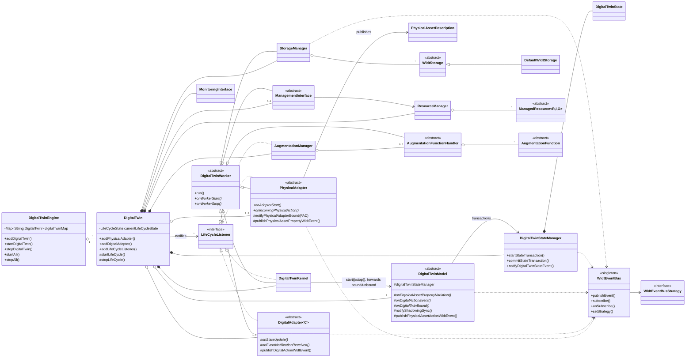
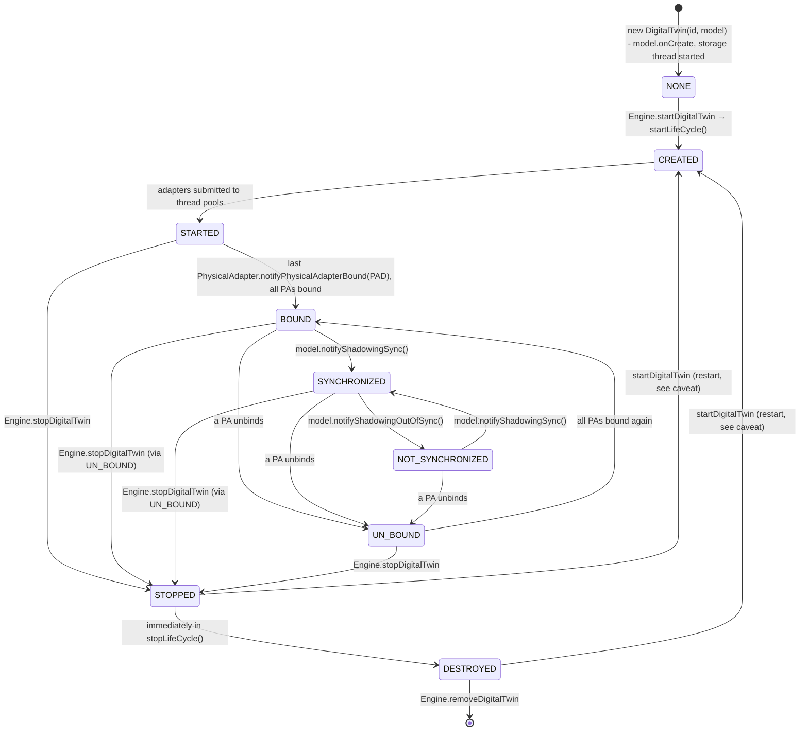
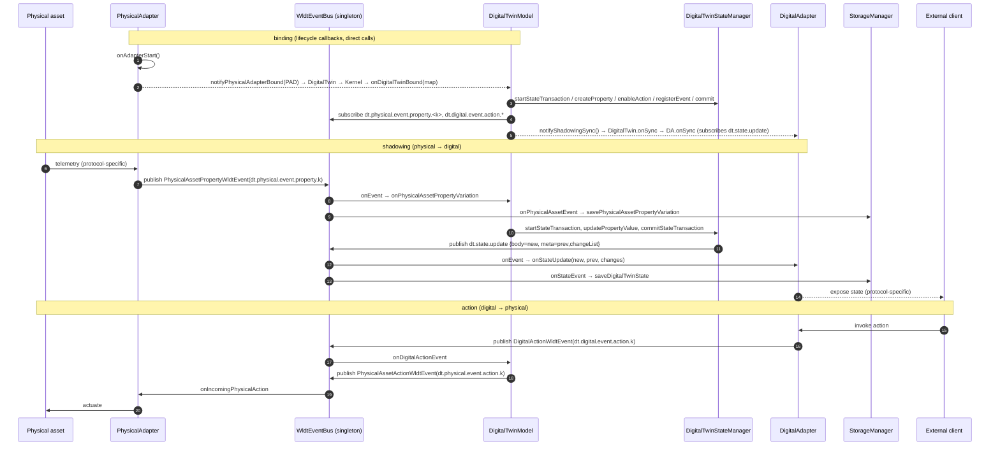

# WLDT Core (Java): Architectural and Feature Map

Source: <https://github.com/wldt/wldt-core-java> at commit `0f76c6ba`, read
only; nothing was built or run. The learnings for the runner are in
[wldt-research-notes.md](wldt-research-notes.md), and the documentation and
paper are summarised in [wldt-docs-and-paper.md](wldt-docs-and-paper.md).

- Version **0.8.1** (`build.gradle.kts:2`), artifact `io.github.wldt:wldt-core`,
  Java source level 1.8 (`build.gradle.kts:4`). Gradle build (there is no
  `pom.xml`).
- Latest commit `0f76c6ba` on **2026-11-06** ("Update README to reflect version
  bump of wldt-core to 0.8.1"); 136 commits; tags v0.5.0 to v0.8.1.
- **No runtime dependencies.** Only test dependencies: JUnit 5 and the
  Prometheus client (`build.gradle.kts:23-31`). Logging, metrics, event bus and
  storage are all implemented in the library itself.
- Licence: GPL-3.0 for non-commercial use, commercial licence otherwise
  (`README.md`).
- Changelogs: `docs/changelogs/v0.6.0.md` … `v0.8.1.md`.

Every citation is `path:line` relative to the repository root. Main sources are
under `src/main/java/it/wldt/`, abbreviated **`M/`** below, so
`M/core/engine/DigitalTwin.java:59` means
`src/main/java/it/wldt/core/engine/DigitalTwin.java:59`. Test sources
`src/test/java/it/wldt/` are abbreviated **`T/`**. Anything marked _inference_
is my reading of the code, not something the code or docs state.

---

## 1. Package tree

| Package                                                                                                        | Responsibility                                                                                                                                                                                                                       |
| :------------------------------------------------------------------------------------------------------------- | :----------------------------------------------------------------------------------------------------------------------------------------------------------------------------------------------------------------------------------- |
| `it.wldt.core.engine`                                                                                          | `DigitalTwinEngine` (holds many DTs), `DigitalTwin` (one DT and its lifecycle), `DigitalTwinWorker` (Runnable base class), `LifeCycleState`, `LifeCycleListener`, `LifeCycleStateVariation`                                          |
| `it.wldt.core.model`                                                                                           | `DigitalTwinKernel` (wires the DT's internal managers together), `DigitalTwinModel` (the user's behaviour: shadowing callbacks), `ShadowingModelListener`                                                                            |
| `it.wldt.core.model.annotation`                                                                                | `@ShadowingFunction` and the `ShadowingType` enum: metadata on the model's callback methods                                                                                                                                          |
| `it.wldt.core.state`                                                                                           | DT State (`DigitalTwinState`), its resources (property, event, action, relationship, relationship instance), `DigitalTwinStateManager`, `DigitalTwinStateTransaction`, `DigitalTwinStateChange`, `DigitalTwinStateEventNotification` |
| `it.wldt.core.event`                                                                                           | In-JVM event bus: `WldtEventBus` singleton, `WldtEvent`, `WldtEventFilter`, `WldtEventTypes`, pluggable `WldtEventBusStrategy` (5 implementations), `EventManager` helpers, event logger                                             |
| `it.wldt.core.event.observer`                                                                                  | `WldtEventObserver`: subscribes to every family of DT events on behalf of a listener (the StorageManager uses it)                                                                                                                    |
| `it.wldt.adapter.physical`                                                                                     | `PhysicalAdapter`, `ConfigurablePhysicalAdapter<C>`, the Physical Asset Description model (`PhysicalAssetDescription`, `…Property`, `…Event`, `…Action`, `…Relationship`, `…RelationshipInstance`) and the records storage persists  |
| `it.wldt.adapter.physical.event`                                                                               | Physical events on the bus: property variation, event notification, action, relationship instance created and deleted                                                                                                                |
| `it.wldt.adapter.digital`                                                                                      | `DigitalAdapter<C>`, `DigitalAdapterListener`, `DigitalAdapterLifeCycleListener`, `DigitalActionRequest`                                                                                                                             |
| `it.wldt.adapter.digital.event`                                                                                | `DigitalActionWldtEvent`, `DigitalWldtEvent`                                                                                                                                                                                         |
| `it.wldt.augmentation` (+ `function`, `handler`, `context`, `request`, `result`, `error`, `event`, `listener`) | Augmentation functions (since 0.7.0): `AugmentationManager`, handlers, stateless and stateful functions, results, errors, augmentation bus events                                                                                    |
| `it.wldt.storage`                                                                                              | `StorageManager` (records events to storages), abstract `WldtStorage`, in-memory `DefaultWldtStorage`                                                                                                                                |
| `it.wldt.storage.model` (+ `state`, `physical`, `digital`, `lifecycle`, `augmentation`)                        | Stored record types and `StorageStats`                                                                                                                                                                                               |
| `it.wldt.storage.query`                                                                                        | Query requests and results carried over the bus: `QueryRequest`, `QueryResult`, `QueryExecutor` (client side), `QueryManager`/`DefaultQueryManager` (storage side)                                                                   |
| `it.wldt.management`                                                                                           | `ManagementInterface` (worker), `ResourceManager`, `ManagedResource<R,I,O>` (CRUD), `ResourceRequest`/`ResourceResponse`, observers                                                                                                  |
| `it.wldt.monitoring` (+ `metrics`)                                                                             | `MonitoringInterface` (one per DT), `MonitoringInterfaceConfiguration`, `MonitoringInterfaceHandler` (the exporter extension point), metric types, `CoreMonitoringUtils` (metric names)                                              |
| `it.wldt.log`                                                                                                  | Logging facade: `WldtLogger`, `WldtLoggerFactory`, `WldtLoggerProvider`, default stdout logger                                                                                                                                       |
| `it.wldt.exception`                                                                                            | 25 checked exceptions, all `extends Exception` (`M/exception/*.java`)                                                                                                                                                                |

---

## 2. Core abstractions and relationships

### 2.1 What each class is

- **`DigitalTwinEngine`** holds a `Map<String, DigitalTwin>`
  (`M/core/engine/DigitalTwinEngine.java:41`). It offers add, remove, start and
  stop for one DT or all of them (`:58-131`, `:140`, `:180`). Every method is
  `synchronized`. It is a plain in-process registry: no scheduling and no
  persistence.
- **`DigitalTwin`** (`M/core/engine/DigitalTwin.java:59`) is one twin. It
  implements `ShadowingModelListener`, `PhysicalAdapterListener` and
  `DigitalAdapterListener`. It owns:
  - the lists of physical and digital adapters (`:96`, `:101`);
  - a `DigitalTwinStateManager` (`:127`), `StorageManager` (`:189`),
    `ResourceManager` (`:158`), `AugmentationManager` (`:107`) and
    `MonitoringInterface` (`:194`);
  - an optional `ManagementInterface` (`:164`);
  - the `DigitalTwinKernel` (`:132`);
  - the lifecycle listener list (`:137`) and `currentLifeCycleState` (`:142`).

  At most 5 physical and 5 digital adapters
  (`PHYSICAL_ADAPTERS_THREAD_POOL_SIZE_LIMIT`, `:71`, `:76`; checked at `:670`,
  `:720`).

- **`DigitalTwinKernel`** (`M/core/model/DigitalTwinKernel.java:46`) extends
  `DigitalTwinWorker` and implements `LifeCycleListener`. Its constructor
  injects the state, storage, resource and augmentation managers into the model
  (`:83-86`). Its worker thread calls `digitalTwinModel.start()` (`:112`). It
  passes `onDigitalTwinBound`, `onDigitalTwinUnBound` and
  `onPhysicalAdapterBindingUpdate` on to the model (`:138`, `:159`, `:165`). In
  0.6.0 the old `DigitalTwinModel` was renamed `DigitalTwinKernel`, and the old
  `ShadowingFunction` was renamed `DigitalTwinModel`
  (`docs/changelogs/v0.6.0.md`).
- **`DigitalTwinModel`** (`M/core/model/DigitalTwinModel.java:99`) is the
  abstract class users subclass for the DT's behaviour, called the "shadowing
  function". It is a `WldtEventListener`. It holds protected references to
  `digitalTwinStateManager`, `storageManager` and `resourceManager`
  (`:118-128`). Subscription helpers:
  - `observePhysicalAssetProperty/Properties/Event(s)/Relationship(s)`
    (`:654-899`);
  - `observeDigitalActionEvents` (`:925`);
  - `publishPhysicalAssetActionWldtEvent` (`:952`).

  Augmentation calls: `execute…`, `start…` and `stopAugmentationFunction`
  (`:1040-1361`). Abstract callbacks (`:2093-2278`):
  - lifecycle: `onCreate`, `onStart`, `onStop`, `onDigitalTwinBound`,
    `onDigitalTwinUnBound` and `onPhysicalAdapterBidingUpdate`;
  - shadowing: `onPhysicalAssetPropertyVariation`,
    `onPhysicalAssetEventNotification`,
    `onPhysicalAssetRelationshipEstablished`,
    `onPhysicalAssetRelationshipDeleted` and `onDigitalActionEvent`;
  - five augmentation callbacks.

  Sync is signalled with `notifyShadowingSync()` and
  `notifyShadowingOutOfSync()` (`:2303`, `:2312`).

- **`DigitalTwinWorker`** (`M/core/engine/DigitalTwinWorker.java:39`) is
  `Runnable`. `run()` calls `onWorkerStart()`; if that throws, it calls
  `onWorkerStop()` (`:58-75`). The base of PhysicalAdapter, DigitalAdapter,
  Kernel, StorageManager, ManagementInterface and AugmentationFunctionHandler.
- **`PhysicalAdapter`** (`M/adapter/physical/PhysicalAdapter.java:59`) extends
  `DigitalTwinWorker` and implements `WldtEventListener` and
  `LifeCycleListener`.
  - Abstract: `onIncomingPhysicalAction`, `onAdapterStart` and `onAdapterStop`
    (`:248-252`).
  - Publishes with `publishPhysicalAssetPropertyWldtEvent`, `…EventWldtEvent`
    and `…RelationshipCreated/DeletedWldtEvent`, stamping the adapter id on each
    event (`:254-353`).
  - Binds with `notifyPhysicalAdapterBound(PAD)` (`:423`), updates with
    `notifyPhysicalAssetBindingUpdate` (`:368`, `:396`), and unbinds with
    `notifyPhysicalAdapterUnBound` (`:417`).
  - Optional hooks: `onDigitalTwinSync()` and `onDigitalTwinUnSync()` (`:572`,
    `:584`).
  - `ConfigurablePhysicalAdapter<C>` adds a typed configuration
    (`M/adapter/physical/ConfigurablePhysicalAdapter.java:32-47`).
- **`DigitalAdapter<C>`** (`M/adapter/digital/DigitalAdapter.java:62`) has the
  same bases. Abstract methods (`:450-476`):
  `onStateUpdate(new, previous, changeList)`, `onEventNotificationReceived`,
  `onAdapterStart/Stop`, `onDigitalTwinSync/UnSync` and
  `onDigitalTwinCreate/Start/Stop/Destroy`. It sends actions with
  `publishDigitalActionWldtEvent` (`:250`, `:282`) and observes event
  notifications with `observe…EventsNotifications` (`:317-422`). It holds a
  `QueryExecutor` (`:95`, created at `:483-484`). Bound and unbound are reported
  by `notifyDigitalAdapterBound/UnBound` (`:432-447`).
- **Physical Asset Description (PAD)** is `PhysicalAssetDescription`, which
  holds lists of actions, properties, events and relationships
  (`M/adapter/physical/PhysicalAssetDescription.java:49-55`). Element fields:
  - `PhysicalAssetProperty<T>`: key, initialValue, type, contentType, immutable,
    writable (`M/adapter/physical/PhysicalAssetProperty.java:55-85`);
  - `PhysicalAssetEvent`: key, type, contentType
    (`M/adapter/physical/PhysicalAssetEvent.java:49-62`);
  - `PhysicalAssetAction`: key, type, contentType
    (`M/adapter/physical/PhysicalAssetAction.java:51-65`);
  - `PhysicalAssetRelationship<T>`: name, type
    (`M/adapter/physical/PhysicalAssetRelationship.java:43-45`);
  - `PhysicalAssetRelationshipInstance<T>`: key, targetId, relationship
    (`M/adapter/physical/PhysicalAssetRelationshipInstance.java:42-44`).

  Each physical adapter publishes its own PAD; the DT keeps one per adapter
  (`M/core/engine/DigitalTwin.java:112`, `:993`).

- **DT State.** `DigitalTwinState` holds maps of properties, actions, events and
  relationships, plus an `evaluationInstant`
  (`M/core/state/DigitalTwinState.java:41-47`). It is changed only through
  `DigitalTwinStateManager` transactions (§6).
- **`StorageManager`** (`M/storage/StorageManager.java:72`) is a worker that
  implements `IWldtEventObserverListener`. It writes bus events to every
  registered `WldtStorage` that opted in to that event family, and answers query
  requests (§7).
- **`ResourceManager` / `ManagementInterface` / `ManagedResource`** form the
  user's management surface (§7.3).
- **`AugmentationManager`** (`M/augmentation/AugmentationManager.java:50`) is a
  `LifeCycleListener` that hosts up to 5 `AugmentationFunctionHandler`s (`:60`,
  `:181`). Each handler
  (`M/augmentation/handler/AugmentationFunctionHandler.java:70`) runs
  `StatelessAugmentationFunction`s and `StatefulAugmentationFunction`s.
- **`MonitoringInterface`** (`M/monitoring/MonitoringInterface.java:30`) is one
  per DT and is passed to the model, adapters, augmentation and storage when the
  DT starts (`M/core/engine/DigitalTwin.java:808-819`, `:850-866`).
- **`LifeCycleListener`** (`M/core/engine/LifeCycleListener.java:35-63`) has 13
  callbacks. Registered automatically: the AugmentationManager
  (`DigitalTwin.java:287`), the Kernel (`:312`) and every physical and digital
  adapter (`:677`, `:730`). `addLifeCycleListener` is public (`:362`).

### 2.2 Component and class diagram



The components talk to each other mostly through the **process-wide**
`WldtEventBus` singleton, with each subscription scoped by a `digitalTwinId`
string. Lifecycle notifications are the exception: `DigitalTwin` calls each
`LifeCycleListener` directly.

---

## 3. DT lifecycle

### 3.1 States (exact enum)

`it.wldt.core.engine.LifeCycleState`
(`M/core/engine/LifeCycleState.java:23-34`): `NONE("dt_none")`,
`CREATED("dt_created")`, `STARTED("dt_started")`, `BOUND("dt_bound")`,
`UN_BOUND("dt_un_bound")`, `SYNCHRONIZED("dt_synchronized")`,
`NOT_SYNCHRONIZED("dt_not_synchronized")`, `STOPPED("dt_stopped")`,
`DESTROYED("dt_destroyed")`.

`fromValueToInt` maps each state to an integer for the lifecycle gauge
(`:59-97`), for example SYNCHRONIZED=8 and BOUND=7. The docs describe a
five-state conceptual lifecycle (Operating & Not Bound, Bound, Shadowed, Out of
Sync, Done; `docs/dt_definition_basic_concepts.md:94-104`). The enum has no
"Done" state.

Each transition goes through a `notifyLifeCycleOn*` method
(`M/core/engine/DigitalTwin.java:380-655`), which does four things:

1. sets `currentLifeCycleState` inside `synchronized(syncStateObject)`;
2. publishes a `dt.lifecycle` bus event whose body is the state string
   (`M/core/event/EventManager.java:131-151`);
3. updates the `life_cycle_value` metric;
4. calls every `LifeCycleListener`.

Per-adapter bound and unbound callbacks (`:494-547`) go to the listeners but do
**not** change `currentLifeCycleState`.

### 3.2 Transitions and triggers

| From → To                                | Trigger                                                                                                                                                                                                                                                                                                                                                  | Code                                                                                                                                                        |
| :--------------------------------------- | :------------------------------------------------------------------------------------------------------------------------------------------------------------------------------------------------------------------------------------------------------------------------------------------------------------------------------------------------------- | :---------------------------------------------------------------------------------------------------------------------------------------------------------- |
| (construction) → `NONE`                  | `new DigitalTwin(id, model)` builds the managers, starts the **StorageManager thread** and calls `model.onCreate()` through the Kernel constructor                                                                                                                                                                                                       | `DigitalTwin.java:261-316`, `:290`, `:315`; `DigitalTwinModel.java:490-503`                                                                                 |
| `NONE`/`STOPPED`/`DESTROYED` → `CREATED` | `DigitalTwinEngine.startDigitalTwin` → `startLifeCycle()`: starts the augmentation manager, the kernel ("model-engine") thread and the management interface thread, requires ≥1 physical and ≥1 digital adapter, then `notifyLifeCycleOnCreate`                                                                                                          | `DigitalTwinEngine.java:153-156`; `DigitalTwin.java:805-841`                                                                                                |
| `CREATED` → `STARTED`                    | Once every adapter has been submitted to its fixed thread pool                                                                                                                                                                                                                                                                                           | `DigitalTwin.java:844-874`                                                                                                                                  |
| → `BOUND`                                | A physical adapter calls `notifyPhysicalAdapterBound(PAD)` → `DigitalTwin.onPhysicalAdapterBound` marks it bound; when **all** physical adapters are bound (`isDtBound`), the DT goes `BOUND` and listeners get `onDigitalTwinBound(map adapterId→PAD)`                                                                                                  | `PhysicalAdapter.java:423-439`; `DigitalTwin.java:984-1001`, `:950-951`                                                                                     |
| `BOUND` → `SYNCHRONIZED`                 | **User code:** the model calls `notifyShadowingSync()`, usually after building the initial state in `onDigitalTwinBound` → `onShadowingSync` → `notifyLifeCycleOnSync`. Digital adapters then subscribe to state updates automatically                                                                                                                   | `DigitalTwinModel.java:2303-2307`; `DigitalTwin.java:963-966`; `DigitalAdapter.java:722-739`; example `T/process/shadowing/DemoDigitalTwinModel.java:94-97` |
| `SYNCHRONIZED` → `NOT_SYNCHRONIZED`      | **User code only:** `notifyShadowingOutOfSync()`. The framework never does this on its own                                                                                                                                                                                                                                                               | `DigitalTwinModel.java:2312-2316`; `DigitalTwin.java:973-976`                                                                                               |
| → `UN_BOUND`                             | A physical adapter unbinds (`notifyPhysicalAdapterUnBound`, an exception in `onAdapterStart`, or `onWorkerStop`) while not all adapters are bound                                                                                                                                                                                                        | `PhysicalAdapter.java:204-233`, `:417-421`; `DigitalTwin.java:1028-1048`                                                                                    |
| any → `STOPPED` → `DESTROYED`            | `DigitalTwinEngine.stopDigitalTwin` (state not NONE/STOPPED/DESTROYED) → `stopLifeCycle()`: interrupts the kernel and stops the model, `shutdownNow` + `onWorkerStop` on the adapters (which unbinds them, so the DT passes through `UN_BOUND`), then `STOPPED`, then `DESTROYED` straight after, sleeps 2 s, stops storage, management and augmentation | `DigitalTwinEngine.java:193-196`; `DigitalTwin.java:887-935`                                                                                                |

Digital adapter bound and unbound (`notifyDigitalAdapterBound/UnBound`,
`DigitalAdapter.java:432-447`) are recorded in `digitalAdaptersBoundStatusMap`
(`DigitalTwin.java:1056-1084`). They do **not** affect the DT state; only
physical adapters count towards `BOUND`.

Restarting a DT the engine has stopped is allowed
(`DigitalTwinEngine.java:153-155`), but `stopLifeCycle` removes the Kernel and
the AugmentationManager from the listener list (`DigitalTwin.java:894`, `:930`).
It also stops the StorageManager, which clears its storages
(`M/storage/StorageManager.java:209`). `startLifeCycle` re-adds none of them and
does not restart the StorageManager (`DigitalTwin.java:805-880`). _Inference_: a
restarted DT never delivers `onDigitalTwinBound` to its model and persists
nothing, so restart does not really work.

`startDigitalTwin` and `stopDigitalTwin` log a warning, and do not throw, when
called from the wrong state; the `throw` lines are commented out
(`DigitalTwinEngine.java:159-171`, `:199-211`).

### 3.3 State diagram



The transition function is not explicit. Any `notifyLifeCycleOn*` call
overwrites `currentLifeCycleState` without checking the previous state
(`DigitalTwin.java:380-655`). _Inference_: the diagram above shows the paths the
code produces, not ones it enforces. One race: physical adapters start on pool
threads before `notifyLifeCycleOnStart()` (`:844-874`). An adapter that binds
synchronously in `onAdapterStart`, as the demo adapter does
(`T/process/physical/DemoPhysicalAdapter.java:159`), can therefore reach `BOUND`
or `SYNCHRONIZED` before `STARTED` overwrites it.

---

## 4. Data flow

### 4.1 Physical to digital (shadowing)

1. Physical adapter receives data from its protocol (user code, often its own
   thread, as in `T/process/physical/DemoPhysicalAdapter.java:166-193`).
2. It builds `PhysicalAssetPropertyWldtEvent<T>(key, value)`. The type becomes
   `dt.physical.event.property.<key>`
   (`M/adapter/physical/event/PhysicalAssetPropertyWldtEvent.java:37`,
   `M/adapter/physical/event/PhysicalAssetWldtEvent.java:87-92`).
   `publishPhysicalAssetPropertyWldtEvent` stamps the adapter id and publishes
   it on the bus under the DT id
   (`M/adapter/physical/PhysicalAdapter.java:254-258`).
3. The model subscribed to that exact type through
   `observePhysicalAssetProperty`, usually inside `onDigitalTwinBound`
   (`DigitalTwinModel.java:654-666`). The bus delivers to
   `DigitalTwinModel.onEvent`, which dispatches with `instanceof` to
   `handlePhysicalAssetPropertyVariation` → user
   `onPhysicalAssetPropertyVariation`. Exceptions are caught and logged; metrics
   are recorded (`DigitalTwinModel.java:1992-1999`, `:1521-1557`).
4. User code runs `startStateTransaction()` →
   `updateProperty`/`updatePropertyValue`/… → `commitStateTransaction()`
   (`T/process/shadowing/DemoDigitalTwinModel.java:175-180`).
5. On commit the change list is applied to a copy of the state, the new state is
   swapped in, and a `dt.state.update` event is published. Its body is the new
   state; metadata `…previous_state` and `…change_list` carry the old state and
   changes (`M/core/state/DigitalTwinStateManager.java:127-148`, `:194-225`).
6. A digital adapter subscribed in `onSync` (`DigitalAdapter.java:734`,
   `:209-219`). `onEvent` → `processDigitalTwinStateUpdateEvent` → user
   `onStateUpdate(new, previous, changes)` (`DigitalAdapter.java:679-707`,
   `:659-676`).
7. In parallel, the StorageManager receives the same `dt.state.update` and the
   physical event, and writes them to the storages
   (`M/storage/StorageManager.java:230-301`, `:310-388`).

Physical **events** follow the same path (`dt.physical.event.event.<key>`). The
model usually re-emits them as DT event notifications with
`digitalTwinStateManager.notifyDigitalTwinStateEvent(...)`, which publishes
`dt.state.event.notification.<key>` (`DigitalTwinStateManager.java:239-262`;
`T/process/shadowing/DemoDigitalTwinModel.java:211-215`). Digital adapters that
called `observeDigitalTwinEventNotification(s)` receive them in
`onEventNotificationReceived` (`DigitalAdapter.java:346-360`, `:710-717`).

### 4.2 Digital to physical (actions)

1. Digital adapter: `publishDigitalActionWldtEvent(actionKey, body)` → type
   `dt.digital.event.action.<key>` (`DigitalAdapter.java:250-256`;
   `M/adapter/digital/event/DigitalActionWldtEvent.java:68-74`).
2. The model subscribed with `observeDigitalActionEvents()` (wildcard
   `dt.digital.event.action.*`) (`DigitalTwinModel.java:925-931`). It receives
   the event in `onDigitalActionEvent` (`:1953-1989`), may validate it against
   the DT State actions, and forwards with
   `publishPhysicalAssetActionWldtEvent(key, body)` →
   `dt.physical.event.action.<key>` (`:952-954`;
   `T/process/shadowing/DemoDigitalTwinModel.java:286-291`).
3. The physical adapter subscribed automatically to one exact type per action
   declared in its PAD, when it bound (`PhysicalAdapter.java:456-481`).
   `onEvent` → `onIncomingPhysicalAction` (`:541-548`, `:502-539`).
4. The adapter talks to the asset. The result comes back as an ordinary property
   or event variation (§4.1), as in
   `T/process/physical/DemoPhysicalAdapter.java:89-111`.

There is no request/response correlation and no action result type. An action is
fire-and-forget; its effect shows up later as a state change.

### 4.3 Sequence diagram



---

## 5. Event bus and messaging model

**API.** `WldtEventBus.getInstance()` is a double-checked-locking singleton
(`M/core/event/WldtEventBus.java:39-58`). It has:

- `publishEvent(dtId, publisherId, event)`;
- `subscribe(dtId, subscriberId, filter, listener)` and `unSubscribe(...)`;
- `setStrategy(strategy)`, which swaps the strategy and calls `shutdown()` on
  the old one;
- `setEventLogger(...)` (`:63-98`).

Every operation is scoped by `digitalTwinId`. Listeners implement
`onEventSubscribed`, `onEventUnSubscribed` and `onEvent(WldtEvent<?>)`
(`M/core/event/WldtEventListener.java:32-40`).

**Event envelope.** `WldtEvent<T>` carries:

- `id`, a random UUID;
- `type`;
- `contentType`, the body's Java class name by default;
- `body`;
- `metadata`, a `Map<String,Object>`;
- `creationTimestamp` in milliseconds (`M/core/event/WldtEvent.java:38-66`).

Bodies are passed **by reference**; nothing is serialised.

**Topics.** Types are dotted strings defined in
`M/core/event/WldtEventTypes.java:30-103`. A trailing `.*` is the multi-level
wildcard (`:30`).

| Family                   | Type pattern                                                                                                                                         | Publisher                                                                    |
| :----------------------- | :--------------------------------------------------------------------------------------------------------------------------------------------------- | :--------------------------------------------------------------------------- |
| Physical property        | `dt.physical.event.property.<key>`                                                                                                                   | PhysicalAdapter                                                              |
| Physical event           | `dt.physical.event.event.<key>`                                                                                                                      | PhysicalAdapter                                                              |
| Physical action          | `dt.physical.event.action.<key>`                                                                                                                     | DigitalTwinModel                                                             |
| Relationship instance    | `dt.physical.event.relationship.created/deleted.<relName>`                                                                                           | PhysicalAdapter                                                              |
| PAD                      | `dt.physical.event.pad.available` / `.updated` (metadata `adapter_id`)                                                                               | PhysicalAdapter via `EventManager` (`M/core/event/EventManager.java:66-123`) |
| Digital action           | `dt.digital.event.action.<key>`                                                                                                                      | DigitalAdapter                                                               |
| State update             | `dt.state.update`                                                                                                                                    | DigitalTwinStateManager                                                      |
| State event notification | `dt.state.event.notification.<key>`                                                                                                                  | DigitalTwinStateManager                                                      |
| Lifecycle                | `dt.lifecycle` (body = state value)                                                                                                                  | DigitalTwin                                                                  |
| Storage query            | `dt.storage.query.request`, `dt.storage.query.result.<requestId>`                                                                                    | QueryExecutor / StorageManager                                               |
| Augmentation             | `dt.augmentation.function.{registered,unregistered,error}`, `…execution.{start,stop,execute,query}.<handlerId>.<fnId>`, `…result.<handlerId>.<fnId>` | Model / handler (`M/augmentation/event/*.java`)                              |

**Filters.** `WldtEventFilter extends ArrayList<String>`
(`M/core/event/WldtEventFilter.java:38`). An event matches on an exact string or
a wildcard. Wildcard matching strips `.*` and tests with
**`eventType.contains(target)`** (`:73-82`), so a pattern can match anywhere in
the type string, not only as a prefix. The model recovers handler and function
ids from augmentation result types by splitting on `.` and taking indices 4 and
5 (`DigitalTwinModel.java:2029-2031`). _Inference_: an id that contains a dot
breaks that parsing.

**Delivery strategies.** `WldtEventBusStrategy`
(`M/core/event/WldtEventBusStrategy.java:35-45`) has five implementations:

- `OldDeprecatedStrategy`: synchronous. `onEvent` runs on the publisher's thread
  while a global lock is held (`M/core/event/OldDeprecatedStrategy.java:35-48`).
- `PerDtAsyncStrategy`: one single-thread executor per DT
  (`M/core/event/PerDtAsyncStrategy.java:36-45`).
- `PerDtQueuedStrategy`: a per-DT queue drained by a consumer pool, default size
  1 (`M/core/event/PerDtQueuedStrategy.java:36-55`).
- `PerTopicPerSubscriberStrategy`: a reader thread per topic per DT, and a
  priority queue per subscriber ordered by publish nanoseconds
  (`M/core/event/PerTopicPerSubscriberStrategy.java:35-56`).
- **`DefaultEventBusStrategy`**, the default (`WldtEventBus.java:41`):
  1. `publishEvent` puts a `DeliveryTask` on a per-DT `LinkedBlockingQueue`,
     unbounded by default (`M/core/event/DefaultEventBusStrategy.java:100-143`);
  2. a pool of `threadPoolSize` daemon consumer threads per DT, default 1, takes
     tasks, resolves exact and then wildcard subscribers with de-duplication by
     subscriber id, and puts each on a per-subscriber queue (`:227-288`);
  3. a dedicated single-thread executor per **subscriber id** calls `onEvent`
     (`:292-314`).

  The class comment states the guarantees: strict FIFO per DT when
  `threadPoolSize = 1`, the publisher is never blocked except by a bounded
  queue, and slow subscribers are isolated from each other (`:30-71`). A
  comparative evaluation with plots is in `docs/event_bus_evaluation.md`.

Consequences visible in the default strategy:

- **Events for a DT with no subscriptions are dropped silently.** The per-DT
  queue is created only on the first `subscribe`
  (`DefaultEventBusStrategy.java:132-133`, `:165-166`). The StorageManager
  subscribes as soon as the DT is constructed, which in practice creates the
  queue (`DigitalTwin.java:315`; `StorageManager.java:158-182`).
- **Subscriber threads are keyed by subscriber id across all DTs**
  (`DefaultEventBusStrategy.java:160-161`, `:285`). Every DT's StorageManager
  uses the constant id `"storage_manager"` (`M/storage/StorageManager.java:76`,
  `:164`). _Inference_: all StorageManagers in a JVM share one delivery thread.
  So do models with the same id; `EngineTester` builds three DTs whose models
  are all named `"dummy-shadowing-function"` (`T/process/EngineTester.java:41`;
  `T/process/shadowing/DemoDigitalTwinModel.java:29`). Routing remains correct
  because `WldtSubscriberInfo` equality includes the listener object
  (`M/core/event/WldtSubscriberInfo.java:71-76`).
- **A `RuntimeException` thrown from `onEvent` ends the subscriber's loop.**
  Only `InterruptedException` is caught
  (`DefaultEventBusStrategy.java:302-313`). _Inference_: such a listener then
  receives nothing more, silently. The framework's own listeners wrap their user
  callbacks in try/catch (`DigitalTwinModel.java:1524-1556`;
  `DigitalAdapter.java:571-653`; `PhysicalAdapter.java:502-539`), which covers
  this for user code.
- The bus has no persistence, no replay, no acknowledgement, no dead-letter
  queue and no back-pressure unless a bounded queue is configured.

**Observer helper.** `WldtEventObserver` subscribes a single
`IWldtEventObserverListener` to the event families the listener asks for, and
sends each event to a typed callback: `onStateEvent`, `onPhysicalAssetEvent`,
`onLifeCycleEvent`, `onQueryRequestEvent` and so on
(`M/core/event/observer/IWldtEventObserverListener.java:29-52`;
`M/core/event/observer/WldtEventObserver.java:164-345`).

**Event logging.** `IWldtEventLogger` records publish, forward, subscribe and
unsubscribe (`M/core/event/IWldtEventLogger.java:32-42`). Every `DigitalTwin`
constructor installs a `DefaultWldtEventLogger` on the global bus
(`DigitalTwin.java:293`).

**Threading model overall.**

| Thread or pool                                | Created at           | Notes                                         |
| :-------------------------------------------- | :------------------- | :-------------------------------------------- |
| `<dtId>-storage-manager`                      | Construction         | `DigitalTwin.java:331-335`                    |
| `<dtId>-model-engine` (Kernel)                | Start                | `DigitalTwin.java:321-325`                    |
| `<dtId>-management-interface`                 | Start, if one is set | `DigitalTwin.java:341-352`                    |
| Fixed pool sized to the physical adapters     | Start                | `DigitalTwin.java:844`                        |
| Fixed pool sized to the digital adapters      | Start                | `DigitalTwin.java:859`                        |
| Fixed pool sized to the augmentation handlers | Start                | `M/augmentation/AugmentationManager.java:300` |
| Bus consumer and subscriber threads           | First subscription   | See above                                     |

`DigitalTwinWorker.run()` returns once `onWorkerStart()` returns
(`DigitalTwinWorker.java:58-75`). _Inference_: the worker threads are therefore
short-lived, unless the user's `onAdapterStart` blocks. Most callbacks then run
on event-bus subscriber threads, and long-running adapter I/O needs threads the
user creates (as the demo adapter does).

`startLifeCycle` ends by **busy-waiting** with an empty loop
(`DigitalTwin.java:876-878`):

```java
while (!physicalAdapterExecutor.isTerminated()
    && !digitalAdapterExecutor.isTerminated()) {}
```

`startDigitalTwin` therefore blocks the caller, and the engine lock, until every
physical adapter's `onAdapterStart` returns.

---

## 6. DT State model

- **Resources.** All extend `DigitalTwinStateResource`
  (`M/core/state/DigitalTwinStateResource.java:30`).
  - `DigitalTwinStateProperty<T>`: key, value, type, contentType, readable,
    writable, exposed (`M/core/state/DigitalTwinStateProperty.java:55-90`).
  - `DigitalTwinStateEvent`: key, type, contentType
    (`M/core/state/DigitalTwinStateEvent.java:49-64`).
  - `DigitalTwinStateAction`: key, type, contentType, exposed
    (`M/core/state/DigitalTwinStateAction.java:51-70`).
  - `DigitalTwinStateRelationship<T>`: name, type, map of instances
    (`M/core/state/DigitalTwinStateRelationship.java:38-42`).
  - `DigitalTwinStateRelationshipInstance<T>`: relationshipName, targetId,
    instanceKey, metadata
    (`M/core/state/DigitalTwinStateRelationshipInstance.java:41-44`).
  - `DigitalTwinStateEventNotification<T>`: digitalEventKey, body, timestamp. It
    is transient and not part of the state
    (`M/core/state/DigitalTwinStateEventNotification.java:35-39`).
  - In 0.8.1 `type` is semantic and `contentType` is the representation format;
    the core never interprets either (`docs/changelogs/v0.8.1.md`).
- **Transactions.** `startStateTransaction()` creates a
  `DigitalTwinStateTransaction` whose `endDigitalTwinState` is a copy of the
  current state (`DigitalTwinStateManager.java:102-106`;
  `M/core/state/DigitalTwinStateTransaction.java:60-64`). The mutators queue a
  `DigitalTwinStateChange(Operation, ResourceType, resource)` and reject calls
  made outside a transaction (`DigitalTwinStateManager.java:270-630`):
  `createProperty`, `updateProperty`, `updatePropertyValue`, `deleteProperty`,
  `enableAction`, `updateAction`, `disableAction`, `registerEvent`,
  `updateRegisteredEvent`, `unRegisterEvent`, `createRelationship`,
  `addRelationshipInstance`, `deleteRelationship` and
  `deleteRelationshipInstance`.
  - `Operation` =
    `OPERATION_UPDATE | OPERATION_UPDATE_VALUE | OPERATION_ADD | OPERATION_REMOVE`.
  - `ResourceType` =
    `PROPERTY | PROPERTY_VALUE | EVENT | ACTION | RELATIONSHIP | RELATIONSHIP_INSTANCE`
    (`M/core/state/DigitalTwinStateChange.java:38-84`).
  - `commitStateTransaction()` applies the changes in order to the end state,
    stamps `evaluationInstant = Instant.now()`, marks the transaction committed
    (`DigitalTwinStateTransaction.java:95-125`), swaps the state and publishes
    `dt.state.update` (`DigitalTwinStateManager.java:127-148`).
  - `rollbackTransaction()` clears the list (`:114-120`).
  - Validation is in `DigitalTwinState`: conflict, not-found and not-writable
    checks, and `updatePropertyValue` requires the value to keep the same Java
    class (`M/core/state/DigitalTwinState.java:228-256`).
- **What digital adapters see.**
  `onStateUpdate(newState, previousState, ArrayList<DigitalTwinStateChange>)`.
  The change list is the raw, ordered list of operations; there is no computed
  diff (`DigitalAdapter.java:450-452`, `:659-676`). Adapters filter it
  themselves.
- **Versioning and timestamps.** The only time stamp is the state's
  `evaluationInstant`, set at commit (`DigitalTwinState.java:47`, `:533-539`).
  There is no version number or sequence counter, and no optimistic concurrency.
  Stored records add their own timestamps (§7).
- **Copy semantics.** _Inference_: the copy constructor duplicates only the
  maps. The resource objects are shared with the previous state
  (`DigitalTwinState.java:85-91`). `updatePropertyValue` changes the shared
  property object in place (`:242-249`), and relationship instance add and
  remove change the shared relationship object (`:493-532`). So the
  `previous_state` sent with an update can already contain the new values for
  those resources. `rollbackTransaction` sets the end state to the **same**
  object as the start state (`DigitalTwinStateTransaction.java:70-73`).
- **Thread safety.** `DigitalTwinStateManager` has no synchronisation:
  `isEditing` and the transaction are plain fields
  (`DigitalTwinStateManager.java:66-70`). _Inference_: it is safe only while one
  thread at a time edits. `onDigitalTwinBound` runs on a lifecycle (adapter)
  thread and shadowing callbacks run on the model's bus thread, so the two can
  interleave.

---

## 7. Storage, query, management, observability, configuration, errors

### 7.1 Storage

- `StorageManager.putStorage(WldtStorage)` adds a storage; several storages per
  DT are allowed (`M/storage/StorageManager.java:119-128`). The StorageManager's
  `WldtEventObserver` subscribes to state, physical, physical-action, PAD,
  augmentation, digital-action, lifecycle and query-request events (`:158-182`).
  Each `WldtStorage` chooses what to record with flags such as
  `observeStateEvents` (`M/storage/WldtStorage.java:75-93`).
- `WldtStorage` is an abstract class of about 60 methods. Every stored family
  gets `save…`, `get…Count`, `get…InTimeRange(startMs, endMs)` and
  `get…InRange(startIdx, endIdx)`, plus `getStorageStats`, `init` and `clear`
  (`M/storage/WldtStorage.java:282-821`).
- `DefaultWldtStorage` keeps `HashMap<Long, …Record>` per family in memory
  (`M/storage/DefaultWldtStorage.java:57-76`, `:145-153`). There is no durable
  backend in core.
- **Query.** A `QueryRequest` has resourceType, requestType, time or index
  range, and a UUID requestId (`M/storage/query/QueryRequest.java:35-65`).
  - `QueryRequestType` = `TIME_RANGE | SAMPLE_RANGE | LAST_VALUE | COUNT`
    (`M/storage/query/QueryRequestType.java:30-35`).
  - `QueryResourceType` has 17 values, from DT state through STORAGE_STATS
    (`M/storage/query/QueryResourceType.java:30-48`).
  - Queries travel over the bus. `QueryExecutor.syncQueryExecute` subscribes to
    `dt.storage.query.result.<id>`, publishes the request, and waits up to 5 s
    on a latch (`M/storage/query/QueryExecutor.java:48-50`, `:125-188`).
    `asyncQueryExecute` takes a callback (`:195-217`).
  - `StorageManager.onQueryRequestEvent` → `QueryManager.handleQuery` →
    publishes the result (`StorageManager.java:675-694`).
  - The default router always queries the **first** storage in the map's
    iteration order (`M/storage/query/QueryManager.java:81-91`). Queries cannot
    filter by key or value; they only select ranges.
  - The async path unsubscribes with an empty filter
    (`QueryExecutor.java:247-249`). _Inference_: its subscriptions and listener
    map entries are never removed.
  - `DigitalAdapter` and `AugmentationFunctionHandler` each create a
    `QueryExecutor`.

### 7.2 Persistence of lifecycle

Lifecycle variations are stored as `LifeCycleStateVariation(timestamp, state)`
(`M/core/engine/LifeCycleStateVariation.java:23-35`;
`StorageManager.java:643-667`). Query them with `LIFE_CYCLE_EVENT`.

### 7.3 Management interface

- `ManagedResource<R, I, O>` has `create`, `read`, `update` and `delete` on top
  of abstract `onCreate`, `onRead`, `onUpdate` and `onDelete`. Each takes a
  `ResourceRequest<I>` (resourceId, subResourceId, content, metadata) and
  returns a `ResourceResponse<O>` (resource, isError, errorCode, errorMessage).
  Observers are notified on success (`M/management/ManagedResource.java:32-231`;
  `M/management/ResourceRequest.java:39-57`;
  `M/management/ResourceResponse.java:39-75`).
- `ResourceManager` keeps a `HashMap` of resources with add, remove, update and
  clear, and notifies observers (`M/management/ResourceManager.java:33-246`).
- `ManagementInterface` is an abstract worker. It receives
  `onStart(List<ManagedResource>)` and
  `onResourceAdded/Updated/Removed/ListCleared`
  (`M/management/ManagementInterface.java:35-146`). It is set with
  `DigitalTwin.setManagementInterface` (`DigitalTwin.java:1170-1179`).
- The core defines **no built-in resources and no transport**. Nothing in `M/`
  calls `addResource` (grep). Exposing resources over HTTP or another protocol
  is left to the user. The model reaches resources through its protected
  `resourceManager` (`DigitalTwinModel.java:128`).

### 7.4 Metrics and logging

- **Metrics.** A per-DT `MonitoringInterface` is active only when both a
  `MonitoringInterfaceConfiguration` and a `MonitoringInterfaceHandler` are set
  (`M/monitoring/MonitoringInterface.java:192-205`). Each component is switched
  on separately: `DT_MODEL`, `PHYSICAL_ADAPTER`, `DIGITAL_ADAPTER`,
  `AUGMENTATION`, `STORAGE`, `CUSTOM`
  (`M/monitoring/metrics/WldtMetricComponent.java:19-56`;
  `M/monitoring/MonitoringInterface.java:556-569`).
  - Metric types: `WldtCounter`, `WldtUpDownCounter`, `WldtGauge`, `WldtTimer`,
    `WldtHistogram` (`M/monitoring/metrics/`), stored in a `ConcurrentHashMap`
    registry (`M/monitoring/metrics/WldtMetricRegistry.java:33`).
  - The handler receives `onMetricRegistered` and `onMetricUpdated` with
    snapshot copies (`M/monitoring/MonitoringInterfaceHandler.java:43-65`;
    `M/monitoring/MonitoringInterface.java:519-534`).
  - Built-in instrumentation measures latency and success/error counts:
    - model callbacks (`DigitalTwinModel.java:1521-1557`);
    - state commit (`DigitalTwinStateManager.java:156-188`);
    - adapter publish and receive (`PhysicalAdapter.java:254-353`);
    - storage writes (`StorageManager.java:265-272`);
    - the lifecycle gauge (`DigitalTwin.java:394-398`).
  - Metric names are in `M/monitoring/CoreMonitoringUtils.java` (108 constants).
  - A Prometheus exporter exists only as a **test-scope** example
    (`T/monitoring/prometheus/PrometheusMonitoringInterfaceHandler.java`); setup
    is shown at
    `T/monitoring/prometheus/PrometheusMonitoringInterfaceExample.java:270-278`.
    Grafana dashboards are in `prometheus/*.json`.
- **Logging.** `WldtLoggerProvider.setFactory(...)` makes logging pluggable
  (`M/log/WldtLoggerProvider.java:37-58`). The default logger prints every level
  to stdout and reports every level as enabled
  (`M/log/WldtDefaultLogger.java:54-57`, `:76-97`). _Inference_: classes hold
  their loggers in `static final` fields, so the factory must be set before WLDT
  classes are loaded.

### 7.5 Configuration

There are no configuration files, environment variables or dependency injection.
Everything is assembled in Java:

- constructors and setters: `DigitalTwin`, `addPhysicalAdapter`,
  `addDigitalAdapter`, `putStorage`, `setManagementInterface`;
- the monitoring builder `MonitoringInterfaceConfiguration.Builder().with…()`
  (`M/monitoring/MonitoringInterfaceConfiguration.java:173-282`);
- typed adapter configuration objects `C` (`ConfigurablePhysicalAdapter<C>`,
  `DigitalAdapter<C>`; `docs/configurable_adapters.md`);
- the bus strategy, through `WldtEventBus.getInstance().setStrategy(...)`.

Hard limits are compile-time constants: 5 physical adapters, 5 digital adapters,
5 augmentation handlers, and a 5 s query timeout.

### 7.6 Error handling

- All 25 exceptions are checked (`M/exception/*.java`). Typed state exceptions
  cover the Conflict, NotFound and BadRequest cases.
- User callbacks are wrapped in try/catch, and failures are logged and counted,
  never propagated (`DigitalTwinModel.java:1524-1531`;
  `DigitalAdapter.java:574-581`).
- An adapter's `onAdapterStart` exception becomes an unbind notification with
  the error message (`PhysicalAdapter.java:222-233`).
- Many framework paths log and continue: `EventManager`
  (`M/core/event/EventManager.java:84-89`), `StorageManager.onWorkerStart`
  (`StorageManager.java:179-181`), `stopLifeCycle` (`DigitalTwin.java:932-934`).
- There is no retry, no supervision and no restart policy.

---

## 8. Multi-twin features

- **Hosting.** One `DigitalTwinEngine` keeps a map of DTs and starts and stops
  them one by one or all together (`DigitalTwinEngine.java:41`, `:118-131`). The
  engine never inspects a DT beyond its lifecycle state. Several engines can
  exist in one process, but all DTs in that process share **one** `WldtEventBus`
  and its strategy (`WldtEventBus.java:39`).
- **Isolation.** A DT is isolated only by its `digitalTwinId` string; every
  publish and subscribe names it. _Inference_: the bus does not check that the
  publisher belongs to that DT, so code in one DT can publish into another DT's
  topics in the same JVM. Nothing exposes this as a feature.
- **Relationships.** These are physical-world relationships described in the PAD
  (`PhysicalAssetRelationship`). The physical adapter emits instance events, and
  the model mirrors them into `DigitalTwinStateRelationship` and `…Instance`,
  whose `targetId` is an opaque value such as another DT's id
  (`T/process/shadowing/DemoDigitalTwinModel.java:223-245`;
  `docs/relationship_management.md`). The framework does not resolve, validate
  or follow `targetId`.
- **DT-to-DT communication.** _Inference_: no API exists for it, and there is no
  network transport, discovery, federation or remote engine in core. Talking to
  another DT, in-process or remote, has to go through user-written physical or
  digital adapters.

---

## 9. Feature table

| Feature                                    | Where implemented                                                                      | Notes                                                                    |
| :----------------------------------------- | :------------------------------------------------------------------------------------- | :----------------------------------------------------------------------- |
| Multi-DT host                              | `M/core/engine/DigitalTwinEngine.java`                                                 | In-memory map, synchronized, no persistence                              |
| Lifecycle state machine                    | `M/core/engine/DigitalTwin.java:380-655`, `LifeCycleState.java`                        | 9 states. Transitions are implicit, not guarded                          |
| Lifecycle listeners                        | `M/core/engine/LifeCycleListener.java`                                                 | 13 callbacks, called synchronously                                       |
| Lifecycle events on the bus and in storage | `EventManager.java:131-151`; `StorageManager.java:643-667`                             | `dt.lifecycle`                                                           |
| Physical adapters (≤5)                     | `M/adapter/physical/PhysicalAdapter.java`                                              | Each publishes its own PAD; DT is bound when all are bound               |
| Digital adapters (≤5)                      | `M/adapter/digital/DigitalAdapter.java`                                                | Subscribe to state automatically on SYNC                                 |
| Configurable adapters                      | `ConfigurablePhysicalAdapter.java`, `DigitalAdapter<C>`                                | Typed config object                                                      |
| Physical Asset Description                 | `M/adapter/physical/PhysicalAssetDescription.java`                                     | Properties, events, actions, relationships; type and contentType         |
| Shadowing model                            | `M/core/model/DigitalTwinModel.java`                                                   | Callback-based; `@ShadowingFunction` metadata                            |
| Transactional DT state                     | `M/core/state/DigitalTwinStateManager.java`, `DigitalTwinStateTransaction.java`        | Change list, all-or-nothing commit, no versioning                        |
| DT event notifications                     | `DigitalTwinStateManager.java:239-262`                                                 | `dt.state.event.notification.<key>`                                      |
| Digital to physical actions                | `DigitalAdapter.java:250`; `DigitalTwinModel.java:952`; `PhysicalAdapter.java:456-548` | Fire-and-forget, routed by the model                                     |
| Event bus with pluggable strategies        | `M/core/event/`                                                                        | Five strategies; default is per-DT queue plus a thread per subscriber    |
| Wildcard topics                            | `WldtEventFilter.java:73-82`                                                           | Substring match on `.*`                                                  |
| Event observer helper                      | `M/core/event/observer/WldtEventObserver.java`                                         | Typed callbacks for each event family                                    |
| Storage of everything                      | `M/storage/StorageManager.java`, `WldtStorage.java`                                    | Opt-in per family; several storages                                      |
| In-memory default storage                  | `M/storage/DefaultWldtStorage.java`                                                    | No durable backend in core                                               |
| Query over the bus                         | `M/storage/query/*`                                                                    | Time range, sample range, last value, count; sync (5 s) or async         |
| Management resources (CRUD)                | `M/management/*`                                                                       | No built-in resources and no transport                                   |
| Augmentation functions                     | `M/augmentation/*`                                                                     | Stateless (execute) and stateful (start/stop, push or poll); ≤5 handlers |
| Metrics                                    | `M/monitoring/*`                                                                       | 5 metric types; per-component switches; exporter supplied by the user    |
| Pluggable logging                          | `M/log/*`                                                                              | Default logger writes to stdout                                          |
| Persistence or restart of DTs              | Not present                                                                            | Restarting after stop is effectively broken (§3.2)                       |
| Remote or distributed DTs                  | Not present                                                                            | Single JVM                                                               |

---

## 10. Extension points and minimal usage

### 10.1 What a user subclasses or implements

| Class or interface                                                                                                                                                                                                                       | Purpose                                                                                                                                                                                                                 |
| :--------------------------------------------------------------------------------------------------------------------------------------------------------------------------------------------------------------------------------------- | :---------------------------------------------------------------------------------------------------------------------------------------------------------------------------------------------------------------------- |
| `DigitalTwinModel`                                                                                                                                                                                                                       | Required. All lifecycle, shadowing and augmentation callbacks are `abstract`, so every one must be implemented, even though the changelog calls the augmentation callbacks optional (`DigitalTwinModel.java:2093-2278`) |
| `PhysicalAdapter` or `ConfigurablePhysicalAdapter<C>`                                                                                                                                                                                    | One or more required: `onAdapterStart`, `onAdapterStop`, `onIncomingPhysicalAction`                                                                                                                                     |
| `DigitalAdapter<C>`                                                                                                                                                                                                                      | One or more required: `onStateUpdate`, `onEventNotificationReceived`, plus the lifecycle hooks                                                                                                                          |
| `WldtStorage`                                                                                                                                                                                                                            | Custom persistent storage                                                                                                                                                                                               |
| `QueryManager`                                                                                                                                                                                                                           | Custom query routing (`StorageManager.setQueryManager`, `StorageManager.java:705`)                                                                                                                                      |
| `ManagementInterface` and `ManagedResource<R,I,O>`                                                                                                                                                                                       | Management API                                                                                                                                                                                                          |
| `AugmentationFunctionHandler` or `DefaultAugmentationFunctionHandler`, `StatelessAugmentationFunction` (`run`), `StatefulAugmentationFunction` (`start`, `stop`, `onStateUpdate`, `onQueryResultRefresh`, `onEventNotificationReceived`) | Augmentation (`M/augmentation/function/StatelessAugmentationFunction.java:177`; `StatefulAugmentationFunction.java:210-279`)                                                                                            |
| `MonitoringInterfaceHandler`                                                                                                                                                                                                             | Metrics exporter                                                                                                                                                                                                        |
| `WldtLoggerFactory`                                                                                                                                                                                                                      | Logger backend                                                                                                                                                                                                          |
| `WldtEventBusStrategy`                                                                                                                                                                                                                   | Delivery semantics                                                                                                                                                                                                      |
| `LifeCycleListener`, `DigitalAdapterLifeCycleListener`, `IWldtEventObserverListener`, `IQueryResultListener`                                                                                                                             | Observation                                                                                                                                                                                                             |

### 10.2 Minimal usage

Assembled from `T/process/EngineTester.java:38-61`, `:69-77`, `:103`,
`T/process/shadowing/DemoDigitalTwinModel.java` and
`T/process/physical/DemoPhysicalAdapter.java`. Elisions are marked `…`.

```java
// Model: build state on bind, then declare sync
class MyModel extends DigitalTwinModel {
  MyModel() { super("my-model"); }
  @Override protected void onDigitalTwinBound(Map<String, PhysicalAssetDescription> pads) {
    try {
      digitalTwinStateManager.startStateTransaction();
      for (PhysicalAssetDescription pad : pads.values()) {
        for (PhysicalAssetProperty<?> p : pad.getProperties())
          digitalTwinStateManager.createProperty(new DigitalTwinStateProperty<>(
              p.getKey(), p.getInitialValue(), p.getType(), p.getContentType()));
        observePhysicalAssetProperties(pad.getProperties());
      }
      digitalTwinStateManager.commitStateTransaction();
      observeDigitalActionEvents();
      notifyShadowingSync();                       // -> SYNCHRONIZED
    } catch (Exception e) { /* … */ }
  }
  @Override protected void onPhysicalAssetPropertyVariation(PhysicalAssetPropertyWldtEvent<?> ev) {
    try {
      digitalTwinStateManager.startStateTransaction();
      digitalTwinStateManager.updatePropertyValue(
          new DigitalTwinStateProperty<>(ev.getPhysicalPropertyId(), ev.getBody()));
      digitalTwinStateManager.commitStateTransaction();
    } catch (Exception e) { /* … */ }
  }
  @Override protected void onDigitalActionEvent(DigitalActionWldtEvent<?> ev) {
    try { publishPhysicalAssetActionWldtEvent(ev.getActionKey(), ev.getBody()); }
    catch (EventBusException e) { /* … */ }
  }
  // … remaining abstract callbacks (onCreate/onStart/onStop/… and 5 augmentation callbacks)
}

// Physical adapter: publish PAD, then telemetry
class MyPA extends ConfigurablePhysicalAdapter<MyCfg> {
  @Override public void onAdapterStart() {
    PhysicalAssetDescription pad = new PhysicalAssetDescription();
    pad.setProperties(List.of(new PhysicalAssetProperty<>("energy", 0.0)));
    pad.setActions(List.of(new PhysicalAssetAction("switch-on", "demo.actuation", "application/json")));
    notifyPhysicalAdapterBound(pad);               // all PAs bound -> BOUND
    // start own thread: publishPhysicalAssetPropertyWldtEvent(new PhysicalAssetPropertyWldtEvent<>("energy", v));
  }
  @Override public void onIncomingPhysicalAction(PhysicalAssetActionWldtEvent<?> a) { /* actuate */ }
  // …
}

// Assembly
DigitalTwin dt = new DigitalTwin("dt-1", new MyModel());
dt.addPhysicalAdapter(new MyPA("dt-1-pa", new MyCfg()));
dt.addDigitalAdapter(new MyDA("dt-1-da", new MyDaCfg()));
dt.getStorageManager().putStorage(new DefaultWldtStorage("mem", true));   // optional
DigitalTwinEngine engine = new DigitalTwinEngine();
engine.addDigitalTwin(dt);
engine.startAll();      // … engine.stopAll(); engine.removeAll();
```

---

## 11. Design decisions and limitations

1. **One JVM, in-process only.** All DTs share one static event bus
   (`WldtEventBus.java:39`). Event bodies are Java object references, and
   nothing is serialised, distributed, discovered or federated. Interoperability
   with the outside world is entirely the adapters' job.
2. **Events, not calls.** Components talk through bus topics scoped by DT id.
   Lifecycle is the exception, delivered by direct synchronous listener calls
   (`DigitalTwin.java:401-402`). Those calls run on whichever thread triggered
   the transition: an adapter pool thread, the model's bus thread, or the engine
   caller.
3. **Asynchronous by default.** The default bus strategy gives per-DT FIFO order
   and a thread per subscriber (`DefaultEventBusStrategy.java:30-71`). Callbacks
   therefore run on bus threads, not adapter threads. Lifecycle, sync and unsync
   callbacks can run at the same time as event callbacks.
4. **The lifecycle is implicit and the user drives sync.** The framework decides
   BOUND and UN_BOUND (all physical adapters bound or not). SYNCHRONIZED and
   NOT_SYNCHRONIZED happen only when the user's model calls
   `notifyShadowingSync` or `notifyShadowingOutOfSync`. Transitions are not
   validated, and the STARTED-after-BOUND race in §3.3 is possible. No error
   state exists, and no recovery or restart policy; restart after stop is
   effectively broken (§3.2).
5. **Concurrency risks** (_inference_ from the code cited):
   - `DigitalTwinStateManager` is not thread-safe (§6), and copies of the state
     are shallow, so "previous state" can alias the new one.
   - `HashMap`s are read and written from different threads with no lock:
     `StorageManager.storageMap` (`StorageManager.java:81`), `ResourceManager`
     (`M/management/ResourceManager.java:35`), and the AugmentationManager and
     DigitalTwin adapter maps.
   - Default-strategy subscriber loops die on an unchecked exception (§5).
   - StorageManagers, and models that share an id, share a subscriber thread
     across DTs (§5).
   - `startLifeCycle` spin-waits on a CPU core (§5).
   - The fixed 2 s `Thread.sleep` in stop (`DigitalTwin.java:912`) is a timing
     assumption about draining storage events.
6. **Hard-coded limits.** 5 physical adapters, 5 digital adapters, 5
   augmentation handlers, 5 s query timeout (`DigitalTwin.java:71-76`;
   `AugmentationManager.java:60`; `QueryExecutor.java:48-50`). Augmentation
   handlers start only when the DT starts (`AugmentationManager.java:288-305`).
   _Inference_: a handler added after start is never run as a worker.
7. **Storage and query are basic.** The only storage in core is in-memory.
   Queries select by time, index range or count, never by key or value. Queries
   go to the first storage in a `HashMap` (`QueryManager.java:81-91`). The async
   query path leaks subscriptions (§7.1).
8. **Management is a hook, not a feature.** It provides the CRUD abstractions
   and observer plumbing. There are no built-in resources and no protocol
   (§7.3).
9. **No dependencies.** Logging, metrics and storage are home-grown, and all
   exceptions are checked (Java 8 source level).
10. **State change model.** Commits are atomic: a change list is applied to a
    copy and swapped in. There are no version numbers, no conditional updates,
    no multi-writer support, and no persisted transaction log beyond what a
    `WldtStorage` chooses to record (`saveDigitalTwinState(state, changeList)`,
    `WldtStorage.java:282`).
