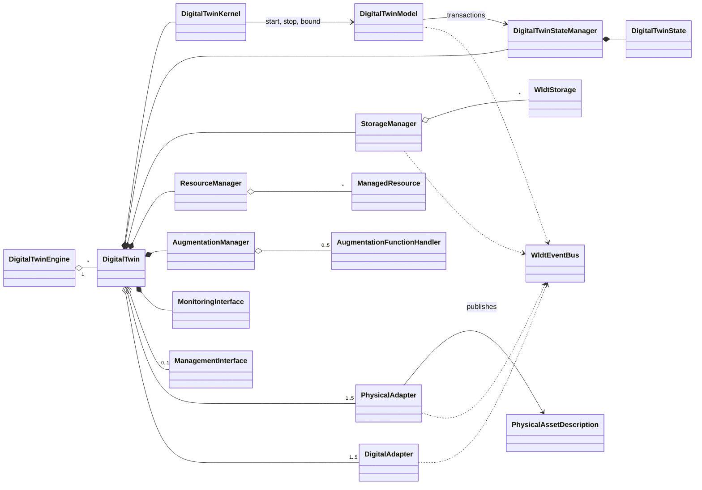
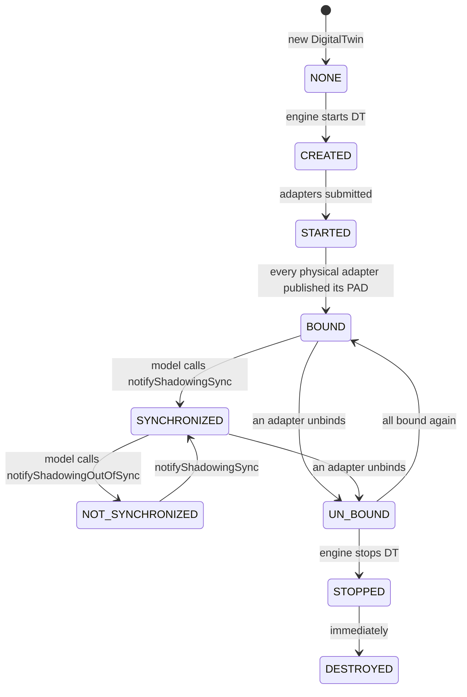
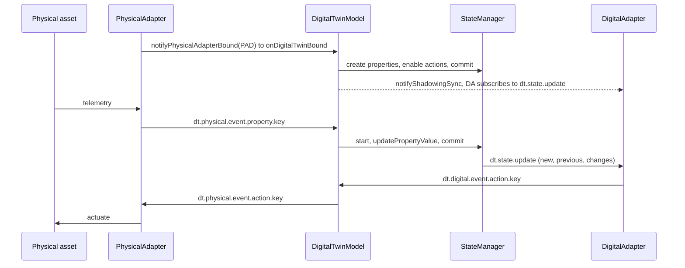

# Research Notes: What the Runner Can Learn From WLDT

WLDT (White Label Digital Twins) is a Java library for building
digital twins (DTs) of IoT assets, from the University of Modena and
Reggio Emilia. These notes map its architecture and features from
three primary sources: its source code, its documentation site and its
paper. They then read it against the runner on branch
`feat/runner-implementing-research-papers` (commit `2dc1f590`) and
derive suggestions for the runner. The notes follow the format of
[dtn-research-notes.md](dtn-research-notes.md), and the numbering here
(W1, W2, ...) is separate from that file's.

| Name  | Source                                                                                                                                                 | Version read                                 |
| :---- | :----------------------------------------------------------------------------------------------------------------------------------------------------- | :------------------------------------------- |
| CODE  | <https://github.com/wldt/wldt-core-java>                                                                                                               | 0.8.1, commit `0f76c6ba` (2026-11-06)        |
| DOCS  | <https://github.com/wldt/wldt.github.io>                                                                                                               | commit `3f75b020` (2026-11-06), covers 0.8.1 |
| PAPER | Picone, Mamei, Zambonelli, "WLDT: A general purpose library to build IoT digital twins", _SoftwareX_ 13 (2021) 100661, doi:10.1016/j.softx.2021.100661 | code version v1.0, read in full (7 pages)    |

How citations are written:

- **CODE.** `path:line` under `src/main/java/it/wldt/`, written as
  `M/...`. Test sources under `src/test/java/it/wldt/` are written as
  `T/...`.
- **DOCS.** A path under `content/`.
- **PAPER.** The section number.
- **Runner.** `file:line` under `servers/execution/runner/`.

Statements marked _inference_ are this document's reading, not
something a source says. Nothing from either WLDT repository was built
or run.

The full maps behind these notes are in two companion files:

- [wldt-code-map.md](wldt-code-map.md): packages, classes, lifecycle,
  data flow, event bus, state model, storage, management, monitoring,
  extension points and limitations of the code, with `path:line`
  citations.
- [wldt-docs-and-paper.md](wldt-docs-and-paper.md): the documented
  concept model, adapters and guides, the paper's architecture and
  evaluation, how the design evolved, and a glossary.

## Since These Notes

Runner 0.11.0 ([issue 19](issues/19-properties.md)) took one thing from
WLDT that these notes list under
[What Not to Copy](#what-not-to-copy): a state of the physical twin.
Scripts and sensors write declared properties, and the runner holds
and publishes the latest value of each. The rest of that entry stands:
the runner has no adapters, no shadowing function and no pipeline, and
it never interprets a value.

Two suggestions are affected:

- **W6** no longer borders on a non-goal, as the non-goal "a script
  that mirrors physical-twin state" is gone.
- **W7** overlaps the types of the properties, which are those of JSON
  Schema.

**W8** is built, in [issue 21](issues/21-dt-class.md): a peer of
`runner.yaml` takes a `relationship`, and a subscription may name it
in place of a peer.

The dependencies between the suggestions are in the
[issues](issues/README.md#proposed-work).

## Suggestions at a Glance

The table is ordered by priority. The first group fixes concrete gaps
that WLDT's design exposes in the runner. The later items widen the
runner's model, and some of them touch a non-goal that the owner would
have to reopen first.

| #   | Suggestion                                  | Group              | Size | WLDT source                                         | Touches a non-goal?       |
| :-- | :------------------------------------------ | :----------------- | :--- | :-------------------------------------------------- | :------------------------ |
| W1  | Revision number and change list on state    | Observability      | S    | `onStateUpdate(new, previous, changes)`; no version | No                        |
| W2  | Coalesce queued state notifications         | Notification       | S    | Bus drops, unbounded queues (anti-pattern)          | No                        |
| W3  | Durable transition and parameter timeline   | Observability      | M    | Storage of lifecycle and state; query by range      | No                        |
| W4  | Script timings and delivery counters        | Observability      | S    | `<op>_exec_time`, success and error counts          | No                        |
| W5  | DT lifecycle as its own axis                | DT-level lifecycle | M    | `LifeCycleState`; bound, synchronized               | No                        |
| W6  | Script-declared sync with the physical twin | DT-level lifecycle | S    | `notifyShadowingSync()` / `OutOfSync()`             | Borders on "PT mirroring" |
| W7  | `type` and `contentType` on declarations    | Description        | S    | 0.8.1 `type`/`contentType`, never interpreted       | Borders on input schemas  |
| W8  | Named relationships on peers                | DTN                | S    | `Relationship` (name, type) and instances           | No                        |
| W9  | Domain event notifications                  | DTN / notification | M    | `dt.state.event.notification.<key>`                 | No                        |
| W10 | Wait for a state revision (long poll)       | Script context     | S/M  | Stateful augmentation functions get pushes          | Borders on SSE            |
| W11 | Overhead benchmark                          | Evaluation         | M    | PAPER §2.5 delay, memory and CPU evaluation         | No                        |

Sizes follow the research notes: S is a day or less, M a few days with
tests and documentation. All items are proposals; none has an issue
file yet.

## WLDT in One Page

WLDT runs DTs as objects inside one JVM. A `DigitalTwinEngine` holds
a map of `DigitalTwin` objects (`M/core/engine/DigitalTwinEngine.java:41`).
Each DT has the following parts:

- **Physical adapters** (at most 5) bind to the physical asset. Each
  one publishes a _Physical Asset Description_ (PAD), which lists the
  properties, events, actions and relationships the asset exposes
  through that adapter.
- **A user-written `DigitalTwinModel`**, the "shadowing function",
  turns physical events into changes of the _DT State_ inside
  transactions.
- **Digital adapters** (at most 5) expose the committed state and
  accept _digital actions_. The model routes each action to a physical
  adapter.

Every component talks to the others through a process-wide event bus
(`M/core/event/WldtEventBus.java:39`). The exception is the lifecycle,
which is delivered by direct listener calls. Storage, query,
management (CRUD on runtime parameters), monitoring and augmentation
functions sit beside the model as opt-in managers. The core has no
runtime dependencies (`build.gradle.kts:23-31`) and no network
transport. Protocols such as MQTT, HTTP and CoAP come as separate
adapter artefacts (DOCS `docs/adapters/*.md`).

In the runner's terms: a WLDT DT is a **data-plane** twin. It mirrors
physical-twin properties into a typed state and exposes them. The
runner is a **control-plane** twin. It holds a state machine of
black-box scripts and exposes the machine, parameters and commands;
the scripts talk to the physical twin (see "No data plane" in
[The Two Designs Side by Side](#the-two-designs-side-by-side)). Most
suggestions below take WLDT's observability and description ideas,
not its data model.

## Detailed Suggestions

### W1. Revision Number and Change List on the State Document

**Add.** A `revision` counter to the state document. It increases by
one each time the runner publishes a changed document, and it is
persisted next to the `machine` row so that it survives a restart.
Also add a `changes` list to the `state` notification only, naming
what differs from the last one published, for example
`["machine.state", "machine.entry", "parameters.scope"]`.

**Touches.** `src/descriptor.service.ts:59-67`,
`src/notify/notifier.service.ts:76-88`, `src/dto/state.dto.ts`,
`src/queue.machine.ts`, `api/API.md`.

**Why.**

- WLDT hands every digital adapter
  `onStateUpdate(newState, previousState, changeList)`
  (`M/adapter/digital/DigitalAdapter.java:450-452`), so a consumer
  never has to diff two states itself. The change list is the raw,
  ordered list of operations (`M/core/state/DigitalTwinStateChange.java:38-84`).
- WLDT's one weakness here is that the state carries only an
  `evaluationInstant` and has no version or sequence number
  (`M/core/state/DigitalTwinState.java:47`).
- The runner shares that gap, and it hurts more because the runner
  crosses a network:
  - the webhook "may deliver out of order" (retries after 1, 2 and
    4 s, `src/notify/webhook.client.ts:7-13`);
  - a peer that follows retained notices cannot tell a replayed
    document from a new one, because `time` is the only ordering key
    and the notifier skips documents that differ only in `time`
    (`src/notify/notifier.service.ts:80-84`).
- A revision gives receivers a total order per DT, and a way to drop
  stale deliveries.
- The change list makes peer subscriptions (issue 16) and Manager
  monitors cheaper to write. It also matches the edge-triggered
  semantics the runner already uses (`src/fsm/subscriptions.ts:117-160`).

**Caution.** `revision` must be persisted. If it restarts from zero,
receivers would discard a restarted runner's documents. If the stored
row is lost, the runner can fall back to an epoch: the runner start
time paired with the counter.

### W2. Coalesce Queued State Notifications

**Add.** While the broker is unreachable, keep only the latest `state`
and `presence` notification instead of handing each one to mqtt.js.
Escalations are not retained, so keep their queue as it is, but bound
its length and count the escalations it drops (W4).

**Touches.** `src/mqtt/mqtt.service.ts:222-240`,
`src/notify/notifier.service.ts`.

**Why.**

- WLDT's default bus shows what goes wrong with unbounded delivery:
  - the per-DT `LinkedBlockingQueue` is unbounded by default
    (`M/core/event/DefaultEventBusStrategy.java:100-143`);
  - events published to a DT with no subscriber yet are dropped
    without a trace (`:132-133`, `:165-166`);
  - a `RuntimeException` in a listener silently ends that subscriber's
    delivery loop (`:302-313`).
- The runner hands every notification to mqtt.js, "which queues it and
  sends it on reconnect" (`src/mqtt/mqtt.service.ts:224`). State and
  presence are retained (`src/notify/notifier.service.ts:18-22`), so
  after reconnecting, every intermediate document is replayed only for
  the broker to keep the last one.
- A long outage on a busy DT grows memory without limit for documents
  nobody will read.

### W3. Durable Transition and Parameter Timeline

**Add.** A `transitions` table with one row per state entry: `entry`,
`state`, `cause` (`transition`, an event name, a completion event, or
a peer subscription), `by` (principal), `at`, and the outcome when the
script exits. Add a matching row whenever parameters change. Serve
both from `GET /history?kind=transition|parameters&since&until&limit`.
Add `count=true`, which returns a count instead of rows, as in WLDT's
`COUNT` query.

**Touches.** `src/queue.schema.ts:9-38` (with a guarded migration, as
`docs/issues/README.md` requires), `src/queue.history.ts`,
`src/fsm/fsm.service.ts`, `src/dto/history.dto.ts`, `api/API.md`.

**Why.**

- WLDT can store every family of event: state with its change list,
  lifecycle variations, physical events and actions
  (`M/storage/StorageManager.java:158-182`, `:643-667`). It reads them
  back by `TIME_RANGE`, `SAMPLE_RANGE`, `LAST_VALUE` or `COUNT`
  (`M/storage/query/QueryRequestType.java:30-35`).
- The runner's `commands` table records a script run, but it has no
  column for the state, the entry, or the event that started it
  (`src/queue.schema.ts:9-23`).
- The runner's per-state entries and seconds live only in memory and
  are reset at restart (`src/fsm/metrics.ts:32-41`).
- P1 of the DTN notes evaluates outcomes over time, and research note
  11 was "richer history". A durable timeline answers "why is this DT
  in `full`?" after a restart, and lets a Manager rebuild a DT's
  trajectory.

**Caution.** WLDT's query router always reads the first storage it
finds (`M/storage/query/QueryManager.java:81-91`), and its async query
path never unsubscribes (`M/storage/query/QueryExecutor.java:247-249`).
The runner already has one SQLite file and synchronous reads, so
neither problem carries over. Keep it that way.

### W4. Script Timings and Delivery Counters

**Add to `/metrics`:**

- per command name, the wall-clock duration of runs: count, total,
  min and max;
- per notification transport:
  - `published`, `failed` and `dropped`;
  - `retried` for the webhook.

**Touches.** `src/fsm/metrics.ts`, `src/execa-manager.service.ts`,
`src/notify/webhook.client.ts`, `src/dto/metrics.dto.ts`.

**Why.**

- WLDT measures each operation with three metrics:
  `<op>_exec_time`, `<op>_exec_success_count` and
  `<op>_exec_error_count`. It does this for model callbacks, state
  commits, adapter publishes and storage writes
  (`M/core/model/DigitalTwinModel.java:1521-1557`,
  `M/core/state/DigitalTwinStateManager.java:156-188`).
- Its metric updates "never affect the normal execution of the
  program" (DOCS `docs/guides/monitoring-interface.md`). The runner
  already follows the same rule for resources (`README.md:464-520`).
- The runner reports CPU seconds and peak RSS per run. It does not
  report how long a run took, and it does not count delivery failures:
  a webhook that fails all its retries leaves no trace in `/metrics`.

Prometheus format stays a non-goal (S14). These are JSON counters.

### W5. DT Lifecycle as Its Own Axis

**Add.** A `lifecycle` field, in `/health` and in the presence notice,
with these values:

- `starting`: configuration loaded, database not yet restored;
- `ready`: machine restored and listening;
- `stopping`: `beforeApplicationShutdown` has run.

Also add a `lifecycle` gauge to `/metrics`. The values come from facts
the runner already has (`src/main.ts:27-41`,
`src/fsm/fsm.service.ts:105-107`).

**Why.**

- WLDT keeps the DT's lifecycle apart from the model's domain state.
  `LifeCycleState` has 9 values (`M/core/engine/LifeCycleState.java:23-34`).
  Each change is published on the bus, stored, and exported as the
  gauge `dt_lifecycle_value` (`M/core/engine/DigitalTwin.java:380-402`).
- The runner has three partial axes:
  - presence (`online`);
  - health (`ok`/`degraded`);
  - the machine's script status.

  None of them tells a Manager "this DT is up but not yet restored",
  or "this DT is shutting down and will answer 503".

- WLDT also shows what to avoid:
  - Its transitions are never checked: any `notifyLifeCycleOn*`
    overwrites the state (`M/core/engine/DigitalTwin.java:380-655`).
  - An adapter that binds inside `onAdapterStart` can reach `BOUND`
    before `STARTED` overwrites it (`:844-874`).
  - Restart after stop is effectively broken, because listeners and
    the storage manager are not restored (`:894`, `:930`,
    `M/storage/StorageManager.java:209`).
- So the runner's lifecycle should be a small explicit table with
  tests for each edge, as the FSM already is.

### W6. Script-Declared Sync With the Physical Twin

**Add.** `POST /sync {synchronized: bool, reason?}`, open to the
`script` role and the `client` role. Show the value as
`sync: {synchronized, reason, since}` in the state document, and let
`/health` report `degraded` while it is `false`. Peers could then
subscribe with `when: {synchronized: false}`. The runner never sets
the value itself.

**Touches.** `src/auth/roles.ts:13-30`, `src/descriptor.service.ts`,
`src/health.service.ts`, `src/fsm/subscriptions.ts`, `api/API.md`.

**Why.**

- In WLDT, only the user's model declares that the DT is in sync with
  its asset, with `notifyShadowingSync()` and
  `notifyShadowingOutOfSync()`
  (`M/core/model/DigitalTwinModel.java:2303-2316`). The framework
  never decides this on its own.
- The documented meaning of _Out of Sync_ is that the DT "can handle
  neither state-alignment events nor application-layer events"
  (DOCS `docs/introduction/dt-life-cycle.md`).
- The runner cannot see the physical twin. Only a script knows whether
  its connection to the physical twin works.
- Today a script can only signal trouble through `$failure`, an event,
  or an escalation. All three are either FSM moves or Manager requests,
  not a standing condition.

**Caution.** This borders on the non-goal "a script that mirrors
physical-twin state into the state document". It mirrors no data,
only one boolean about the link, but the owner should confirm that
line.

### W7. `type` and `contentType` on Declarations

**Add.** Optional `type` (a semantic tag, for example `bed-request`)
and `contentType` (for example `application/json`) to:

- each entry of `manager.commands`;
- the `commands` list in `runner.yaml`;
- each FSM event.

Show them in `/dt`. The runner stores and forwards them and never
interprets them.

**Touches.** `src/config/config.schema.ts`, `src/fsm/definition.ts`,
`src/descriptor.service.ts:47-57`, `src/dto/descriptor.dto.ts`.

**Why.**

- WLDT 0.8.1 added exactly this to every property, event and action of
  the PAD and the DT state: "the core never interprets either"
  (DOCS `docs/change-logs/change-log-0.8.1.md`;
  `M/core/state/DigitalTwinStateProperty.java:55-90`).
- That is the cheapest machine-readable description there is. A
  Manager or the DTaaS client can tell what a command expects without
  a schema language.
- It gives part of deferred item 14 (machine-readable API) without
  committing to OpenAPI.

**Caution.** "Per-command input schemas" is a non-goal (open question
10). A label is not a schema, but the owner should say whether the
line holds.

### W8. Named Relationships on Peers

**Add.** An optional `relationship` name on each peer in `runner.yaml`,
for example `neighbour`, `supplier` or `part-of`. Show it in
`GET /peers` and `/dt`. Allow FSM `subscriptions` to name a
relationship instead of a single peer, so that the subscription
applies to every peer with that relationship.

**Touches.** `src/peers/peers.config.ts:10-23`,
`src/fsm/subscriptions.ts:22-41`, `src/peers/peers.controller.ts`.

**Why.**

- WLDT separates a relationship, which is a name and a target type
  such as `has_room`, from its instances, each with a `targetId`, a
  key and metadata (`M/core/state/DigitalTwinStateRelationship.java:38-42`,
  `M/core/state/DigitalTwinStateRelationshipInstance.java:41-44`;
  DOCS `docs/guides/dt-relationships.md`).
- The runner's peers carry an opaque `attributes` map, which the
  runner never reads.
- A named relationship is the smallest step that makes "all my
  neighbours" expressible in the FSM file. It also answers open
  question 8 of the DTN notes without fixing any attribute schema.

WLDT never resolves or follows `targetId` (`T/process/shadowing/DemoDigitalTwinModel.java:223-245`).
The runner already goes further, by following peers.

### W9. Domain Event Notifications

**Add.** `POST /notify/event {key, body}` for the `script` role. It
publishes `{kind: 'event', id, time, data: {key, body}}` on
`<base>/notify/event` (not retained) and on the webhook. Add a
subscription form `when: {event: key}` for peers.

**Touches.** `src/notify/notifier.service.ts`,
`src/dto/notify.dto.ts:7-12`, `src/mqtt/mqtt.config.ts:61-62`,
`src/peers/peer-watch.ts:28-51`, `src/fsm/subscriptions.ts`.

**Why.**

- WLDT separates state from transient _event notifications_. The model
  calls `notifyDigitalTwinStateEvent(...)`, which publishes
  `dt.state.event.notification.<key>`, and digital adapters opt in per
  key (`M/core/state/DigitalTwinStateManager.java:239-262`;
  DOCS `docs/guides/digital-adapter.md`).
- The runner has two kinds of event, and neither covers this:
  - FSM events, which move the local machine;
  - state notifications, which describe it.
- A hospital that admits a patient has no way to tell its neighbours
  "a patient was redirected here" without changing its machine state.
  Peers can react today only to `state` and `online`
  (`src/fsm/subscriptions.ts:22-41`).

**Caution.** Rate-limit or count these events (W4), because a script
can flood the broker. The runner's argument against a stdout event
protocol (DTN open question 13) applies here too, and the same HTTP
and role checks are the answer.

### W10. Wait for a State Revision (Long Poll)

**Add.** `GET /state?after=<revision>&wait=<seconds>`. The request
answers at once if the revision is newer than `after`. Otherwise it
waits up to `wait` seconds (capped, say, at 30) for the next change.
This needs W1.

**Touches.** `src/app.controller.ts:59`, `src/descriptor.service.ts`,
`src/notify/changes.ts`.

**Why.**

- WLDT pushes state updates and event notifications to its stateful
  augmentation functions, which are long-running computations
  (`StatefulAugmentationFunction.onStateUpdate`,
  `M/augmentation/function/StatefulAugmentationFunction.java:210-279`).
  A function that cannot take pushes polls instead, with
  `refreshQueryResult()` (DOCS `docs/guides/augmentation_functions.md`).
- The runner's long-running scripts can only poll. The hospital demo
  sets `POLL_MS` for exactly this (`demo/hospital/hospital.fsm.yaml:62`).
- A long poll removes the poll interval from a script's reaction
  time. It needs neither MQTT in the script nor a push transport.

**Caution.** Server-sent events are a non-goal (DTN open question 2),
and a long poll is close kin. One HTTP request per waiting script
also holds a socket for as long as it waits.

### W11. Overhead Benchmark

**Add.** A script under `test/bench/` that measures three things:

- the runner's added latency for an MQTT `event` request and its reply;
- the delay from a state change to the notification a peer receives;
- the memory and CPU of an idle runner and of a busy one.

Use the paper's sweep: 5 to 100 messages per second at 100 bytes,
then 100 to 5000 bytes at 10 messages per second. Record the results
in the README.

**Why.**

- WLDT's paper evaluates exactly these on one edge node (PAPER §2.5,
  Fig. 3). WLDT adds about 1 ms over MQTT, against about 15-20 ms for
  Eclipse Ditto, and uses about 8 MB of heap (MQTT) and 10 MB (CoAP),
  with CPU mostly under 2 %. The figures are read from the paper's
  charts and are approximate.
- The runner has resource figures for scripts, but none for itself. A
  DTN of many runners on one host (P2's orchestrator) needs to know
  each runner's fixed cost.

## What the Runner Already Does Better

WLDT confirms several of the runner's decisions by getting the same
thing wrong or leaving it open:

| Topic                 | WLDT                                                                                                                                                       | Runner                                                                                                            |
| :-------------------- | :--------------------------------------------------------------------------------------------------------------------------------------------------------- | :---------------------------------------------------------------------------------------------------------------- |
| Lifecycle transitions | Implicit, never checked; STARTED-after-BOUND race (`M/core/engine/DigitalTwin.java:380-655`, `:844-874`)                                                   | Explicit table, deterministic, validated at load (`src/fsm/definition.ts:63-77`, D3)                              |
| Restart               | Broken after stop (listeners and storage not restored)                                                                                                     | Machine, parameters and peer switches restored; unfinished runs marked `interrupted` (`src/fsm/recovery.ts`, D28) |
| Action outcome        | Fire-and-forget; no correlation or result type (`M/adapter/digital/DigitalAdapter.java:250-256`)                                                           | Reply statuses, idempotency keys, outcome of `POST /` (`src/dto/fsm.dto.ts:16-28`)                                |
| Multi-DT isolation    | One JVM-wide bus singleton; DTs isolated only by an id string; storage managers of every DT share one delivery thread (`M/storage/StorageManager.java:76`) | One process per DT (S2); a separate script account (issue 18)                                                     |
| Management interface  | CRUD abstractions with no built-in resource and no transport (`M/management/*`)                                                                            | Declared parameters over HTTP and MQTT, all-or-nothing `PUT`, events on change (D21, D22)                         |
| Authentication        | None in core                                                                                                                                               | Ed25519 request tokens, roles, signed output (15a, 15b)                                                           |
| Shutdown              | Fixed 2 s sleep to drain storage (`M/core/engine/DigitalTwin.java:912`); busy-wait at start (`:876-878`)                                                   | SIGTERM, grace, SIGKILL; waits for scripts; replies 503 while stopping                                            |
| Configuration         | Java code only; hard-coded limits of 5 adapters and a 5 s query timeout                                                                                    | Strict zod-validated YAML (`src/config/config.schema.ts:11-39`)                                                   |
| State copies          | Shallow copy: "previous state" can already hold new values (`M/core/state/DigitalTwinState.java:85-91`)                                                    | Each document built fresh (`src/descriptor.service.ts:59-67`)                                                     |
| Advice from a helper  | Augmentation results are suggestions; "the framework never applies results automatically" (DOCS `docs/change-logs/change-log-0.7.0.md`)                    | Escalation `proposal` is advice to the Manager; it never raises an FSM event (D25)                                |

The last row is a parallel rather than an advantage: both designs keep
the decision with the owner of the state.

## What Not to Copy

- **A multi-DT engine.** It is a runner non-goal (open question 12),
  and WLDT shows the cost of the alternative: one shared bus, shared
  threads, isolation by string.
- **A typed physical-twin state** (properties, PAD, shadowing
  function). This is the core of WLDT, but in the runner it is the
  non-goal "a script that mirrors physical-twin state". The runner's
  scripts can run a WLDT-style DT behind the runner if a project needs
  one. _Inference_: a WLDT DT with an HTTP digital adapter could be the
  very script a runner state starts.
- **"Bound when all adapters published a PAD."** The runner has no
  adapters. The closest analogue, waiting for peers before the first
  transition, would conflict with D6 (no initial state).
- **Processing pipelines and the cache** (PAPER §2.2). These are
  in-process data transformation; in the runner that is script
  territory.
- **The 5-handler and 5-adapter caps** (`M/core/engine/DigitalTwin.java:71-76`).
  Any limit the runner adds should be configurable and come with a
  refusal status.

## Open Questions

1. **Lifecycle hooks.** WLDT gives the model `onCreate`, `onStart` and
   `onStop` (`M/core/model/DigitalTwinModel.java:2093-2278`). Should
   the FSM file be able to name a state to enter at start, or an event
   to raise at shutdown? D6 says no initial state, so this needs the
   owner.
2. **Where `sync` lives (W6).** Should it be a field of the state
   document, a parameter-like value, or part of health?
3. **Revision scope (W1).** Should the counter cover the whole
   document, or the machine, parameters and command separately?
4. **Event notifications and history (W9, W3).** Should published
   domain events be stored in the timeline? WLDT stores them
   (`QueryResourceType` DT state event notifications, 0.6.0+).
5. **A WLDT digital twin behind a runner.** Is a demo where a runner
   state starts a WLDT DT (Java) and reads its HTTP digital adapter
   worth having? It would show the control plane and data plane side
   by side.

## WLDT Architecture Map

### Packages

| Package                                 | Responsibility                                                                                                             |
| :-------------------------------------- | :------------------------------------------------------------------------------------------------------------------------- |
| `it.wldt.core.engine`                   | `DigitalTwinEngine` (many DTs), `DigitalTwin` (one DT and its lifecycle), `DigitalTwinWorker` (Runnable), `LifeCycleState` |
| `it.wldt.core.model`                    | `DigitalTwinKernel` (wires managers), `DigitalTwinModel` (user's shadowing callbacks), `@ShadowingFunction` metadata       |
| `it.wldt.core.state`                    | `DigitalTwinState`, its resources, `DigitalTwinStateManager`, transactions and changes                                     |
| `it.wldt.core.event`                    | In-JVM bus `WldtEventBus`, `WldtEvent`, filters, five delivery strategies, observer helper                                 |
| `it.wldt.adapter.physical` / `.digital` | Adapter base classes, PAD model, physical and digital events                                                               |
| `it.wldt.augmentation`                  | Augmentation manager, handlers, stateless and stateful functions (0.7.0+)                                                  |
| `it.wldt.storage` (+ `.query`)          | `StorageManager`, abstract `WldtStorage`, in-memory default, query over the bus                                            |
| `it.wldt.management`                    | `ManagementInterface`, `ResourceManager`, `ManagedResource<R,I,O>` (CRUD)                                                  |
| `it.wldt.monitoring`                    | Per-DT `MonitoringInterface`, five metric types, exporter hook                                                             |
| `it.wldt.log`, `it.wldt.exception`      | Logging facade; 25 checked exceptions                                                                                      |

### Components

### Lifecycle

The enum is `NONE`, `CREATED`, `STARTED`, `BOUND`, `UN_BOUND`,
`SYNCHRONIZED`, `NOT_SYNCHRONIZED`, `STOPPED`, `DESTROYED`
(`M/core/engine/LifeCycleState.java:23-34`). The documentation draws a
five-state conceptual version: Operating & Not Bound, Bound,
Shadowed, Out of Sync and Done (DOCS `docs/introduction/dt-life-cycle.md`).
The enum has no _Done_.

The diagram shows the paths the code produces, not paths it enforces
(see W5).

### Data Flow

An action never changes state directly. "Any changes can only occur
as a result of the shadowing function from the PA to the DT"
(DOCS `docs/introduction/dt-model.md`).

### Event Bus

- **Envelope.** Each `WldtEvent<T>` carries an id, a `type`, a
  `contentType`, a `body`, a `metadata` map and a creation timestamp
  (`M/core/event/WldtEvent.java:38-66`). Bodies are Java references
  and are never serialised.
- **Topics.** Event types are dotted strings, scoped by DT id. Some
  examples:
  - `dt.physical.event.property.<key>`;
  - `dt.digital.event.action.<key>`;
  - `dt.state.update`;
  - `dt.state.event.notification.<key>`;
  - `dt.lifecycle`;
  - `dt.storage.query.request`.

  The full list is in `M/core/event/WldtEventTypes.java:30-103`.

- **Wildcards.** A `.*` wildcard matches by _substring_, not by prefix
  (`M/core/event/WldtEventFilter.java:73-82`).
- **Delivery.** By default each DT gets a FIFO queue, and each
  subscriber id gets its own thread. Four other strategies can be
  plugged in (`M/core/event/DefaultEventBusStrategy.java:30-71`).

### State Model

The state holds four maps: properties, actions, events and
relationships. Each property has a key, value, type, contentType and
the flags readable, writable and exposed. The state also carries an
`evaluationInstant` (`M/core/state/DigitalTwinState.java:41-47`).

Changes are made inside a transaction (`DigitalTwinStateManager.java:102-148`):

1. `startStateTransaction()` copies the current state.
2. Each mutator queues a `DigitalTwinStateChange`. The operations are
   ADD, UPDATE, UPDATE_VALUE and REMOVE, and the resource types are
   PROPERTY, PROPERTY_VALUE, EVENT, ACTION, RELATIONSHIP and
   RELATIONSHIP_INSTANCE.
3. `commitStateTransaction()` applies the changes in order, swaps the
   state in, and publishes `dt.state.update`.

Event notifications are transient and are not part of the state.

## The Two Designs Side by Side

| Feature             | WLDT (0.8.1)                                                  | Runner (0.10.0)                                                                  |
| :------------------ | :------------------------------------------------------------ | :------------------------------------------------------------------------------- |
| Unit                | Many DTs per JVM                                              | One DT per process                                                               |
| Behaviour           | Java callbacks in a `DigitalTwinModel`                        | YAML FSM; each state runs a script                                               |
| Physical side       | Physical adapters, PAD, shadowing                             | Scripts talk to the PT; the runner sees exit codes and resources only            |
| Digital side        | Digital adapters (MQTT, HTTP, CoAP as separate artefacts)     | Built-in HTTP and MQTT twins of every route; webhook                             |
| State               | Typed properties, events, actions, relationships              | Machine, parameters, latest command                                              |
| Lifecycle           | 9-state enum, implicit transitions                            | Health, presence and machine status; no single lifecycle (W5)                    |
| Actions or commands | Fire-and-forget actions routed by the model                   | Allow-listed commands with replies, idempotency and roles                        |
| Runtime parameters  | `ManagedResource` CRUD, transport left to the user            | Declared parameters, controllable subset, events on change                       |
| History             | Opt-in storage of every event family; range and count queries | SQLite command history; machine and parameters persisted; metrics in memory (W3) |
| Metrics             | Per-component timers and counters; exporter hook              | JSON counters and script resources (W4)                                          |
| DT-to-DT            | Relationships as data only; no messaging                      | Peers followed through signed notices; edge-triggered subscriptions              |
| Security            | None in core                                                  | Roles, Ed25519 tokens, signed output, separate script account                    |
| Extra computation   | Augmentation functions suggest results to the model           | Scripts; escalation proposals to a Manager                                       |
| Dependencies        | None at runtime                                               | NestJS, execa, mqtt.js, zod, `node:sqlite`                                       |

## The Paper

**Claim.** Existing DT platforms run in the cloud, are tied to one
platform, and are monolithic. IBM, AWS "shadows", Azure "replicas" and
Eclipse Ditto are the examples. WLDT instead models "each DT as an
independent and autonomous software component" for the edge and the
cloud (PAPER §1).

**Architecture (v1.0).** A `WldtEngine` runs threaded _workers_, and
each worker mirrors one protocol: `Mqtt2MqttWorker`, `Coap2CoapWorker`,
or legacy workers such as the Philips Hue one. Workers use processing
pipelines, a TTL cache, and a metrics manager that reports to CSV or
Graphite (PAPER §2.1-2.4).

**Evaluation.** The setup was one Intel i7 node with 16 GB RAM. The
results:

- **Overhead.** WLDT adds about 1 ms over MQTT, about 2-3 ms over
  CoAP without its cache, and under 1 ms with the cache. Ditto adds
  about 15-20 ms.
- **Memory.** About 8 MB (MQTT) and 10 MB (CoAP).
- **CPU.** Mostly under 2 %, with peaks of about 6 %.
- **Code size.** The core is about 5,300 lines (PAPER §2.5, Fig. 3).

The paper attributes Ditto's overhead to its "monolithic design". It
also says Ditto "can potentially work side-by-side with" WLDT.

**Limitations.** The paper states none and has no related-work
section. Its future work is an appeal for contributors (PAPER §5).
_Inference_: the paper does not discuss scaling to many DTs, security
or persistence.

**Evolution.** The current library is a redesign with its own 0.x
version line. The paper's worker-and-pipeline protocol mirror became
the kernel, model, adapters, bus, state manager and storage. The
renames were:

- `WldtEngine` became `DigitalTwin`, and `DigitalTwinEngine` was
  added (0.3.0);
- `ShadowingFunction` became `DigitalTwinModel` (0.6.0).

Change logs are under DOCS `docs/change-logs/`. Some of the documentation
pages still show pre-0.3.0 code such as `new WldtEngine(...).startLifeCycle()`
(DOCS `docs/guides/configurable-adapters.md`).

## Vocabulary of WLDT Against the Runner

| WLDT term                        | Meaning                                                    | Nearest runner term                           |
| :------------------------------- | :--------------------------------------------------------- | :-------------------------------------------- |
| Physical Asset (PA)              | The real-world thing                                       | Physical twin; unknown to the runner          |
| Physical Asset Description (PAD) | Per-adapter list of properties, events, actions, relations | None; closest is `/dt` (W7)                   |
| Shadowing function, DT Model     | Maps physical events to state                              | The scripts                                   |
| DT State                         | Properties, events, actions, relationships, instant        | State document (machine, parameters, command) |
| State change list                | Ordered operations of one commit                           | None (W1)                                     |
| Event notification               | Transient domain event                                     | None (W9); FSM events are local               |
| Digital action                   | Request from an app to the DT                              | Command, FSM event                            |
| Lifecycle state                  | Created, bound, synchronized, ...                          | Presence, health, script status (W5)          |
| Relationship (instance)          | Named link type (link to a target DT)                      | Peer, with opaque attributes (W8)             |
| Managed resource                 | Runtime-tunable DT parameter                               | Controllable parameter                        |
| Augmentation function            | Helper computation whose results the model may apply       | Escalation proposal, in spirit                |
| Monitoring interface             | Per-DT metrics hub                                         | `/metrics`                                    |
| DigitalTwinEngine                | Hosts many DTs                                             | None by design; the platform deploys runners  |

## Sources

WLDT, cloned to a throwaway directory and read only:

- CODE at `0f76c6ba`: `build.gradle.kts`, `README.md`,
  `docs/changelogs/`, every package under `src/main/java/it/wldt/`,
  and `src/test/java/it/wldt/process/` (`EngineTester`,
  `DemoDigitalTwinModel`, `DemoPhysicalAdapter`).
- DOCS at `3f75b020`: `content/_index.md`, `content/docs/introduction/*`,
  `content/docs/guides/*`, `content/docs/adapters/*`,
  `content/docs/change-logs/*`, `content/blog/release_081.md`.
- PAPER: read from the Internet Archive copy of the open-access PDF in
  the UNIMORE IRIS repository
  (`iris.unimore.it/bitstream/11380/1232320/1/1-s2.0-S2352711021000066-main.pdf`).
  ScienceDirect and IRIS refused automated fetches.

Runner, under `servers/execution/runner/`, at `2dc1f590`: `README.md`,
`STATE-MACHINE.md`, `SECURITY-MODEL.md`, `api/API.md`,
`docs/state-machine-design.md`, `docs/dtn-research-notes.md`,
`docs/issues/*.md`, `demo/hospital/*.yaml`, and the `src/` files cited
above.
